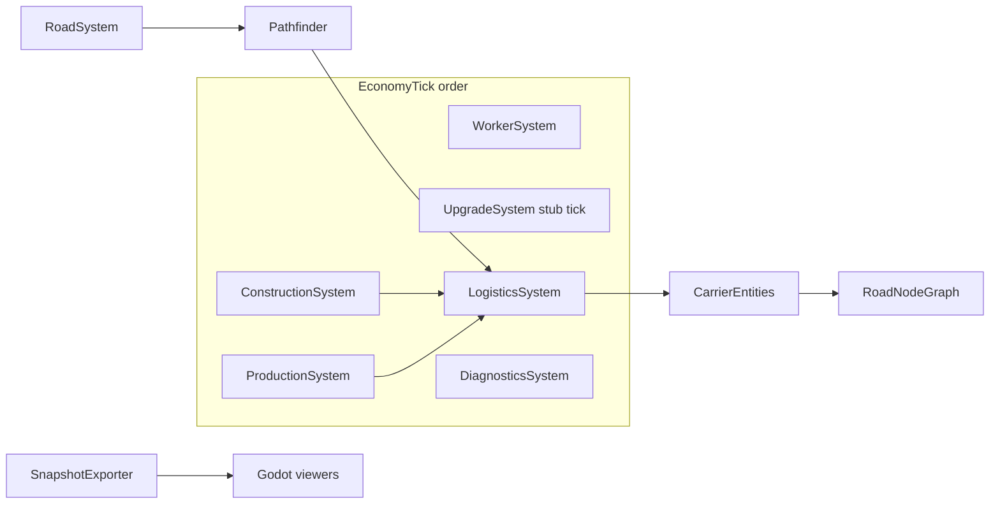

# RUN_02.6 — Economy Foundation Current State

Audit date: 2026-06-16. This document maps the **verified** state of the Trial Economy Game logistics foundation at the start of RUN_02.7 planning. Claims follow the Evidence standard from [`RUN_02_6_ECONOMY_FOUNDATION_AUDIT_PLAN.md`](../runs/RUN_02_6_ECONOMY_FOUNDATION_AUDIT_PLAN.md).

---

## Verification baseline

### Audit session metadata

| Field | Value |
|-------|-------|
| git branch | `feature/run-02-6-economy-foundation-audit-plan` |
| git commit hash | `8b6c399953261642bbff867b7cf810ec166b4d69` |
| branch point | `main` at same commit (RUN_02 + RUN_02.5 merged) |
| working tree before verification | clean |
| working tree after verification | clean |
| Godot executable | `/home/joe/Documents/Godot/Godot_v4.5.2-stable_linux.x86_64` |
| GODOT_USER_DATA_DIR | `godot_project/.godot_user` |
| audit timestamp | 2026-06-16T09:09:16+01:00 (verification start) |
| generated/untracked artefacts | `godot_project/.godot_user/` (gitignored userdata; expected) |
| stale Godot processes after verification | none (`pgrep -af 'Godot.*godot_project'` matched only shell wrapper) |

### Verification commands

| Command | Exit code | Summary |
|---------|-----------|---------|
| `timeout 400s $GODOT --headless --path godot_project --script res://sim/tools/run_tests.gd` | 0 | 167/167 passed, `EXIT: 0 (pass)` |
| `timeout 60s ... run_smoke.gd -- --variant=economy_trial --ticks=10 --seed=1` | 0 | KERN-SMOKE-001–004 pass |
| `timeout 60s ... run_smoke.gd -- --variant=military_trial ...` | 0 | KERN-SMOKE-001–004 pass |
| `timeout 60s ... run_smoke.gd -- --variant=hybrid ...` | 0 | KERN-SMOKE-001–004 pass |
| `timeout 120s ... verify_failure_modes.gd` | 0 | `INTEGRITY PASS` |
| `timeout 450s ... run_economy_smoke.gd` | 0 | ECON-SMOKE-001–005 pass, `ECON SMOKE PASS` |

No `SCRIPT ERROR` lines observed in captured output for these runs.

---

## System map

Tick order source: `godot_project/sim/economy/economy_tick.gd` — map sync → forest/deposits → workers → production → construction → upgrades → carriers → diagnostics → statistics.

---

## A. Logistics foundation

### Road nodes / flags

| Layer | Finding |
|-------|---------|
| **Documented intent** | Glossary (`docs/design/10_glossary.md`): road node = junction for carrier pickup/dropoff; “flag” is deprecated alias. Requirements §25–26: road nodes as transfer/buffer points. |
| **Implementation** | `BUCKET_ROAD_NODES` in `economy_state.gd`; nodes created in `economy_road_system.gd` (`_ensure_node_at_hex`, `create_building_road_node`). Fields: `id`, `q`, `r`, `building_id`, `player_id`, `segment_ids[]`, `inventory`. No separate `flag` entity bucket. |
| **Tests** | `test_econ_road_004_node_buffers_wares` (inventory API on node); `test_econ_road_005_carrier_moves_along_road`; scenario `test_scenario_pathfinding_test_map`. No dedicated `ECON-NODE-001` test file. |
| **Export** | `road_nodes[]` in full snapshot (`snapshot_exporter.gd` lines 30–32, 69). |
| **Viewer** | `layer_renderer.gd` reads `road_nodes`; `viewer_controller.gd` iterates nodes for overlays. |

### Building entrances / ports

| Layer | Finding |
|-------|---------|
| **Documented intent** | `02_trial_economy_game_requirements.md` §21: buildings have input/output ports (road node links). `ECON-NODE-001`: node adjacent to each building port. `06_config_and_data_schema.md` example: `ports: [road_node_south]`. |
| **Implementation** | Each completed building gets one `road_node_id` at anchor `(anchor_q, anchor_r)` via `economy_init.gd` / `create_building_road_node`. `buildings.json` has **no** `ports` field. Construction sites use ephemeral nodes at site anchor (`economy_logistics_system.gd` `_dest_node_id`). |
| **Tests** | No direct test for port adjacency or multi-port footprints. Indirect: construction smokes, `test_econ_cons_003`, ECON-SMOKE-003. |
| **Export** | Building dict includes `road_node_id`; nodes exported separately. No `ports[]` in snapshot. |
| **Viewer** | Buildings positioned by `anchor_q`/`anchor_r`; nodes drawn from `road_nodes`. |

### Road segments

| Layer | Finding |
|-------|---------|
| **Documented intent** | ECON-ROAD-001–007: hex-edge roads, terrain/slope, congestion, blocked-route diagnostics. |
| **Implementation** | `BUCKET_ROADS`; `place_road` / `remove_road` in `economy_road_system.gd`; congestion increment on carrier traverse, decay each tick. |
| **Tests** | `test_econ_road_001`–`007`, hardening `test_econ_road_003`–`006`, `test_econ_cmd_road_001`. |
| **Export** | `roads[]` with `hex_a_q/r`, `hex_b_q/r`, `edge_key`, `congestion`. |
| **Viewer** | Road segments rendered from `roads[]` in layer renderer. |

### Network connectivity (buildings ↔ nodes ↔ nodes)

| Layer | Finding |
|-------|---------|
| **Implementation** | Segments link co-located nodes via `segment_ids`. Pathfinding (`economy_pathfinding.gd`) walks node graph. Building stores linked via `building.road_node_id` → store's building node. HQ-first source preference in `_find_source_store_for_ware`. |
| **Tests** | `test_econ_path_001`, hardening path 002/003; `test_scenario_blocked_route_map`. |

### Pathfinding (wares / workers / carriers)

| Layer | Finding |
|-------|---------|
| **Documented intent** | Carriers move along road edges per tick; pathfinding on road network. |
| **Implementation** | Dijkstra on road nodes (`EconomyPathfinder.find_route`). Carriers: full routes as `route_node_ids[]`. Workers: reachability only (`_worker_reachable_from_building`); **no** worker position on map. |
| **Tests** | Path tests above; carrier movement `test_econ_carr_001`, `test_econ_carr_002`, `test_econ_road_005`. |
| **Export** | Carrier markers include `route_node_ids`, `route_index`, `edge_progress`. |

### Delivery jobs

| Layer | Finding |
|-------|---------|
| **Documented intent** | ECON-JOB-001–003: create on demand, assign by priority, lifecycle created → assigned → in_transit → delivered \| blocked. |
| **Implementation** | `BUCKET_DELIVERY_JOBS`; `request_delivery` in `economy_logistics_system.gd`. Fields include `source_store_id`, `dest_store_id`, `dest_entity_id`, `dest_entity_type`, `ware_type`, `amount`, `status`, `priority`, `carrier_id`, `block_reason`. |
| **Tests** | `test_econ_job_003_job_lifecycle_transitions`; hardening `test_econ_evt_007`; scenarios and smokes exercise jobs indirectly. **No** isolated `test_ECON_JOB_001` or `test_ECON_JOB_002` files (searched `godot_project/sim/tests` — not found). |
| **Export** | Full jobs in `entities.delivery_jobs`; markers: `ware_movement_markers` (in_transit), `blocked_job_markers` (blocked/waiting_route/failed); `diagnostics.delivery.jobs[]`. |

### Ware movement model

| Layer | Finding |
|-------|---------|
| **Documented intent** | ECON-ROAD-004: nodes act as transfer/buffer points. ECON-ROAD-005: carriers transport along network. |
| **Implementation** | Carriers move **node-by-node** along routes; wares held on carrier during transit (`ware_type`, `ware_amount`). Pickup/delivery is **store-to-store** (building inventory or construction `delivered` dict) at route endpoints — **not** staged in road-node `inventory` during logistics ticks. Node `inventory` created with capacity but never read/written by `economy_logistics_system.gd` (grep: no `inventory_add` in logistics). |
| **Tests** | `test_econ_road_004` tests manual `inventory_add` on node entity, not logistics staging. `test_econ_carr_001` proves delivery to building store. |
| **Export** | `ware_moved` events; carrier markers show in-transit ware. Node inventories exported in `road_nodes[].inventory` if populated. |

### Carriers

| Layer | Finding |
|-------|---------|
| **Documented intent** | ECON-CARR-001–002: one ware type; move per tick speed. |
| **Implementation** | Separate `BUCKET_CARRIERS` entities (not the `carrier` worker type). States: idle, assigned, moving. Assignment: first idle carrier per player (`_take_idle_carrier`). One job per carrier. Spawn count from `starting_workers_per_type.carrier` in `economy.json` (value 3) in `economy_init._create_starting_carriers`. |
| **Tests** | `test_econ_carr_001`, `test_econ_carr_002`, `test_econ_road_005`, ECON-SMOKE-001. |
| **Export** | `carrier_markers[]`; diagnostics utilisation. |

### Builders vs material delivery

| Layer | Finding |
|-------|---------|
| **Documented intent** | ECON-CONS-001: construction consumes delivered wares and **builder work** over ticks. Catalogue lists builder worker type. |
| **Implementation** | Materials: `EconomyConstructionSystem._request_missing_materials` → `request_delivery` to construction_site. Builder labour: abstract `builder_work` / `builder_work_remaining` tick counter after `_materials_complete` — **not** builder worker assignment. `builder` workers exist in pool (`economy.json`: 2) but `EconomyWorkerSystem` only fills production building slots. |
| **Tests** | `hardening/test_econ_cons_001_construction_consumes_wares`; ECON-SMOKE-003. |
| **Export** | `construction_sites[]` with `delivered`, `required`, `builder_work_remaining`. |

### Worker pools and specialists

| Layer | Finding |
|-------|---------|
| **Documented intent** | ECON-WORKER-*: HQ/storehouse provisioning; specialist types per building. |
| **Implementation** | Workers idle at `home_store_id` (HQ); auto-assigned to buildings with matching `worker_type` and open slots. No map movement. `AssignWorkerCommand` sets `worker_request_pending` on building (`assign_worker_command.gd`) but `_fulfill_worker_requests` does not read that flag. |
| **Tests** | Worker hardening 001–005; `test_econ_worker_003`; scenario tool shortage map. |

### Tools

| Layer | Finding |
|-------|---------|
| **Implementation** | Consumed from worker home store on assignment per `tools.json` `tool_requirements`. Events: `tool_missing`, `tool_consumed`. |
| **Tests** | `test_econ_tool_001`–`004` hardening + `test_econ_tool_002`. TOOL-004 checks production diagnostics when tools missing, **not** `diagnostics.shortages.tools` counter. |

### Missing-worker / missing-tool / no-route / no-carrier

| State | Implementation | Tests | Export/diagnostics |
|-------|----------------|-------|-------------------|
| Missing worker | Building `BLD_PAUSED_MISSING_WORKER`, `paused_reason: missing_worker` | `test_econ_worker_003`, worker_005 | `diagnostics.shortages.workers` counts `paused_reason == missing_worker` |
| Missing tool | `tool_missing` event; assignment skipped | tool_002, tool_004 | `diagnostics.shortages.tools` **always 0** (`_shortage_diagnostics` never increments `tool_missing`) |
| No route | Job `JOB_WAITING_ROUTE`, `block_reason: no_route`; `blocked_routes` meta | `test_econ_road_007`, path_003, blocked_route scenario | `blocked_job_markers`, `diagnostics.routing` |
| No carrier | Job `JOB_WAITING_CARRIER` | indirect via smokes | `diagnostics.delivery` |
| Missing ware | Job `JOB_WAITING_WARE` | job lifecycle test | delivery diagnostics |
| Unused constants | `BLD_PAUSED_NO_ROUTE`, `WORKER_CARRYING`, `CARRIER_BLOCKED` defined in `economy_constants.gd` only — grep shows no assignment in `sim/economy/` |

---

## B. Economy modularity

### Data-driven wares, buildings, recipes

| Layer | Finding |
|-------|---------|
| **Documented intent** | Config under `godot_project/sim/data/`; `EconomyConfig.load_all()` (DDR/schema docs). |
| **Implementation** | JSON: `wares.json`, `buildings.json`, `recipes.json`, `workers.json`, `tools.json`, `construction_costs.json`, `economy.json`, `terrain.json`, `upgrades.json`. Loaded in `economy_config.gd`. |
| **Tests** | `test_econ_ware_001_ware_types_enumerated`; `test_econ_tool_003_requirements_configurable_by_type`. |
| **Export** | Config not in snapshot; runtime behaviour driven by loaded config. |

### Multi-input / multi-output recipes

| Layer | Finding |
|-------|---------|
| **Implementation** | `recipes.json` supports `inputs` / `outputs` dicts; production reads via `get_recipe`. |
| **Tests** | Chain tests (timber, food, mine tiers). |

### Adding new wares/resources without code changes

| Layer | Finding |
|-------|---------|
| **Implementation** | Generic ware-type string keys in inventory, jobs, construction costs. `bricks`, `brick_kiln`, `bricks_from_stone` already in config — **no** economy test references `bricks` (grep `sim/tests/economy` — no matches). |
| **Tests** | **No direct test** proving config-only new ware end-to-end. |
| **Searches for absence** | `grep bricks sim/tests/economy` → no matches; `glob test*NODE_001*` → not found. |

### Renewable / finite resources

| Layer | Finding |
|-------|---------|
| **Implementation** | Forest: `tree_density` on tiles, forester/woodcutter in `economy_production_system.gd`. Deposits: `deposit_amount` depletion on mines. |
| **Tests** | Forest hardening 001–005; mine hardening 001–006; scenarios forest/mine maps. |

### Generic construction, storage, delivery by ware type

| Layer | Finding |
|-------|---------|
| **Implementation** | `get_construction_cost(building_type)`; `request_delivery(ware_type, ...)`; inventory keyed by ware strings. |
| **Tests** | Construction, logistics, storage tests use multiple ware types (timber, planks, stone, tools, food tiers). |

### Test focus

75 economy test `.gd` files under `sim/tests/economy/` (excluding `.uid`). Strong coverage for timber/planks chains, mines, food, tools, roads, carriers. Weaker for bricks chain and isolated JOB-001/002 rule IDs.

---

## C. Snapshot / export / viewer

### Full snapshot (`SnapshotExporter.export_snapshot`)

| Field | Present | Notes |
|-------|---------|-------|
| `roads` | Yes | |
| `road_nodes` | Yes | includes `inventory` on nodes |
| `buildings` | Yes | |
| `construction_sites` | Yes | |
| `worker_markers` | Yes | |
| `carrier_markers` | Yes | |
| `ware_movement_markers` | Yes | in_transit jobs only |
| `blocked_job_markers` | Yes | blocked, waiting_route, failed |
| `entities` | Yes | full bucket dump including `delivery_jobs` |
| `diagnostics` | Yes | see diagnostics section |
| `display_layers` | Yes | terrain, height, resources, tree_density, ownership |

### Training snapshot (`export_training_snapshot`)

Omits: `road_nodes`, `worker_markers`, `ware_movement_markers`. Includes: `roads`, `buildings`, `construction_sites`, `carrier_markers`, `blocked_job_markers`, `diagnostics`.

### CSV export (`EconomyExporter`)

Files: `snapshot.json`, `events.jsonl`, `metrics.csv`, `production_status.csv`, `construction_status.csv`, `delivery_jobs.csv`, `resource_status.csv`, `worker_carrier_status.csv`. Test: `hardening/test_econ_diag_004_csv_exports_generated`.

### Viewer consumption (non-authoritative)

- `client/core/viewer_controller.gd`, `client/adapters/layer_renderer.gd`: roads, road_nodes, carriers, ware_movement_markers.
- `client/core/rollout_controller.gd`: carrier_markers, blocked_job_markers for economy summary panel.
- RUN_02.5 legibility review: stall reasons are diagnostic **counts** only; human-readable stall strings not exported.

### Snapshot tests

`test_econ_snap_002_all_display_layers_present` asserts **display_layers** only — does **not** assert logistics top-level arrays (`roads`, `road_nodes`, carrier markers). No `test_ECON_SNAP_001` file found (schema_version checked lightly in ECON-SMOKE-005).

---

## D. Test coverage summary

### Economy tests by area

| Area | Count (approx) | Representative tests |
|------|----------------|------------------------|
| Roads / nodes / path | 14 | road_001–007, path_001, hardening road_003–006, path_002–003 |
| Carriers | 2 hardening | carr_001, carr_002 |
| Delivery / jobs / priority | 9+ | job_003, pri_001–003, evt_007, scenarios |
| Workers / tools | 10 | worker_001–005, tool_001–004, scenarios |
| Construction / upgrades | 8+ | cons_001, cons_003, upgrade_* |
| Chains / map / terrain | 24+ | chain_001/010, forest, food, mine |
| Scenarios | 10 | `test_scenario_*_map.gd` |
| Snapshots / diag / det | 6 | snap_002, diag_001, diag_004, det_002, stall_001 |

### Smokes

ECON-SMOKE-001–005 via `run_economy_smoke.gd` — all passed at audit baseline (exit 0).

### Rule IDs without dedicated test files (verified by search)

| Rule ID | Matrix expectation | Search result |
|---------|-------------------|---------------|
| ECON-MAP-002 | `test_ECON_MAP_002_out_of_bounds_rejected` | **No file** — `glob **/test*MAP_002*` empty |
| ECON-NODE-001 | `test_ECON_NODE_001_node_adjacent_to_building_port` | **No file** |
| ECON-JOB-001 | job created on missing input | **No file** — covered indirectly |
| ECON-JOB-002 | carrier assignment by priority | **No file** — pri_002/003 test priority elsewhere |
| ECON-SNAP-001 | schema_version | **No file** |
| Config-only new ware | — | **No test** |

### Important behaviours with thin or no direct tests

- Road-node buffer staging during live logistics (vs API-only ROAD-004).
- Multi-port / footprint-edge entrance geometry (HQ 3×3).
- `diagnostics.shortages.tools` population.
- Training snapshot logistics completeness for neural observer.
- Bricks / brick_kiln production chain.
- `AssignWorkerCommand` / `worker_request_pending` behaviour.

---

## Branch and RUN history context

| Item | State |
|------|-------|
| RUN_02 implementation | On `main`; lessons learned claim family-level completion |
| RUN_02 run doc checklist | Still unchecked in `docs/runs/RUN_02_TRIAL_ECONOMY_GAME.md` |
| RUN_02.5 | Merged to `main`; visual observer only, no new logistics mechanics |
| RUN_04 hardening | 39+ economy hardening tests present under `hardening/` |

---

## Related documents

- Gap register: [`RUN_02_6_ECONOMY_FOUNDATION_GAP_REGISTER.md`](RUN_02_6_ECONOMY_FOUNDATION_GAP_REGISTER.md)
- Decision draft: [`15_worker_carrier_flag_logistics_foundation_DECISION_DRAFT.md`](../design/15_worker_carrier_flag_logistics_foundation_DECISION_DRAFT.md)
- Run plan: [`RUN_02_6_ECONOMY_FOUNDATION_AUDIT_PLAN.md`](../runs/RUN_02_6_ECONOMY_FOUNDATION_AUDIT_PLAN.md)
