# Development dependency graph: Civilisation, Divinity and Industry run (27 Nov 2026)

The dependency graph, development waves, concurrency limits, critical path, merge order with its gates, playable checkpoints A–G and the cut plan for the 18-hour run (owner brief 26 Nov §§41–44; owner brief 27 Nov "Prioritisation" and §13; owner decision D6.18). The packages, their effort, owned files, event blocks and migrations are in [DEVELOPMENT_PACKAGE_INDEX.md](DEVELOPMENT_PACKAGE_INDEX.md) ("the index"). Shared surfaces are fixed by [SHARED_ARCHITECTURAL_CONTRACTS.md](SHARED_ARCHITECTURAL_CONTRACTS.md) ("the contracts", including the Industry addendum §22). Lead rulings R1–R35 ([LEAD_RULINGS.md](LEAD_RULINGS.md)) apply. Where this document and the contracts disagree, the contracts win.

**Time base.** **H0 = the start of the run (now, 27 Nov 2026).** F0 is already running in `wt-lrs-int0` (`unity/int0`) and U3a in `wt-lrs-u3a` (`unity/u3a`). Hours are estimates: agent effort from the index, about **0.5 h per merge** (review plus the ~20-minute full runner suite on the merge result), **45–100 min per Unity checkpoint run**. The 18-hour window ends at **H18**; the protected final window is **H15–H18** (section 8). Work after H18 is the **continuation run** (the owner asked to keep working until the game is finished).

---

## 0. The one rule behind the order

**Separate worktrees do not make shared-contract changes safe.** Two branches that each change a frozen file (`GodState`, `GodSim`, `Goods`, `Wares`, `EventCatalog`, `Thinker`, `Mind.cs`, `PopulationSystem`, `SaveFile`) each pass their own tests and then break each other, or silently move every hash, when they meet on `unity/poc`. Therefore all shared surface is landed by **one neutral foundation commit per workstream, before the packages that use it**:

- **F1** (F1a, then F1b) for the Civilisation and Divinity packages (contracts §0);
- **I1a** for the industrial and knowledge packages (contracts §22.0–22.1), cut after F1b and C1, merged after the Tier 1 set.

After a foundation commit, packages change only their own files; any further shared change is an amendment row by the lead (contracts §20), never a package-branch edit.

---

## 1. The graph

Solid arrows are **hard** prerequisites (merged into `unity/poc` before the dependent branches, or before it merges where labelled). Dotted arrows are **soft** (used if merged; otherwise the fallback of the index or contracts §22.9). Interim parts (`D1a`, `D2a`, `C6a`) let a dependent start early from the interim commit; the dependent still merges after the full package.

```mermaid
graph TD
    classDef lead fill:#eee,stroke:#555,color:#000
    classDef t1 fill:#d7ecff,stroke:#1d5fa8,color:#000
    classDef t2 fill:#e6f5e1,stroke:#3a7d2c,color:#000
    classDef ind fill:#fff1d6,stroke:#b07400,color:#000
    classDef gate fill:#ffffff,stroke:#000,stroke-dasharray:4 3,color:#000

    F0["F0 integration baseline (lead, running)"]:::lead
    subgraph F1grp["F1 shared foundation"]
        F1a["F1a"]:::t1
        F1b["F1b"]:::t1
    end
    F2["F2 demography experiments"]:::t1
    U3a["U3a grid hidden, decode overlay (running)"]:::t1
    U1a["U1a camera, input, time"]:::t1
    Q1["Q1 analytics, KPIs, bench"]:::t1
    Q3["Q3 integration assurance"]:::t1
    Q4["Q4 final release (lead)"]:::lead
    C1["C1 physical economy, AssetId"]:::t1
    D1["D1 gods, Mythic, gate"]:::t1
    D2["D2 suggestions, commands, compulsion"]:::t1
    D3["D3 miracles"]:::t1
    D6["D6 commandments (package)"]:::t1
    U2a["U2a divine HUD"]:::t1

    C2["C2 obligations, lending"]:::t2
    C3["C3 employment, enterprises"]:::t2
    C6["C6 organisations, services"]:::t2
    C7["C7 healthcare, education"]:::t2
    C10["C10 government, citizenship"]:::t2
    D4a["D4a possession"]:::t2
    D4b["D4b avatar"]:::t2
    D7["D7 archive, resurrection"]:::t2
    U1b["U1b embodied cameras"]:::t2
    U2b["U2b pills, commandment builder"]:::t2
    U3b["U3b gestures, looks, effects"]:::t2
    U5["U5 reports, inspection"]:::t2

    T1{{"Tier 1 set merged"}}:::gate
    I1a["I1a industrial and knowledge foundation"]:::ind
    I1["I1 industrial content, recipes, waste"]:::ind
    I2["I2 vehicles, harvesting"]:::ind
    I3["I3 refineries, industrial trade"]:::ind
    I4["I4 electricity"]:::ind
    I5["I5 military production"]:::ind
    I6["I6 industrial presentation, analytics"]:::ind
    K1["K1 knowledge, designs, licences"]:::ind
    K2a["K2a money and accounting core"]:::ind
    K2b["K2b institutional money"]:::ind

    F0 --> F1a
    F1a --> F1b
    F0 --> F2
    F1b -.->|code merges after| F2
    F0 --> U1a
    F1a -.->|rebase| U1a
    F0 --> Q1
    F1b --> Q1
    D1 -->|0026 views| Q1

    F1a --> C1
    F1a --> D1
    D1 -->|D1a| D2
    D1 -->|D1a| D3
    D1 -->|D1a| U2a
    F1a --> U2a
    D2 -->|D2a| D6
    D1 --> Q3

    F1b --> C6
    C1 -->|merges first| C6
    C1 --> C2
    C1 --> C3
    C6 -->|C3b| C3
    C2 -.->|wage arrears| C3
    C6 -->|C6a| C7
    C6 --> C10
    D2 --> C10
    D6 -.->|temple| C10
    D1 --> D4a
    F1b --> D4a
    D4a --> D4b
    D1 --> D7
    F1b --> D7
    D3 --> D7
    U1a --> U1b
    D4a --> U1b
    U2a --> U2b
    D4a --> U2b
    D6 --> U2b
    U3a --> U3b
    F1a --> U3b
    D3 --> U3b
    D1 --> U5
    C1 -.->|economy tab| U5
    C6 -.->|institution panels| U5
    D7 -.->|memorial| U5

    C1 --> T1
    D1 --> T1
    D2 --> T1
    D3 --> T1
    D6 --> T1
    U1a --> T1
    U2a --> T1
    U3a --> T1
    Q3 -->|harness| T1

    F1b --> I1a
    C1 --> I1a
    T1 -->|before I1a merges| I1a
    I1a --> I1
    C6 --> I1
    C3 -.-> I1
    I1 --> I2
    C3 -.->|operator jobs| I2
    D4a -.->|possessed driver| I2
    D2 -.->|compelled driver| I2
    I1 --> I3
    C2 --> I3
    C6 --> I3
    I2 -.->|deliveries| I3
    I1 --> I4
    C2 -.->|billing| I4
    I2 -.->|fuel delivery| I4
    I1 --> I5
    I2 --> I5
    I3 --> I5
    C3 --> I5
    C6 --> I5
    I4 -.-> I5
    I1 --> I6
    U2a --> I6
    U3a --> I6
    Q1 -->|0030, sql| I6
    I2 -.->|cargo view| I6
    I4 -.->|grid overlay| I6
    I1a --> K1
    C1 --> K1
    C6 --> K1
    C7 -.->|teaching, skills| K1
    C10 -.->|patent law| K1
    K1 -.->|design minima| I1
    K1 -.-> I4
    I1a --> K2a
    C3 --> K2a
    C6 --> K2a
    C2 -.->|obligation settlement| K2a
    K2a -.->|money payment| I3
    K2a -.->|bill payment| I4
    K2a -.->|fees| K1
    K2a --> K2b

    Q3 --> Q4
    Q1 --> Q4
    F2 --> Q4
```

Q4 also depends on **everything merged by the freeze (H15)**; those edges are omitted for legibility.

---

## 2. Adjacency table

| Package | Hard prerequisites | Soft prerequisites (fallback) | Directly unblocks | Wave |
|---|---|---|---|---|
| **F0** | — | — | F1a, F2, U1a, Q1 (baseline bench) | 0 |
| **U3a** | — (Game only, from `unity/poc` `c1ab594`) | — | U3b, I6, Tier 1 gate | 0 |
| **F1a** | F0 | — | F1b, C1, D1, U2a, U3b, U1a (rebase) | 1 |
| **F1b** | F1a | — | C6, D4a, D7, Q1 (`0026`, P7), F2 (code merge), I1a | 1 |
| **F2** | F0 (code merges at a declared re-pin point after F1b) | C6, C7 (treatments) | Q4 (results) | 1 |
| **U1a** | F0 (command builder rebases on F1a) | — | U1b, Tier 1 gate | 1 |
| **Q1** | F0 (bench); F1b and D1 (`0026`, P7); C6, C10, package D6 (`0030`); K1, K2 (`0041`) | — | I6 (`0030`, `sql`), Q4 | 1–5 |
| **C1** | F1a (mappers after F1b) | — | C2, C3, C6 (merge order), U5 (economy tab), I1a, I2, I4, K1, K2a, Tier 1 gate | 2 |
| **D1** | F1a | — | D2, D3, U2a (from D1a), D4a, D7, U5, Q1 (`0026`), Q3, Tier 1 gate | 2 |
| **D2** | D1 (start from D1a) | — | D6 (from D2a), C10, Tier 1 gate; soft I2 | 2 |
| **D3** | D1 (start from D1a) | — | D7, U3b, Tier 1 gate | 2 |
| **U2a** | F1a, D1 (works against the D1a view) | — | U2b, I6, Tier 1 gate | 2 |
| **Q3** | D1 (harness), then each merge | — | Tier 1 gate (harness), Q4, G (`ind_slice`) | 2–5 |
| **D6** (package) | D2 (start from D2a) | — | U2b, C10 (temple), Q1 (`0030`), Tier 1 gate | 3 |
| **C6** | F1b; C1 merged before C6 merges | C2 (none required) | C3b, C7 (from C6a), C10, U5 panels, I1, I3, I5, K1, K2a | 3 |
| **C3** | C1 (C3a); C6 (C3b) | C2 (wage arrears) | I5, K2a; soft I1, I2, I4 | 3 |
| **C7** | C6 (start from C6a) | — | soft K1 (teaching, skill store) | 3 |
| **D4a** | D1, F1b | — | D4b, U1b, U2b; soft I2 | 3 |
| **D4b** | D4a | — | — | 3 |
| **U3b** | U3a, F1a (`GestureMade` v2), D3 (effect events) | D4, C7, package D6 (later clips) | — | 3 |
| **C2** | C1 | — | I3, K2a (settlement); soft C3, I4 (billing) | 3 |
| **D7** | D1, F1b, D3 merged first | — | U5 (memorial); soft K1 (`ArchivedLife.Know`) | 3 |
| **U1b** | U1a, D4a | — | — | 4 |
| **U2b** | U2a, D4a, package D6 | — | — | 4 |
| **U5** | D1 | C1 (economy tab), C6 (institution panels), D7 (memorial) | soft I6 | 4 |
| **C10** | C6, D2 | package D6 (temple, laws) | soft K1 (patent law) | 4 |
| **Q4** | everything merged by the freeze | — | — | 5 |
| **I1a** | F1b, C1; **Tier 1 set merged before it merges** | — | I1, I2–I6 (via I1), K1, K2a | 4i |
| **I1** | I1a, C6 (org owners and decisions) | C3 (wages), K1 (design minima; else `DesignId = 0`), Q1 | I2, I3, I4, I5, I6 | 4i |
| **I2** | I1, C1 | C3 (operator jobs), C6 (fleets), D2 and D4a (compelled and possessed driving), Q3 | I5; soft I3, I4, I6 | 4i |
| **I4** | I1, C1 | C6 (utility), C3 (staff), C2 (billing), I2 (fuel delivery), K1, K2a, Q1 | soft I5, I6 | 4i |
| **I3** | I1, C2, C6 | I2 (deliveries), K2a (money payment; goods payment works without it) | I5 | 4i |
| **I6** | I1, U2a, U3a, Q1 (`0030`, `sql`) | I2 (cargo), I4 (grid overlay), U5, U1's tab registration (R9) | G | 4i |
| **K1** | I1a, C1, C6 | C7 (teaching, skills), C10 (patent law; else scenario seed), C9 (complaints; else stub), K2a (fees), D7 | soft I1, I4 (minima) | 4i |
| **K2a** | I1a, C1, C3 (`Pay` 101), C6 | C2 (obligation settlement; spot payments work without it) | K2b; soft I3, I4, K1 | 4i |
| **I5** | I1, I2, I3, C6, C3 | I4, D2/D4, K1, K2a; C4/M9 for Tier 3 combat | — | 5+ |
| **K2b** | K2a | C8 (banking services) | — | 5+ |

---

## 3. Waves (dependency-driven, not chronological barriers)

| Wave | Content | Packages | Window |
|---|---|---|---|
| **0 Baseline and contracts** | confirm the base; contracts, rulings and the Industry addendum are written (done) | F0 (running), U3a (running) | H0–H2 |
| **1 Independent foundations** | the shared foundation; work that needs only the base | F1a, F1b, F2, U1a, Q1 (baseline bench in slot 1) | H2–H8 |
| **2 Functional systems** | gods and divine interventions, the physical economy, the divine HUD, the harness | D1 (D1a), D2 (D2a), D3, C1, U2a, Q3, Q1 (`0026`) | H6–H12 |
| **3 Institutions and advanced divine interaction** | organisations, services, employment, commandments, possession, avatar, gestures | package D6, C6 (C6a), C3, C7, D4a, D4b, U3b; C2 and D7 if slots allow | H8–H15 |
| **4 Integrated gameplay** | embodied controls, builder, reports, government; end-to-end scenarios. **4i industrial lane** (opportunistic, after the Tier 1 set has merged) | U1b, U2b, U5, C10, Q3 scenarios s01–s18; **4i:** I1a, I1, I2 ∥ I4, K1, K2a, I3, I6, Q3 `ind_slice` | H12–H15, continuing after H18 |
| **5 Release assurance** | regression, Unity, build, smokes, handover; continuation planning | Q4 (H15–H18); continuation: G, then I5, K2b, Tier 3 | H15–H18, then continuation |

Independent work continues while others are integrated: for example F2's sweeps run through waves 1–3, and Q3 grows its harness with every merge.

---

## 4. Resources, concurrency and benchmark slots

**Machine.** One Windows machine (Ryzen 7 5800X, 8 cores / 16 threads; not yet declared the reference machine). Measured facts that bound concurrency: the full `dotnet test DotNet -c Release` suite takes about **20 minutes** and uses every core; a Unity batch run takes **45–100 minutes** under editor throttling; **one Unity editor per folder** (CLAUDE.md).

| Limit | Value | Why |
|---|---|---|
| Concurrent **package agents** | **6** | each runs focused test filters most of the time and one full suite before hand-back; more than 6 makes those suites queue behind each other and starve the lead's merge suite |
| Plus always-on helpers | Q3 (continuous), F2 sweeps (background, `--workers 4`; `--workers 2` when 3 or more agents are testing), the lead | Q3 and F2 run mostly the runner, not builds |
| Concurrent **full suites** | **3** at most; the lead's merge suite has priority | 16 threads; a fourth suite doubles everyone's wall time |
| Concurrent **Unity runs** | **2** at most: the lead's checkpoint run plus **one** package agent holding the "Unity token" (U1a, U2a, U3b, U1b, U2b, I6 in turn) | throttled editors; memory |
| Editors per folder | 1 | CLAUDE.md. Checkpoint Unity runs use a dedicated worktree **`wt-lrs-ckpt`** checked out (detached) at the checkpoint tag, with its Library copied warm from a closed editor's folder, so that merges continue in `wt-lrs` during the run |
| The lead's merge queue | about **22 merges between H2 and H15** at ~0.5 h each | the lead's time, not CPU, is the binding resource from H6 to H15: merges of two packages with disjoint files may share one suite run (batch of at most 2) |
| **Benchmark slots** (Q1) | **slot 1: H2.0–H2.5** (baseline `bench` on the F0 base, before F1a's first test run); **slot 2: H15.0–H15.5** (`bench_divine_500`, `bench_org_500` on the frozen head) | a quiet machine: during a slot no other agent runs tests and F2's sweeps pause |

**What runs at the same time** (planned, with 6 package slots):

| Time | Package agents running | Count | Notes |
|---|---|---|---|
| H0–H2 | F0 (lead + merge helper), U3a | 2 | everything else needs F0. Acceleration: F1a may start drafting from the `unity/int0` head once both branch merges are committed there, then rebase onto the F0 merge commit and take its pins at that base |
| H2–H6 | F1a, U1a; F2 (background); Q1 (slot 1, then preparation) | 2–3 | **structural bottleneck:** every D, C and later U package waits for F1a |
| H6–H7 | F1b, D1, C1 | 3 | |
| H7–H8 | F1b, D1, C1, D2, D3, U2a (all three from D1a) | 6 | full |
| H8–H9.5 | C1, D2, D3, U2a, C6 (from F1b), package D6 (from D2a at H8.5); D1 ends H8.5; Q3 from H9 | 6 | |
| H9.5–H11 | C1, D2, U2a, C6, D6, D4a | 6 | |
| H11–H12 | U2a, C6, D6, D4a, C3, U3b | 6 | |
| H12–H13 | C6, D6, C3, U3b, C7 (from C6a), D4b | 6 | |
| H13–H15 | C3, U3b, D4b, U1b, U2b, then I1a (in the slot C7a frees at H13.5) | 6 | D7, C2, C10 and U5 cannot finish by H15 and wait for the continuation (section 7) |
| H15–H18 | final window: no new packages; at most **2** background agents on continuation branches (I1, then one of K1, K2a, C2), `--workers 2`, no Unity, paused during slot 2 and the build | ≤ 2 | section 8 |

**Maximum concurrent agents:** 6 package agents + Q3 + F2 (background) + the lead = **9 sessions** at the peak (H7–H15), with at most 3 full suites and 2 Unity runs at once.

---

## 5. Timeline (planned starts, ends and merges)

| Package | Start | Agent done | Merged | Notes |
|---|---|---|---|---|
| F0 | (running) | H2.0 | H2.0 | Checkpoint A run H2.0–H3.5 in `wt-lrs-ckpt` |
| U3a | (running) | ~H1.0 | H2.3 | joins A if the A run has not started, else B |
| Q1 | H2.0 | continuous | `0026` at H10.0 | slot 1 H2.0–H2.5 |
| F2 | H2.0 | ~H14 (sweeps) | code at the B re-pin (H12) or behind a tuning flag | results in the handover |
| F1a | H2.0 | H5.5 | H6.0 | index cut threshold: merged by H6.5 |
| U1a | H2.0 | H5.5 | H6.3 | rebased on F1a |
| F1b | H6.0 | H7.5 | H8.0 | |
| D1 | H6.0 (D1a at H7.0) | H8.5 | H9.0 | |
| C1 | H6.0 | H10.5 | H11.3 | |
| D3 | H7.0 | H9.5 | H9.8 | |
| D2 | H7.0 (D2a at H8.5) | H10.5 | H11.0 | |
| U2a | H7.0 | H11.5 | H12.0 | Checkpoint B (+C) Unity run H12.0–H13.5 |
| C6 | H8.0 (C6a at H10.5) | H13.0 | H13.5 | after C1 |
| D6 (package) | H8.5 | H12.5 | H13.0 | **Tier 1 set complete at H13.0** |
| Q3 | H9.0 (from D1) | continuous | each checkpoint | |
| D4a | H9.5 | H12.0 | H12.3 | |
| C3 | H11.3 (after C1 merges) | H14.5 (C3a H13.3; C3b after C6) | H14.5 | |
| U3b | H11.0 | H14.8 | H14.8 (batched with D4b) | |
| C7 | H12.0 (from C6a) | C7a H14.0 | C7a H14.3 | C7b (education) to the continuation |
| D4b | H12.0 | H14.5 | H14.8 (batched) | |
| U1b | H13.0 | H15.0 | H15.0 (batched with U2b) | |
| U2b | H13.0 | H15.0 | H15.0 (batched) | |
| I1a | H13.5 (branch can be cut at H11.3, after C1) | H15.0 | H15.0 if its gate passes by H15.5, else first merge of the continuation | |
| — continuation — | | | | |
| I1 | H15.0 (from the I1a head; rebases after I1a merges) | H18.0 | C+0.5 (H18.5) | background during the final window |
| C2, D7, U5, C10 | H18.0 | H21–H22 | H21.5–H22.5 | D5 Tier 2 tail |
| I2 ∥ I4 (minimal) | H18.5 | H21.5 | H22.0 | |
| K1 minimal, K2a | H18.5 | H21.0–H21.5 | H22.5 | used by G if merged |
| I6 minimal | H19.0 | H22.0 | H23.0 | cards first, then I2/I4 views |
| Q3 `ind_slice` | scaffolded from H19 | H23.5 | H23.5 | VS1–VS10, seeds 1–3 |
| **Checkpoint G** | | | **~H25** | Unity run H23.5–H25.0 |
| I3, I5, K2b, Tier 3 | after G | | | |

---

## 6. Critical path

**Within the 18-hour window (to Checkpoint F):**

1. **Institutional chain (critical, ~1 h slack):** F0 (now → H2.0) → F1a (H2.0 → H5.5, merged H6.0) → F1b (H6.0 → H7.5, merged H8.0) → C6 (H8.0 → H13.0, C6a at H10.5, merged H13.5) → C7a (H12.0 → H14.0, merged H14.3) → freeze H15.0 → final window → **F at H18.0**. This chain carries Checkpoint E.
2. **Divine chain (~2 h slack):** F0 → F1a (H6.0) → D1 (D1a H7.0) → D2 (D2a H8.5) → package D6 (H8.5 → H12.5, merged H13.0) → Tier 1 set complete H13.0 → Q3 scenario 13 (H13–H14). This chain carries Checkpoint B and the Tier 1 gate of the industrial lane.
3. **The binding resource** between H6 and H15 is the lead's merge queue (about 22 merges): batching two disjoint packages per suite and running checkpoint Unity runs in `wt-lrs-ckpt` are what keep the chains above on time.

**Industrial path (to Checkpoint G):** Tier 1 set merged (H13.0) → I1a (H13.5 → H15.0, merged H15.0 or at the start of the continuation) → I1 minimal (H15.0 → H18.0, background in the final window; merged H18.5) → I2 ∥ I4 minimal (H18.5 → H21.5; merged H22.0) → I6 minimal (merged H23.0) and Q3 `ind_slice` VS1–VS10 (H23.5) → Unity run → **G at about H25**, 7 hours into the continuation. Checkpoint G **does not fit the 18-hour window** without taking agent slots or merge time from the D5 Tier 2 core, which D6.18 forbids. It moves earlier only if D5 packages finish early (each hour saved on C6 or package D6 moves I1a and I1 by about an hour).

---

## 7. Cut plan (tier-driven, by hour marks)

**The drop ladder** (first dropped → last; a "drop" moves the package, unstarted or unmerged, to the continuation list; nothing leaves the design):

1. **Industry beyond the slice:** I5; I3 beyond one agreement; I4 meters and billing; I1's oil, copper and recycling chains and waste beyond slag and ash outputs; I6 beyond cards, overlay and glyphs.
2. **K1 rights beyond the minimum and auctions** (already Tier 3); at H10 also K1's patent and licence part, keeping designs, knowledge and documents.
3. **K2b.**
4. **D7** resurrection.
5. **C10** government and citizenship.
6. **U5** reports.
7. **C2** lending (with it I3's obligations; K2a falls back to spot payments).
8. **C7b** education (C7a healthcare stays).
9. **U1b, U2b, D4b.**
10. **U3b** (U3a stays).

**Never cut:** the Tier 1 set (F0, F1, F2 experiments, C1, D1, D2, D3, package D6 commandments, U1a, U2a, U3a, Q1 Tier 1, Q3, Q4) and the final window. **The industrial slice is not on the ladder:** it never takes a slot or a merge from rungs 4–10; when no slack remains it is simply *not started* and goes to the continuation (D6.18).

| Mark | Check | If on track | If behind |
|---|---|---|---|
| **H6** | F1a merged (threshold H6.5); U1a ready | proceed as section 5 | drop rungs 1–6 now (D7, C10, U5 do not start); I1a and all K work go to the continuation; F1b keeps only what D4, D7 and Q1 need (cards and names may slip to their consumers); U2a narrows to the Tier 1 HUD (gating, Mythic meter, instruct and miracle flows). If F1a is still not merged at H8, Checkpoint B becomes the target of the final build and D4 and C6 reduce to D4a and C6a |
| **H10** | D1 and D3 merged; D2a and C1 within 1 h of done; F1b merged | D7 may start only in a slot that delays neither C7a nor D4b; the I1a branch may be cut as soon as C1 merges | drop rungs 1–6; C3 → C3a only; C7 → C7a only; D4 → D4a only; I1a waits for the Tier 1 set |
| **H13** | the Tier 1 set has merged (package D6 the last, planned H13.0) | the industrial lane opens: I1a takes the next free slot; rungs 4–7 that have not started (D7, C10, U5, C2) cannot finish by H15 and go to the continuation; C7b is dropped if C7a is not merged by H14 | **no industrial merge in this window** (I1a stays on its branch; G only in the continuation); drop rungs up to 9 that have not started (U1b, U2b, D4b) so the merge queue and Q3 serve Tier 1 only |
| **H15** | freeze | only merges whose gate is already running and passes by **H15.5** complete | everything else goes to the continuation list in the handover, in this order: I1a (if not merged), I1, C2, D7, U5, C10, I2, I4, K1, K2a, I3, I6, Q3 `ind_slice` → G, Q1 `0030` and `0041`, I5, then Tier 3 |

---

## 8. Protected final window (H15–H18)

**No new packages; only fixes.** A fix that fails its gate twice is resolved by reverting the offending merge to the last green head. The lead owns `unity/poc` and `SaveFile.cs`; the Q4 doc helper writes only documentation.

| Time | Step |
|---|---|
| H15.0–H15.5 | last gates of merges already in progress; Q1 benchmark slot 2 (quiet machine: background agents pause) |
| H15.5–H16.0 | `powershell -NoProfile -ExecutionPolicy Bypass -File AgentScripts/check-game-compile.ps1` (0 errors); full `dotnet test DotNet -c Release`; every landed pin (P1–P13 as present); stage 3 hash `4bd54b271857a803`; Q3 replay and save/load on the `civdiv_*` scenarios |
| H15.5–H17.0 | Unity EditMode and PlayMode on the frozen head (in `wt-lrs-ckpt`); `Unity_Agrees_With_Runner` |
| H17.0–H17.5 | Windows build (`-batchmode -nographics`), the stage 3 and population smokes and the god-mode smoke (`-godonly -godpopulation`, R29) |
| H17.5–H18.0 | tags `civdiv-d`, `civdiv-e`, `civdiv-f` on the commits where their content completed; builds copied under `Builds/` (never committed); DEV_LOG, STAGE_4_HANDOVER §1–2, ACCEPTANCE status written **from what actually ran**; the continuation list (section 7) |

During the window at most two background agents continue on continuation branches (I1 first), with `--workers 2`, no Unity, and nothing merged.

---

## 9. Merge order into `unity/poc` and the gates

**Gate at every merge** (contracts §0.2, §16–18, §22.8; index §2):

| Gate | Applies |
|---|---|
| The package's hand-back: branch has merged current `unity/poc`; own tests run and reported (what ran and what did not); its DEV_LOG record | every merge |
| `AgentScripts/check-game-compile.ps1` on the merge result: **0 errors** | every merge (it compiles Game, Editor and all test assemblies without Unity) |
| `dotnet test DotNet -c Release` green on the merge result (~20 min; at most two packages with disjoint files per run) | every merge |
| **Neutrality pins:** P1, P4, P8 always; P2, P3 after D1; P5 after C6; P9 after D7; **P10–P13 after I1a**; stage 3 hash `4bd54b271857a803` | every merge |
| The package's reconciliation test (events = fact rows) and `*_SaveLoadParity` | that package |
| Frozen-file diff review by the lead | F1a, F1b, I1a only; any other package that touches a frozen file is refused |
| P6 `Switch_Matrix` by Q3 within an hour of the merge; a failure reverts the merge | every merge after D1 |
| Unity EditMode and PlayMode, Windows build, smokes | at checkpoints (A, B with C, the final build for D, E, F; G in the continuation), and Unity compile for packages that change a type `God.Game` uses |
| Re-pin | only at declared points: the Checkpoint B merge (F2's code, `Divinity.Enabled` on for god-only games) |

**Planned merge order** (hours from section 5):

1. F0 (H2.0) → Checkpoint A run, tag `civdiv-a`
2. U3a (H2.3)
3. F1a (H6.0)
4. U1a (H6.3)
5. F1b (H8.0)
6. D1 (H9.0)
7. D3 (H9.8)
8. Q1 `0026` early views (H10.0)
9. D2 (H11.0)
10. C1 (H11.3)
11. U2a (H12.0) → Checkpoint B (+C) run, re-pin, tags `civdiv-b`, `civdiv-c`
12. D4a (H12.3)
13. package D6 (H13.0) → **Tier 1 set complete**
14. C6 (H13.5)
15. C7a (H14.3)
16. C3 (C3a and C3b, H14.5)
17. D4b + U3b (batch, H14.8)
18. U1b + U2b (batch, H15.0)
19. I1a (H15.0 if its gate passes by H15.5)

**Continuation order:** I1a (if not merged), I1, C2, D7, U5, C10, I2, I4, K1, K2a, I3, I6, Q3 `ind_slice` → **Checkpoint G**, Q1 `0030` and `0041`, I5, K2b, Tier 3.

---

## 10. Playable checkpoints A–G

Each checkpoint is independently demonstrable; a later failure never invalidates the last working build (tags plus build copies under `Builds/`).

| Checkpoint | Packages | Planned | Demo |
|---|---|---|---|
| **A Living world** | F0 (+ U3a if ready) | H3.5 | the integrated M3–M5 population with I-BS and demography: households, learning, gestures, barter; F2's experiment reports as text |
| **B Divine sandbox** | F1, D1, D2, D3, U1a, U2a, U3a; Q1 Tier 1 views; Q3 harness | H13.5 | god-only Living Island (`-godonly`): Mythic meter, suggestion, command and compulsion of a named NPC, heal, smite and create resources with ledger rows; the grid hidden; exact replay |
| **C Working economy** | C1 (+ C3a) | with B (H13.5) | persistent NPCs work fields and workshops, own and haul goods, theft is classified; the economy card of the inspection panel |
| **D Personal divine interaction** | D4a, D4b, U1b, U2b, U3b | final build (H18) | possess an NPC and walk it in third person, return control to the same person; manifest an avatar that walks and gives; gesture clips |
| **E Institutional society** | C6, C7a, C3b (C2, D7, C10, U5 in the continuation) | final build (H18) | a communal food store with a keeper and a ration rule; an injured person treated by a healer; an enterprise employing workers |
| **F Integrated civilisation and divinity** | everything merged by the freeze | H18 | the final Windows build; the s01–s18 scenario status from Q3; the handover |
| **G Industrial slice** (D6.18) | I1a, I1, I2, I4, I6 minimal, Q3 `ind_slice` (+ K1, K2a, I3, C2, C3 if merged) | continuation, ~H25 | Iron Coast `ind_slice`: an NPC drives a harvester from the hill mine with visible ore to the smelter (processed, or sold with a payment); coal reaches the station; power reaches the factory; a new harvester is built from real inputs and boarded by an existing NPC; cutting a link or the coal stalls production with outage glyphs, and restoring it resumes; VS1–VS10 reconcile and replay (index §4) |
