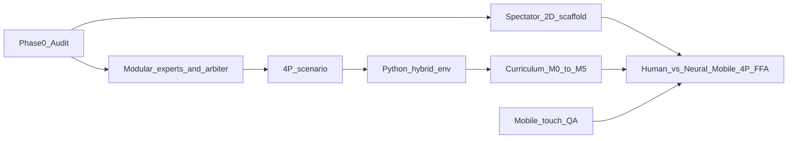

# PRD — Neural Hybrid AI, Spectator Legibility, and Mobile Playability

Status: Infrastructure / Part D **discipline reference** — **product Definition of Done superseded** by [`docs/prd/FINAL_GOD_STRATEGY_PLAYABLE_PRD.md`](../prd/FINAL_GOD_STRATEGY_PLAYABLE_PRD.md)  
**Do not claim the project product-complete from this file.** Hybrid 4P FFA Part D remains useful for mobile/screenshot/neural patterns; the Final PRD applies that discipline to **Full God-Strategy** (ages, culture, workers, pollution) with phases 0–8.  
Supersedes: `docs/runs/PRD - New PRD.md` (draft paste)

**Suggested branches** (dependency order):

| Part | Branch suggestion | Focus |
|------|-------------------|-------|
| A | `feature/neural-hybrid-4p-ai` | Modular neural training scaffold, curriculum Stages 0–2 / M0–M5 |
| B | `feature/hybrid-2d-spectator-legibility` | 2D 4-player spectator, screenshot gates |
| C | `feature/mobile-hex-view-playability` | Touch-first mobile QA across all modes |
| D | `feature/human-vs-neural-mobile-4p-ffa` | Productised human vs neural 4P mobile FFA |

**Base branch:** latest stable branch after Manual Playability QA and MRP full-stack work (do not hardcode a branch name).

**Primary goals (one per pillar):**

- **Part A — Neural Hybrid AI:** Train hierarchical modular neural bots for a 4-player hybrid logistics RTS via staged curriculum and expert/arbiter gates — not a single flat policy over the full action space.
- **Part B — Spectator legibility:** Make 4-player hybrid bot matches human-watchable without reading debug JSON; show plain-English AI intent from candidate-action telemetry.
- **Part C — Mobile playability:** Prove the 2D hex view is human-playable on mobile-shaped screens with touch-equivalent controls across tutorials, MVPs, and spectator.
- **Part D — Human vs Neural Mobile 4P FFA:** Deliver the productised end-state mode — human Player 1 vs three neural AI opponents on a mobile-shaped screen with proper victory/defeat.

**Ultimate objective (product end-state):** A human can launch and complete a 4-player free-for-all match on a mobile-shaped screen, controlling one faction against three neural-network-controlled AI opponents. The match must be playable from the mobile hex view, understandable through the HUD and inspector, and capable of ending through proper elimination/winner rules (Command Hub destroyed → sole remaining player → victory or defeat screen).

Training scaffold success (Parts A–C) is necessary but **not sufficient** for PRD completion. Part D is the real product definition of done.

**First implementation run claims only:** early curriculum (Stages 0–2 / M0–M5), modular candidate interface + heuristic experts or shared-trunk prototype, spectator/mobile scaffolding — **not** full human-vs-neural mobile FFA unless Part D acceptance genuinely passes.

**Companion RUN docs** (create during implementation):

- `docs/runs/RUN_NEURAL_HYBRID_4P_AI.md`
- `docs/runs/RUN_HYBRID_2D_SPECTATOR_LEGIBILITY.md`
- `docs/runs/RUN_MOBILE_HEX_VIEW_PLAYABILITY.md`
- `docs/runs/RUN_HUMAN_VS_NEURAL_MOBILE_4P_FFA.md`

---

## Instruction to Cursor

Before making changes, read and follow:

- `.cursor/rules/00-project-identity.mdc`
- `.cursor/rules/01-autonomous-run-policy.mdc`
- `.cursor/rules/02-test-first-development.mdc`
- `.cursor/rules/03-godot-sim-authority.mdc`
- `.cursor/rules/05-ip-originality.mdc`
- `.cursor/rules/06-git-branch-and-review-policy.mdc`
- `.cursor/rules/07-final-report-format.mdc`
- `.cursor/rules/08-neural-training-gates.mdc`
- `.cursor/rules/10-run-verification-and-logging.mdc`

Then read:

- `README.md`
- `docs/architecture/04_bot_and_training_architecture.md`
- `docs/runs/RUN_06_NEURAL_TRAINING_FOR_TRIAL_GAMES.md`
- `docs/runs/RUN_08_HYBRID_BOTS_TELEMETRY_BALANCE.md`
- `docs/runs/RUN_10_HUMAN_PLAYABLE_HYBRID.md`
- `docs/runs/MRP_hybrid_3d_spectator_added.md`
- `docs/audit/RUN_MANUAL_PLAYABILITY_QA_RESULTS.md`
- `docs/verification/local_verification.md`

**Relationship to MRP:** [`docs/runs/MRP_hybrid_3d_spectator_added.md`](MRP_hybrid_3d_spectator_added.md) defines economy bot, skirmish MVP, hybrid MVP, and **3D** bot spectator tracks. This PRD adds **hierarchical modular neural hybrid training** (Part A), a **2D** 4-player spectator for training eval (Part B), **mobile hex-view QA** (Part C), and the **productised human-vs-neural mobile 4P FFA** mode (Part D). The existing 3D hybrid spectator remains a parallel MRP track; Part B is the primary path for 4-player training screenshots.

**Prerequisites (must be green before Part A neural work):**

- RUN_01–04 kernel verification (per `docs/verification/local_verification.md`)
- RUN_06 trial-game neural scaffold complete ([`docs/runs/RUN_06_NEURAL_TRAINING_FOR_TRIAL_GAMES.md`](RUN_06_NEURAL_TRAINING_FOR_TRIAL_GAMES.md))
- RUN_07 headless hybrid + RUN_08 hybrid bots ([`docs/runs/RUN_08_HYBRID_BOTS_TELEMETRY_BALANCE.md`](RUN_08_HYBRID_BOTS_TELEMETRY_BALANCE.md))
- Human-playable hybrid MVP (RUN_09/10 scope) for Part C hybrid modes
- Per `.cursor/rules/08-neural-training-gates.mdc`: hybrid 4P training is an **extension** of RUN_06, not a replacement

---

## 1. Executive summary

This umbrella PRD unifies four product pillars under one thesis:

> Build a **hierarchical modular neural AI** for 4-player hybrid logistics RTS **only through staged curriculum gates**, ensure every rollout is **human-watchable** with plain-English bot intent (spectator), prove **mobile hex-view playability** (Part C), and deliver the **product end-state**: a human playing a complete mobile 4P FFA against three neural opponents (Part D).

The final product target is **not** only a bot-vs-bot training demonstration. The end-state product must include a human-playable 4-player free-for-all on a mobile-shaped screen: Player 1 = human (touch); Players 2–4 = `ModularNeuralHybridBot` (or `NeuralHybridBot` only when explicitly marked fallback); victory = sole remaining player after Command Hub elimination rules.

A single flat network choosing one action from the whole hybrid action space is **not** the target architecture. Use specialist expert heads (shared trunk first) that **propose** candidate macro-actions, an arbiter that **chooses** among them, then the existing macro-action compiler and `CommandValidator` — same as humans and scripted bots.

**Hard sequencing rules:**

1. Build spectator legibility (Part B scaffold) **before** heavy neural training.
2. Build modular candidate interface + telemetry (Part A.4) **before** claiming strong AI.
3. Part C proves general mobile playability; **Part D** is the extra final gate for human-vs-neural mobile FFA.

**Honest first-run scope:**

| Part | First-run claim |
|------|-----------------|
| A | Stages 0–2 / M0–M5; heuristic experts + small arbiter or shared-trunk prototype; weak bot in 4P match |
| B | 2D spectator + screenshot/overlap gates; plain-English intent from decision telemetry |
| C | Mobile profiles pass for menu + tutorials + spectator; document capture method |
| D | **Not claimed** on first run unless full acceptance passes — may use scripted fallback only with honest report |

Do **not** claim PRD complete, Stage M9/M10 success, or full neural-bot mobile FFA unless Part D acceptance genuinely passes.



---

## 2. Shared architecture guardrails

- The **Godot/GDScript simulation core** is authoritative; UI, spectator, and Python are non-authoritative.
- Authoritative gameplay remains in `godot_project/sim/`. Client code stays in `godot_project/client/`.
- Python is for: training; neural inference tooling; rollout collection; metrics; model storage; evaluation orchestration. Python must **not** become a second game simulation.
- Neural bots must:
  - observe snapshots (or policy observation exports);
  - use legal action masks;
  - submit commands through the same command API as humans and scripted bots;
  - never mutate `GameState` directly;
  - never access hidden information outside their player observation;
  - respect fog/intel rules where enabled;
  - use deterministic seeds for tests/evaluation;
  - export metrics and replay artefacts.
- **Macro-actions** compile into one or more validated commands per tick through `CommandValidator`. They are a higher-level policy surface; they do not bypass validation.
- **Hierarchical modular bots:** expert policies **propose** candidate macro-actions; an arbiter **chooses** among them; experts never mutate game state directly. All chosen actions still pass macro-action compiler + `CommandValidator`.
- **Mobile runtime inference:** neural inference must not freeze mobile play. No Python-only inference dependency for shipped mobile runtime unless explicitly packaged, tested, and documented.
- Reuse RUN_06b patterns from [`docs/architecture/04_bot_and_training_architecture.md`](../architecture/04_bot_and_training_architecture.md):
  - `PolicyObservationExporter.export_policy_observation(state, actor_id)`
  - `CommandAvailabilityProvider.enumerate_legal_commands(state, actor_id)` (always includes `NoopCommand`)
  - Python scoring policy over legal commands where appropriate
- Prefer **extending** existing exporters before inventing parallel `hybrid_ai_observation_exporter.gd` unless hybrid genuinely needs new fields.
- Existing scripted bots remain: teacher policies; baseline opponents; sanity checks; regression tests; fallback comparison.
- Screenshot and readability gates are **product requirements**, not optional polish.
- Use original placeholder art; do not copy Widelands, C&C, OpenRA, Red Alert, or other protected identity. Kenney `DOWNLOADED/` assets are reference-only, not shipped art.
- Terminology: use [`docs/design/10_glossary.md`](../design/10_glossary.md) — Command Hub, Settlement, Fabricator, etc.

---

## 3. Shared non-goals and anti-patterns

**Non-goals (first run):**

- Strong final 4-player RTS AI
- Huge deep-learning framework from scratch
- Training for hours without proving the environment works
- Removing deterministic heuristic bots
- Skipping action masking
- Omniscient full-map training observations unless an oracle/debug stage explicitly allows it
- Judging success by loss curves alone — evaluate actual gameplay outcomes
- Weakening failure-mode integrity checks (`verify_failure_modes.gd`)
- Desktop-only completion for Part C (mobile cannot rely on right-click, hover, mouse wheel, or required keyboard shortcuts)

**Anti-patterns (fail the run if claimed as success):**

- Loss-curve-only success without gameplay metrics
- Map-only screenshots with no HUD, tutorial, or inspector
- Desktop-only QA for mobile claims
- Oracle observations in fog-enabled training without documentation
- Claiming PRD complete without Part D human-vs-neural mobile FFA
- Claiming “neural bots play a full game” when only scripted bots ran in spectator or mobile FFA

---

## 4. Implementation sequencing and existing inventory

### 4.1 Staged delivery order

| Stage | Part | Work | Rationale |
|-------|------|------|-----------|
| 0 | A.5 | Current-state audit | Answer readiness questions before neural work |
| 1 | B (partial) + A.4 | 2D spectator scaffold + modular candidate interface | Watchability and telemetry before heavy training |
| 2 | A.6–A.8 | 4P scenario, observation, macro-action mask | Training inputs |
| 3 | A.9–A.12 | Curriculum/rewards, Python env, shared-trunk model; M0–M5 | Proof modular training loop |
| 4 | A.13–A.14 | `ModularNeuralHybridBot`, 4P eval, artefacts | Integration |
| 5 | B (complete) | Overlap checker, screenshot gate, intent HUD | Full spectator gates |
| 6 | C | Mobile profiles, touch QA | General mobile playability |
| 7 | D | Human vs neural mobile 4P FFA product mode | **Product end-state** |

### 4.2 Existing vs new (inventory)

| Area | Exists today | This PRD adds / extends |
|------|--------------|-------------------------|
| Trial neural training (RUN_06) | `python_tools/training/` — BC, policy eval, Godot headless transport | `python_tools/training/hybrid_ai/` subpackage |
| 3D hybrid spectator | `hybrid_3d_bot_spectator.tscn`, `Hybrid3dSpectatorController`, verify tools | **2D** 4P spectator (new); reuse controller/inspector patterns |
| Manual playability QA | `run_manual_playability_qa.gd`, `docs/audit/RUN_MANUAL_PLAYABILITY_QA_RESULTS.md` | Mobile portrait profiles, touch-target gates (Part C extends, not replaces) |
| Settler legibility | `ViewerTestHarness`, screenshot review JSON/MD | Same patterns for hybrid spectator and mobile |
| Hybrid 4P scenario | Not confirmed | `hybrid_4p_training_ffa.json` |
| `hybrid_ai/` GDScript | Not present | Observation exporter, action space, expert proposers, arbiter, `ModularNeuralHybridBot` |
| Mobile layout profiles | May be partial | `mobile_layout_profiles.gd` |
| Human vs neural mobile 4P FFA | Not present | Main menu entry, difficulty select, mobile FFA scene (Part D) |

**2D vs 3D spectator decision:** Part B targets a **2D** 4-player spectator as the primary path for training eval screenshots and overlap checks. The 3D MRP spectator remains parallel. Reuse patterns from `Hybrid3dSpectatorController` and `hybrid_3d_inspector_panel.gd` where applicable.

---

# Part A — Neural Hybrid 4-Player AI

## A.1 Product goal

Create a neural AI system for the hybrid game where four players compete on the same map.

Each player must eventually:

1. build and connect a basic economy;
2. gather and deliver resources;
3. construct military infrastructure;
4. produce units;
5. scout/observe enemies where allowed by fog/intel;
6. attack opponents;
7. defend itself;
8. eliminate opponents;
9. survive as the sole remaining player.

The long-term training goal is modular neural opponents that play recognisably like competent humans. The **product** goal is Part D: a human completes a mobile 4P FFA against those opponents.

---

## A.2 Curriculum design principle

Do **not** start with “train one flat network to win a 4-player RTS” directly. Reward is too sparse and the action space is too large. Do **not** train the full expert hierarchy from scratch in one step.

Use two coordinated curricula:

1. **Flat environment curriculum (Stages 0–2)** — prove training loop, observation/action schema, and basic building behaviour.
2. **Modular hierarchy curriculum (M0–M10)** — train expert proposers and arbiter in sequence (see A.4.4).

Flat stages with objective metrics and promotion gates (environment scaffolding):

| Stage | Name | Promotion summary |
|-------|------|-------------------|
| 0 | Environment works | 100 rollouts, invalid rate < 10%, stable shapes |
| 1 | Imitate scripted hybrid bot | Teacher action match > 60% held-out |
| 2 | Build useful things | ≥3 useful economy buildings in 80% eval matches |
| 3 | Balanced economy | Basic stockpile threshold in 70% eval matches |
| 4 | Supply military production | ≥1 military unit in 70% eval matches |
| 5 | Offense vs passive targets | Destroy passive target in 60% eval matches |
| 6 | Win 1v1 vs weak bot | Beat weak scripted bot > 50% |
| 7 | 2-player self-play | Beats random/passive; sometimes beats scripted |
| 8 | 4-player free-for-all | Same rewards as 7; survival and eliminations |
| 9 | Self-play league | Latest beats prior checkpoint set; no degenerate exploit |

**Modular hierarchy stages (M0–M10)** — primary path to Part D opponents:

| Stage | Training target | Notes |
|-------|-----------------|-------|
| M0 | Candidate interface works | Heuristic experts generate candidates; non-neural arbiter can choose |
| M1 | Economy expert imitation | Learn from scripted economy teacher |
| M2 | Logistics expert imitation | Learn road/connect/repair choices |
| M3 | Military production expert imitation | Learn when to build/queue/supply military |
| M4 | Combat expert imitation | Learn target/posture choices from scripted combat teacher |
| M5 | Arbiter imitation | Learn to choose between expert candidates from scripted hybrid bot |
| M6 | Expert reinforcement tuning | Tune each expert in constrained scenarios |
| M7 | Joint arbiter reinforcement tuning | Experts mostly frozen; train arbiter in mixed scenarios |
| M8 | Full integrated 1v1 | One modular neural bot vs weak/scripted bot |
| M9 | Full 4-player FFA | Human-compatible neural opponents in 4P free-for-all |
| M10 | Self-play / league | Checkpoint pool, exploiters, regression opponents |

First implementation may use **heuristic candidate proposers plus a small neural arbiter**. Later runs replace heuristic proposers with trained specialist neural experts. First run target: **Stages 0–2 and M0–M5** (stretch M6–M7).

Full stage rewards and gates: [`docs/design/hybrid_ai_curriculum.md`](../design/hybrid_ai_curriculum.md) (create in A.9).

```text
Stage 0 — environment works
Stage 1 — imitate scripted hybrid bot
Stage 2 — build anything useful
Stage 3 — build a balanced economy
Stage 4 — supply military production
Stage 5 — produce and use units against passive targets
Stage 6 — win 1v1 against weak scripted bot
Stage 7 — win 2-player self-play
Stage 8 — survive and win 4-player free-for-all
Stage 9 — self-play league / model ladder
```

**Anti-reward-hacking rule:** Do not reward “building stuff” forever without tying later rewards to useful connected production, military supply, combat, and winning.

---

## A.3 Macro-action design

The hybrid game has a large low-level action space (hexes, roads, buildings, production, posture, attacks, priorities). The neural model must **not** initially output raw low-level commands such as `place road segment from q,r to q,r` or `select exact hex among hundreds`.

Train on **macro-actions** that compile into validated game commands:

```text
Build wood economy near HQ
Build stone economy near nearest rock
Build barracks near connected road
Connect nearest important site
Queue rifle squad
Set posture defend base
Set posture attack weakest visible enemy
Expand toward resource cluster
Repair disconnected building
Wait / run economy
```

Each macro-action must: precondition check; legal mask boolean; command compiler; validation through existing command system; failure reason; decision log.

**Relationship to RUN_06b `legal_commands[]`:** Macro-actions are a compact policy head; each selected macro-action compiles to one or more entries that would pass `CommandAvailabilityProvider` validation. Document the mapping in `action_schema.py` and `hybrid_ai_action_space.gd`.

Later versions may add lower-level spatial actions.

---

## A.4 Hierarchical modular neural bot architecture

The neural hybrid bot must **not** be designed as only one flat network choosing one action from the whole action space.

Use a hierarchical modular architecture in which specialist policies propose candidate macro-actions and an arbiter chooses between them.

### A.4.1 Required architecture

```text
Strategic Manager
  ↓
Expert Candidate Proposers
  - Economy / building expert
  - Logistics / road and bottleneck expert
  - Military production expert
  - Combat / target expert
  - Defence / crisis expert
  - Scouting / expansion expert
  ↓
Arbiter / gating policy
  ↓
Macro-action compiler
  ↓
CommandValidator
  ↓
Authoritative Godot command API
```

**Hard rules:**

- Expert policies propose actions; they do **not** directly mutate game state.
- The arbiter chooses between proposed candidate macro-actions (or noop when all useful candidates are illegal, low-value, or blocked).
- All chosen macro-actions still pass through the macro-action compiler and `CommandValidator`.
- Illegal actions remain masked.
- The bot obeys the same player observation/fog/intel rules as human players unless running an explicitly labelled oracle/debug curriculum stage.
- Every expert and arbiter decision must be logged for training, debugging, replay, and spectator explanation.

### A.4.2 Shared trunk + specialist heads (first implementation)

For mobile, several fully separate large networks may be expensive and awkward. **First implementation** uses:

```text
Shared observation encoder
  ├── economy head
  ├── logistics head
  ├── military production head
  ├── combat head
  ├── defence / emergency head
  └── arbiter / gating head
```

Later, heads may become fully separate networks if needed. This gives specialist behaviour without immediately creating a hard-to-train multi-network system.

Create:

```text
python_tools/training/hybrid_ai/modular_policy.py
python_tools/training/hybrid_ai/expert_heads.py
python_tools/training/hybrid_ai/arbiter.py
godot_project/sim/hybrid/bot/modular_neural_hybrid_bot.gd
godot_project/sim/hybrid/ai/expert_candidate_proposer.gd
godot_project/sim/hybrid/ai/strategic_manager.gd
godot_project/sim/hybrid/ai/modular_arbiter.gd
```

`NeuralHybridBot` (flat MLP) may remain as a **debug/fallback** path for Stages 0–2 only. **Part D opponents must use `ModularNeuralHybridBot`** unless explicitly marked scripted fallback in the report.

### A.4.3 Candidate action format

Each expert candidate must be structured data:

```text
candidate_id
source_expert
macro_action_id
macro_action_params
precondition_pass
legal_mask_pass
urgency_score
value_estimate
risk_score
expected_resource_impact
expected_military_impact
plain_english_reason
compiled_command_preview
```

The arbiter receives the candidate list and chooses one candidate, or noop only when all useful candidates are illegal, low-value, or blocked.

### A.4.4 Expert policies

**Economy / building expert** — propose economy construction and production-chain actions: `build_wood_economy`, `build_stone_economy`, `build_forester_support`, `build_sawmill`, `build_quarry`, `increase_economy_priority`.

**Logistics expert** — keep the base connected and productive: `connect_nearest_important_site`, `repair_or_replace_disconnected_road`, fix blocked delivery, `expand_road_toward_resource_cluster`.

**Military production expert** — military infrastructure and unit production: `build_barracks`, `build_guard_post`, `queue_rifle_squad`, `increase_military_priority`, supply military site.

**Combat expert** — attacks, target selection, combat posture: `attack_weakest_visible_enemy`, attack enemy Command Hub if viable, attack enemy military site, `set_attack_visible_enemy_posture`, retreat from bad fight.

**Defence / crisis expert** — override when under immediate threat or economic collapse: defend Command Hub, queue emergency unit, repair critical road, stop overexpansion, protect worker route.

**Scouting / expansion expert** — map control and resource expansion: `expand_toward_nearest_resource_cluster`, scout contested centre, claim neutral resource, build forward guard post.

### A.4.5 Strategic Manager

Runs at lower frequency than tactical experts. Chooses high-level intent included in each expert and arbiter observation:

```text
stabilise_economy
expand
tech_to_military
defend
harass
attack_to_eliminate
recover_from_damage
```

Example:

```text
tick 12000
strategic_intent: tech_to_military
economy expert proposes: build_sawmill
military expert proposes: build_barracks
combat expert proposes: noop_no_visible_enemy
arbiter chooses: build_barracks
reason: economy threshold met and no immediate threat
```

### A.4.6 Arbiter / gating policy

**Inputs:** shared observation summary; strategic intent; legal action mask; expert candidate list; candidate value/urgency estimates; current threat level; resource bottlenecks; military balance; time since last economy/combat/logistics action.

**Outputs:** `chosen_candidate_id`; `chosen_macro_action`; confidence; `plain_english_reason`; safe fallback if compilation fails.

**Must avoid degenerate behaviour:** always building economy never attacking; always attacking before economy exists; always nooping because candidates conflict; overbuilding disconnected sites; suicidal attacks; ignoring Command Hub defence.

### A.4.7 Candidate-action telemetry (product requirement)

Every AI decision must export:

```text
tick
player_id
observation_summary
strategic_intent
visible_threat_level
expert_candidates[]
candidate_action
candidate_source_expert
candidate_legal
candidate_score
arbiter_scores
chosen_action
rejected_reason
compiled_commands
validation_result
reward_delta
plain_english_reason
```

The spectator HUD must display plain-English intent, for example:

```text
Player 3 intent: defending base
Considering: build guard post, queue rifle squad, repair road
Chosen: queue rifle squad
Reason: enemy visible near Command Hub
```

This is a **product feature**, not debugging-only. Wire to Part B scoreboard “Current bot intent” field.

### A.4.8 Modular AI tests

**Godot:**

```text
test_neural_hybrid_040_expert_candidate_schema_stable.gd
test_neural_hybrid_041_economy_expert_proposes_legal_candidates.gd
test_neural_hybrid_042_combat_expert_noops_when_no_enemy_visible.gd
test_neural_hybrid_043_defence_expert_responds_to_command_hub_threat.gd
test_neural_hybrid_044_arbiter_selects_only_legal_candidate.gd
test_neural_hybrid_045_arbiter_safe_noop_when_all_candidates_illegal.gd
test_neural_hybrid_046_modular_bot_uses_command_api.gd
test_neural_hybrid_047_modular_bot_decision_log_contains_expert_scores.gd
test_neural_hybrid_048_four_modular_neural_bots_tick_without_crash.gd
test_neural_hybrid_049_mobile_inference_budget_not_exceeded.gd
```

**Python:**

```text
test_expert_candidate_schema.py
test_economy_expert_forward_pass.py
test_combat_expert_forward_pass.py
test_arbiter_masks_illegal_candidates.py
test_modular_checkpoint_save_load.py
test_modular_policy_deterministic_inference.py
```

---

## A.5 Phase A.5 — current-state audit

Before editing:

```bash
git status --short
git branch --show-current
git log --oneline -5
```

Create: `docs/audit/RUN_NEURAL_HYBRID_4P_AI_CURRENT_STATE.md`

Audit: hybrid bot files; training tools; Python dependencies; replay/rollout format; observation snapshots; legal command enumeration; hybrid scenario files; 3D/2D spectator tools; heuristic economy/military/hybrid bots; fast vs long bot suites; known failures. Reuse RUN_08 hybrid bot inventory.

The audit must answer:

```text
Can a scripted hybrid bot currently complete the hybrid objective?
Can four scripted bots currently run in one match?
Can a four-player hybrid scenario load?
Can a bot observe only its own legal/intel state?
Can legal actions be enumerated or approximated?
Can rollouts be saved?
Can a match end with one remaining player?
```

Do not start neural implementation until this audit exists.

---

## A.6 Phase A.6 — four-player hybrid benchmark scenario

Create or confirm:

```text
godot_project/sim/data/scenarios/hybrid/hybrid_4p_training_ffa.json
godot_project/sim/data/config/hybrid_4p_training_config.json
```

**Scenario requirements:** 4 players; symmetric or near-symmetric spawns; small base/Command Hub each; nearby starting resources; neutral/contested centre resources; expansion space; victory = sole remaining player; elimination = Command Hub destroyed or no viable HQ; max tick cap; deterministic seed.

**Config required fields:**

```text
players: 4
max_ticks: 50000
stall_threshold_ticks: 1000
elimination_rule: command_hub_destroyed
winner_rule: sole_remaining_player
fog_enabled: true
curriculum_stage: configurable
```

**Acceptance:** scenario loads headlessly; four players spawn; valid starting economy options; ≥1000 ticks without error; elimination/winner evaluator works; snapshot includes ownership and objective state.

---

## A.7 Phase A.7 — hybrid AI observation schema

Create (extend RUN_06 exporters where possible):

```text
godot_project/sim/hybrid/ai/hybrid_ai_observation_exporter.gd
python_tools/training/hybrid_ai/observation_schema.py
```

Support two forms:

### A.6.1 Scalar/vector observation (early MLP)

```text
own_stockpile: planks, stone, tools, field_supplies, food/rations if present
own_buildings: hq, woodcutter, forester, sawmill, quarry, barracks, guard_post, military_production counts
own_units: carrier, worker, rifle_squad, other unit counts
economy_status: connected/disconnected buildings, blocked sites, idle production, active deliveries
military_status: queued units, supplied military sites, under_attack, enemy_visible_count,
  visible_enemy_strength, own_strength, recent_damage_done/taken
map_summary: visible resource clusters, nearest_enemy_distance_if_visible, centre_control_estimate
```

### A.6.2 Spatial/tensor observation (later CNN)

Channels may include: terrain, own_buildings, enemy_visible_buildings, neutral_resources, own_units, enemy_visible_units, roads, fog_visible, construction_sites, threat/damage markers.

Do not require spatial model training in the first pass; design schema to support it later.

**Acceptance:** export per 4 players; no hidden enemy leak with fog; stable shape; documented schema; sample JSON artefacts.

---

## A.8 Phase A.8 — action schema and legal action mask

Create:

```text
godot_project/sim/hybrid/ai/hybrid_ai_action_space.gd
python_tools/training/hybrid_ai/action_schema.py
```

**Initial macro-action set:**

```text
0  noop / wait
1  build_wood_economy
2  build_stone_economy
3  build_forester_support
4  build_sawmill
5  connect_nearest_important_site
6  build_barracks
7  build_guard_post
8  queue_rifle_squad
9  set_defend_base_posture
10 set_attack_visible_enemy_posture
11 attack_weakest_visible_enemy
12 expand_toward_nearest_resource_cluster
13 repair_or_replace_disconnected_road
14 increase_military_priority
15 increase_economy_priority
```

**Example — `build_barracks`:** Preconditions: plausible materials path; valid connected build site; capacity need. Output: `PlaceBuildingPlanCommand` for barracks; optional road connection.

**Acceptance:** legal mask per player; invalid macros masked; selected actions compile to validated commands; failures logged; no direct state mutation.

---

## A.9 Phase A.9 — reward model and curriculum

Create:

```text
python_tools/training/hybrid_ai/reward.py
docs/design/hybrid_ai_curriculum.md
```

Stage-specific rewards (summary; full detail in curriculum doc):

| Stage | Key rewards | Promotion gate |
|-------|-------------|----------------|
| 0 | +0.01 valid cmd, −0.05 invalid, −0.001 idle noop, +1.0 survive target | 100 rollouts; invalid < 10%; stable shapes |
| 1 | Supervised CE on teacher macro-action | Teacher match > 60%; no shape errors |
| 2 | +0.5 first wood/stone/sawmill/quarry; +0.2 road; +0.1 fix disconnect; penalties for invalid/disconnect | ≥3 useful buildings in 80% eval |
| 3 | +1.0 full chain; +0.5 stockpile/delivery/bottleneck fix; −0.3 overbuild | Stockpile threshold 70% eval |
| 4 | +1.0 barracks/guard post; +0.5 supplied site; +0.5 queue; +1.0 first unit; −0.2 logistics block | ≥1 unit in 70% eval |
| 5 | +0.5 move to target; +1.0 damage; +2.0 destroy; penalties for idle/stupid attack | Destroy passive target 60% eval |
| 6 | Scaled damage; +2.0 mil building; +5.0 Command Hub; −5.0 own hub loss; +10.0 win 1v1 | Beat weak bot > 50%; economy not immediate collapse |
| 7–8 | +10/opp eliminated; +30 win; survival/damage scaled; −10 eliminated | Beat random/passive; occasionally scripted |
| 9 | Same as 7–8 + opponent pool | Beats prior checkpoints; no single exploit |

---

## A.10 Phase A.10 — Python training environment

Create:

```text
python_tools/training/hybrid_ai/hybrid_env.py
python_tools/training/hybrid_ai/modular_policy.py
python_tools/training/hybrid_ai/train.py
python_tools/training/hybrid_ai/evaluate.py
python_tools/training/hybrid_ai/replay_buffer.py
python_tools/training/hybrid_ai/configs/
```

Interface with Godot authoritative simulation via existing RUN_06 transport (Godot headless; no Python sim). Options: headless rollout scripts; existing Python/Godot bridge; JSON per tick. Do not build a parallel sim in Python.

**Minimum API:**

```python
obs = env.reset(seed=42, stage=2)
obs, reward, done, info = env.step(action)
legal_mask = obs["legal_action_mask"]
```

**4-player:** `obs[player_id]`, `action[player_id]`, `reward[player_id]`, `done`, `info`.

**Acceptance:** short 4P rollout; observations/masks match schema; rewards produced; terminates by win/loss/tick cap; artefacts on disk.

---

## A.11 Phase A.11 — shared-trunk modular policy

**Not** a single flat MLP over the full macro-action space. Implement **shared observation encoder** with specialist heads (see A.4.2):

- economy head
- logistics head
- military production head
- combat head
- defence / emergency head
- arbiter / gating head

Each head outputs expert **candidate proposals** (scores + parameters), not direct state mutation. Arbiter head selects among merged candidates with legal mask applied.

Optional value head for RL stages M6–M7. Deterministic inference mode; checkpoint save/load includes trunk + all heads.

**Outputs per tick:** expert candidate lists; arbiter logits; `chosen_candidate_id`; `chosen_macro_action`; `plain_english_reason`; masked invalid candidates never selected.

**Acceptance:** forward pass works for all heads; arbiter selects only legal candidates; checkpoint save/load; deterministic inference repeatable; mobile inference budget test (A.4.8) passes on target device profile.

Legacy flat `NeuralHybridBot` MLP may exist for Stages 0–2 debugging only.

---

## A.12 Phase A.12 — first-run training scope (Stages 0–2 / M0–M5)

First implementation run must **not** attempt full 4-player combat or Part D product mode.

Implement scaffold and proof model through early flat and modular curriculum.

**Required:** Stage 0 sanity; Stage 1 imitation (if teacher exists); Stage 2 useful building; **M0** candidate interface; **M1–M3** expert imitation (heuristic or neural); **M5** arbiter imitation (small neural arbiter acceptable with heuristic experts).

**Stretch:** Stage 3–4; M4 combat expert; M6 expert RL tuning.

Do **not** claim Part D, M9, or final 4-player strategic AI unless evaluation and mobile FFA acceptance genuinely pass.

**Training outputs:**

```text
docs/audit/neural_hybrid_ai/stage0_env_sanity.json
docs/audit/neural_hybrid_ai/stage1_imitation_results.json
docs/audit/neural_hybrid_ai/stage2_building_results.json
docs/audit/neural_hybrid_ai/modular_m0_m5_results.json
python_tools/training/hybrid_ai/checkpoints/
```

**Acceptance:** trains without crash; legal actions only; modular telemetry complete; improves over random on Stage 2; checkpoint loads in `ModularNeuralHybridBot`; bot runs in hybrid match (may be weak).

---

## A.13 Phase A.13 — Godot ModularNeuralHybridBot wrapper

Create:

```text
godot_project/sim/hybrid/bot/modular_neural_hybrid_bot.gd
```

Optional legacy/debug: `godot_project/sim/hybrid/bot/neural_hybrid_bot.gd` (flat MLP — not for Part D opponents).

`ModularNeuralHybridBot` must:

- run Strategic Manager at configured interval;
- collect expert candidate proposals (heuristic and/or loaded head weights);
- run arbiter to choose candidate;
- export full candidate-action telemetry (A.4.7);
- compile chosen macro-action; submit via command API;
- respect fog/intel; apply legal mask;
- meet mobile inference budget (no frame freeze — async or tick-budget inference).

**First-run inference options (document which is used):**

1. Exported lightweight checkpoint (trunk + heads) for in-engine inference
2. Subprocess inference with strict timeout and safe noop fallback
3. Heuristic experts + small exported arbiter weights

**Part D requirement:** Players 2–4 in mobile FFA must use `ModularNeuralHybridBot` with neural checkpoints — not scripted bot unless report explicitly says **fallback mode**.

**Acceptance:** joins hybrid match; four instances tick in 4P; timeout/failure → safe noop; decision logs include expert candidates, arbiter scores, plain-English reason; telemetry consumable by spectator HUD.

---

## A.14 Phase A.14 — four-player neural evaluation

Create:

```text
godot_project/sim/tools/run_neural_hybrid_4p_smoke.gd
python_tools/training/hybrid_ai/evaluate_4p.py
```

| Match type | Setup | First-run expectation |
|------------|-------|----------------------|
| A.14.1 Sanity | 1 modular neural, 3 passive | Survives, builds something useful |
| A.14.2 Building | 4 modular neural, combat off/passive | Build economy/military without crash |
| A.14.3 Weak opponent | 1 modular neural, 3 weak scripted | Survives; sometimes military production |
| A.14.4 Full FFA | 4 modular neural/self-play | **Long-run / Part D:** sole remaining winner |
| A.14.5 Human vs neural mobile | Human P1, neural P2–4, mobile profile | **Part D product gate** |

Do not claim A.14.4 or A.14.5 success until genuinely happens.

---

## A.15 Phase A.15 — replay and training artefacts

Output folder: `docs/audit/neural_hybrid_ai/`

Per evaluation run:

```text
match_summary.json
player_metrics.csv
reward_trace.csv
action_trace.csv
decision_telemetry.jsonl
expert_candidate_trace.csv
final_snapshot.json
winner.txt
rollout_seed.txt
model_checkpoint_ids.txt
```

Optional: `docs/audit/neural_hybrid_ai/screenshots/` (tie to Part B).

**Metrics:** winner, eliminated_players, ticks_survived, buildings_built, roads_built, units_produced, damage_done/taken, enemy_buildings_destroyed, own_command_hub_alive, invalid_action_rate, noop_rate, reward_total, stage, model_checkpoint.

**Acceptance:** every run produces artefacts; failures explained; no silent timeouts.

---

## A.16 Phase A.16 — tests

Modular architecture tests: see **A.4.8**. Below: schema, reward, environment, and bot wrapper tests.

### A.16.1 Observation/action schema

```text
test_neural_hybrid_001_observation_shape_stable.gd
test_neural_hybrid_002_no_hidden_enemy_info_with_fog.gd
test_neural_hybrid_003_action_mask_shape.gd
test_neural_hybrid_004_macro_actions_compile_or_fail_cleanly.gd
test_neural_hybrid_005_invalid_actions_masked.gd
```

### A.16.2 Reward

```text
test_neural_hybrid_010_reward_building_stage.gd
test_neural_hybrid_011_reward_military_supply_stage.gd
test_neural_hybrid_012_reward_combat_stage.gd
test_neural_hybrid_013_terminal_win_loss_rewards.gd
```

### A.16.3 Environment

```text
test_neural_hybrid_020_4p_scenario_loads.gd
test_neural_hybrid_021_4p_match_ticks.gd
test_neural_hybrid_022_elimination_rule.gd
test_neural_hybrid_023_winner_rule.gd
```

### A.16.4 Bot wrapper

```text
test_neural_hybrid_030_modular_bot_loads_policy.gd
test_neural_hybrid_031_modular_bot_uses_command_api.gd
test_neural_hybrid_032_modular_bot_safe_noop_on_inference_failure.gd
test_neural_hybrid_033_four_modular_bots_can_tick.gd
```

### A.16.5 Python tests

If Python test framework exists:

```text
test_hybrid_env_reset_step.py
test_action_masking.py
test_model_save_load.py
test_reward_stages.py
test_observation_schema_stable.py
```

Register Godot tests with `TEST_FILTER=neural_hybrid` where applicable.

---

# Part B — Hybrid Spectator Visual Language

## B.1 Hard rule: no invisible spectator completion

Do not report neural training success if screenshots show an unreadable map-only view. Bot work only matters if a human can watch the match and understand who owns what, what is being built, what carriers carry, who attacks whom, who is winning, why something is blocked, and what they clicked on.

This is a **required** part of the neural-bot product, not optional polish. Build spectator scaffold **before** heavy training.

## B.2 Spectator goal

A human spectator must be able to:

1. launch a hybrid bot match;
2. pan and zoom the 2D hex world;
3. identify each player's territory/units/buildings;
4. tell buildings, units, roads, wares, and construction sites apart;
5. see what carriers are carrying;
6. see combat, damage, and attacks clearly;
7. click any visible object for a plain-English inspector;
8. read match status, player summaries, and objectives;
9. understand which player is winning or losing;
10. inspect post-match screenshots and confirm visuals make sense.

---

## B.3 Visual language — white outlines

All important map sprites must have a thick **white outline** readable on terrain, roads, fog, ownership tint, and combat effects.

**Outlined objects:** Command Hub; Woodcutter; Forester; Sawmill; Quarry; Barracks; Guard Post; Construction Site; Carrier; Worker; Rifle Squad; other military units; visible carried wares; visible enemy/neutral objective markers.

Suggested minimum: **2–4 px outline at 1× sprite scale.**

Retain player identity via inner colour, banner, badge, or rim. White outline is for readability; it must not erase team identity.

---

## B.4 Player identity

Four distinct consistent identities, e.g.:

```text
Player 1 — blue inner colour / badge
Player 2 — red
Player 3 — green
Player 4 — yellow / purple / orange
```

**Required indicators:** coloured badge on buildings; marker/ring on units; player colour in inspector and scoreboard; optional soft territory tint. Do not rely only on tiny `P1`/`P2` labels.

---

## B.5 Sprite overlap rule

Acceptable overlap: units on roads; carriers entering buildings; combat clusters; stacked resource icons; adjacent buildings.

**Fail conditions:** one building fully covers another; ware icons hidden; labels cover sprites; outlines merge into unreadable blob; ownership badges hidden; construction progress hidden; selected object not locatable.

**Mitigations:** z-ordering by type; per-object screen offsets; unit fan-out; label priority; selection ring; zoom-dependent label hiding; overlap checks.

---

## B.6 Phase B.6 — 2D hybrid spectator scene

**Existing (reuse patterns, do not duplicate):**

- `godot_project/client/scenes/hybrid_3d_bot_spectator.tscn`
- `godot_project/client/core/hybrid_3d_spectator_controller.gd`
- `godot_project/client/ui/hybrid_3d_inspector_panel.gd`
- `godot_project/sim/tools/verify_hybrid_3d_spectator_screen.gd`

**Create for 2D 4-player path:**

```text
godot_project/client/scenes/hybrid_bot_spectator_2d.tscn
godot_project/client/scenes/hybrid_bot_spectator_2d.gd
godot_project/client/core/hybrid_bot_spectator_controller.gd
godot_project/client/ui/hybrid_spectator_sprite_layer.gd
godot_project/client/ui/hybrid_spectator_inspector.gd
godot_project/client/ui/hybrid_spectator_scoreboard.gd
```

**Controls (desktop; touch equivalents in Part C):** WASD/arrows pan; drag pan; wheel zoom; Home centre all players; 1–4 focus player; F follow; Space pause/play; Step while paused; 1×/2×/4× speed; click inspect; Esc clear; Tab cycle objects.

Default zoom must show at least one base and immediate economy.

---

## B.7 Phase B.7 — click inspection

**Selection priority:** topmost unit → military → carrier/worker → building → construction site → road → carried ware → terrain.

**Inspector examples (plain English, not raw IDs):**

```text
Player 2 Barracks
Role: trains rifle squads.
Status: waiting for field supplies.
Connected to roads: yes
Queue: 1 rifle squad, blocked
Missing: field supplies
```

Reuse [`selection_formatter.gd`](../../godot_project/client/adapters/selection_formatter.gd) patterns where applicable.

---

## B.8 Phase B.8 — spectator HUD

**HUD:** match time/tick; pause state; speed; winner/match state; scoreboard; selected object; recent events; camera help.

**Scoreboard per player:** colour/name; alive/eliminated; Command Hub health; building counts; military buildings; units; economy/military strength; damage done/taken; opponents eliminated; **current bot intent** (from A.4.7 telemetry — e.g. `defending base`, `chosen: queue rifle squad`).

**Recent events examples:** `Player 2 completed Barracks`; `Player 3 attacked Player 4 Guard Post`; `Player 4 Command Hub destroyed`.

---

## B.9 Phase B.9 — white outline implementation

Use generated original placeholders. Do not use copyrighted RTS art.

Preferred: `tools/generate_hybrid_spectator_sprites.py` (or extend existing generator).

Produce: base sprite; white-outline sprite; ownership badge variants; carried-ware icons; selected/hover variants.

Alternatives: shader outline; white silhouette behind sprite; alpha dilation. Acceptance is readability, not method.

---

## B.10 Phase B.10 — overlap detection

`godot_project/sim/tools/verify_hybrid_spectator_sprite_overlap.gd`

Record: object_id, type, player_id, screen_rect, outline_rect, z_index, visibility, overlap_with, overlap_area, overlap_ratio, severity.

**Fail if:** important building > 30% overlap with another important building; selected object > 20% covered; ware icon fully hidden; badge fully hidden; HUD clipped; unreadable unit cluster without fan-out.

**Output:** `docs/audit/neural_hybrid_ai/visual/hybrid_spectator_overlap_review.json` and `.md`

---

## B.11 Phase B.11 — screenshot readability gate

```text
godot_project/sim/tools/capture_hybrid_bot_spectator_screenshots.gd
godot_project/sim/tools/verify_hybrid_bot_spectator_readability.gd
```

**Required screenshots:**

```text
docs/audit/neural_hybrid_ai/visual/hybrid_spectator_00_match_start.png
docs/audit/neural_hybrid_ai/visual/hybrid_spectator_01_player_base.png
docs/audit/neural_hybrid_ai/visual/hybrid_spectator_02_economy_running.png
docs/audit/neural_hybrid_ai/visual/hybrid_spectator_03_military_site_supplied.png
docs/audit/neural_hybrid_ai/visual/hybrid_spectator_04_units_produced.png
docs/audit/neural_hybrid_ai/visual/hybrid_spectator_05_attack_started.png
docs/audit/neural_hybrid_ai/visual/hybrid_spectator_06_combat_cluster.png
docs/audit/neural_hybrid_ai/visual/hybrid_spectator_07_player_eliminated.png
docs/audit/neural_hybrid_ai/visual/hybrid_spectator_08_winner.png
docs/audit/neural_hybrid_ai/visual/hybrid_spectator_09_object_clicked_inspector.png
```

Each entry: screenshot_path, tick, camera, zoom, selected_object, visible entities, readability_pass, failure_reasons.

**Fail if:** blank; map-only without HUD; text too small; panels off-screen; indistinguishable player colours; missing outlines; unreadable overlap; no inspector on click; wrong milestone state.

---

## B.12 Phase B.12 — navigation verification

`godot_project/sim/tools/verify_hybrid_spectator_navigation.gd`

Prove through spectator scene (not direct controller mutation): pan/zoom; Home; 1–4 focus; building/unit/terrain click → inspector; Space pause/play; tick advances; Step while paused.

---

## B.13 Phase B.13 — bot-match integration

Every full neural evaluation (`evaluate.py` or Godot equivalent) must produce:

```text
match_summary.json
action_trace.csv
reward_trace.csv
final_snapshot.json
spectator_screenshots/
visual_review.json
overlap_review.json
```

**Final report must answer:** Could a human understand from screenshots? Sprites outlined? Severe overlaps? Click inspection works? HUD readable?

If no trained checkpoint yet, use scripted/passive/prototype bots for spectator validation.

---

## B.14 Phase B.14 — tests

```text
test_hybrid_spectator_001_scene_loads.gd
test_hybrid_spectator_002_camera_pan_zoom.gd
test_hybrid_spectator_003_click_building_inspector.gd
test_hybrid_spectator_004_click_unit_inspector.gd
test_hybrid_spectator_005_click_terrain_inspector.gd
test_hybrid_spectator_006_white_outline_assets_exist.gd
test_hybrid_spectator_007_player_colours_distinct.gd
test_hybrid_spectator_008_sprite_overlap_checker.gd
test_hybrid_spectator_009_scoreboard_readable.gd
test_hybrid_spectator_010_recent_events_readable.gd
test_hybrid_spectator_011_capture_screenshots.gd
test_hybrid_spectator_012_readability_gate_fails_map_only.gd
```

`TEST_FILTER=hybrid_spectator`

---

## B.15 First-run acceptance (spectator)

Complete when:

- 2D hybrid spectator launches; 4P match observable; pan/zoom/click work;
- white outlines on important sprites; readable ownership; no severe overlap piles;
- overlap checker + screenshot set + readability review pass;
- scoreboard/events/HUD readable;
- scripted/prototype bot match demonstrable;
- neural eval pipeline ready to export screenshots when trained policies exist.

**Correct first-run claim:**

> Hybrid spectator visual language and verification are ready. The spectator can show 4-player scripted/prototype bot matches with outlined sprites, click inspection, navigation, overlap checks, and screenshot readability gates. Full neural-bot match review runs once trained policies reach full-game evaluation.

**Do not claim** “human spectator can watch neural bots play a full game” unless trained bots complete a full match and screenshot review confirms readability.

---

## B.16 Future-run acceptance (spectator)

Claim full spectator success only when: 4P neural match reaches elimination/winner; screenshot sequence shows economy → military → combat → elimination → winner; no critical overlap failures; HUD readable; click inspection works; human review confirms understandability.

---

# Part C — Mobile Hex-View Human Playability

## C.1 Product goal

The game must be human-playable from the 2D hex view on a mobile-shaped screen.

A mobile player must be able to:

1. launch the game;
2. read the main menu;
3. enter tutorial/free-play modes;
4. pan and zoom the hex map;
5. tap hexes, buildings, units, and carriers;
6. open readable inspectors;
7. use tutorial Next/Back/Skip/Menu controls;
8. build/place/order via touch-friendly controls;
9. pause/play/step/speed the simulation;
10. understand key events from screenshots.

**Extends** [`docs/audit/RUN_MANUAL_PLAYABILITY_QA_RESULTS.md`](../audit/RUN_MANUAL_PLAYABILITY_QA_RESULTS.md) with portrait profiles, touch-target sizing, pinch/zoom, and per-mode mobile screenshot tables — not a greenfield duplicate.

Map to RUN_10 criteria: touch targets ≥ 44pt; delegated hybrid control; readable diagnostics ([`docs/runs/RUN_10_HUMAN_PLAYABLE_HYBRID.md`](RUN_10_HUMAN_PLAYABLE_HYBRID.md)).

---

## C.2 Touch-first design rule

**Mobile must not rely on:** right-click; hover; required keyboard shortcuts; tiny buttons; wide side panels; mouse wheel; desktop-only hotkeys.

**Mobile must support:** single tap select; tap buttons for actions; tap map to target/place; drag pan; pinch or on-screen +/- zoom; large Play/Pause; large Next/Back; large build/order buttons; bottom-sheet inspector.

Keyboard shortcuts may remain as extras but cannot be required.

---

## C.3 Phase C.3 — mobile current-state audit

Create: `docs/audit/RUN_MOBILE_HEX_VIEW_PLAYABILITY_CURRENT_STATE.md`

Audit each mode: Settler Tutorial/Free Play; Skirmish Tutorial/MVP; Hybrid Tutorial/MVP; 2D Hybrid Bot Spectator; 3D Bot Spectator if exposed.

Per mode record: portrait/landscape launch; menu/tutorial readability; Next/Back/Play touchable; pan/zoom; tap select; inspector; build/order; clipped panels; text size; screenshot path; blockers.

Audit must be screenshot-backed. Diff against manual playability QA results.

---

## C.4 Phase C.4 — mobile screen profiles

```text
mobile_portrait_small: 360x800
mobile_portrait_common: 390x844
mobile_portrait_large: 412x915
mobile_landscape_small: 800x360
mobile_landscape_common: 844x390
mobile_landscape_large: 915x412
tablet_portrait: 768x1024
tablet_landscape: 1024x768
```

Implement or update: `godot_project/client/ui/mobile_layout_profiles.gd`

On small portrait, use drawers/tabs/bottom sheets but always provide access to: tutorial text; objective; inspector; build/order; time controls; map; menu/back.

---

## C.5 Phase C.5 — mobile layout rules

**Main menu:** readable buttons for Settler, Skirmish, Hybrid (tutorial/MVP), 2D/3D Bot Spectator, Quit — none clipped.

**In-game:** top bar (mode/objective/tick/pause); central map; bottom action bar (Play/Pause, Step, Speed, Build, Orders, Inspect, Tutorial); bottom sheet for tutorial, inspector, build palette, production panel.

Screenshots must prove every required function is reachable.

---

## C.6 Phase C.6 — mobile touch controls

```text
tap object = select/inspect
tap empty hex = terrain / target if action mode
drag = pan
pinch or +/- = zoom
tap Build = open drawer
tap type = placement mode; tap hex = place/preview/confirm
tap Road = road mode; source then target hex
tap unit = select; tap enemy = attack/order if mode active
tap Play/Pause, Step, Speed, Next/Back
tap outside drawer or close = dismiss
```

Essential actions need visible buttons, not gesture-only hidden controls.

---

## C.7 Phase C.7 — tutorial navigation on mobile

Each tutorial: Step N of M; title; instruction; Back; Next; Skip; Main Menu.

Touch targets: minimum 44×44 px (prefer 48×48); readable text; adequate spacing; no required button off-screen.

**Failure:** player sees only Skip and Main Menu, or Next/Back hidden/clipped after step 1.

---

## C.8 Phase C.8 — mobile screenshot harness

```text
godot_project/sim/tools/capture_mobile_hex_view_screenshots.gd
godot_project/sim/tools/mobile_hex_view_review_util.gd
```

Capture each mode via main menu at each profile. Minimum sets:

- `mobile_portrait_main_menu.png`, `mobile_landscape_main_menu.png`
- Settler: tutorial start, next, back, HQ selected, build drawer, road mode, unpaused tick
- Skirmish: tutorial start, next, command hub, production drawer, unit, attack, unpaused tick
- Hybrid: tutorial start, next, economy/military selected, supply chain, posture drawer, unpaused tick
- Spectator: match start, pan/zoom, building inspector, unit inspector, scoreboard, combat event
- **Hybrid FFA (Part D):** menu entry, difficulty select, match start, mid-game economy, combat event, victory screen, defeat screen, AI building inspector with intent text

Save under: `docs/audit/screenshots/mobile_hex_view/`

---

## C.9 Phase C.9 — mobile screenshot review criteria

`docs/audit/screenshots/mobile_hex_view/mobile_hex_view_visual_review.json` and `.md`

Per entry: profile, window size, mode, milestone, pass, failure_reasons; visible required text; required controls visibility; touch targets ≥ 44px; layout (no clip, no map-only); legibility (contrast, outlines, player colours).

**Fail if:** map-only; missing tutorial buttons; text/buttons too small; overlapping controls; clipped panels; unclear next action; tick does not advance after Play; overlap hides clicked object.

---

## C.10 Phase C.10 — mobile functional tests

Under `godot_project/sim/tests/viewer/`:

```text
test_mobile_hex_001_main_menu_portrait_readable.gd
test_mobile_hex_002_main_menu_landscape_readable.gd
test_mobile_hex_003_settler_tutorial_touch_next_back.gd
test_mobile_hex_004_skirmish_tutorial_touch_next_back.gd
test_mobile_hex_005_hybrid_tutorial_touch_next_back.gd
test_mobile_hex_006_touch_select_object_opens_inspector.gd
test_mobile_hex_007_drag_pan_changes_camera.gd
test_mobile_hex_008_zoom_control_changes_scale.gd
test_mobile_hex_009_touch_build_drawer_visible.gd
test_mobile_hex_010_touch_build_place_preview.gd
test_mobile_hex_011_touch_play_pause_tick_advances.gd
test_mobile_hex_012_skirmish_touch_attack_order.gd
test_mobile_hex_013_hybrid_touch_posture_order.gd
test_mobile_hex_014_spectator_touch_click_inspector.gd
test_mobile_hex_015_required_touch_targets_large_enough.gd
test_mobile_hex_016_no_required_controls_offscreen.gd
test_mobile_hex_017_mobile_screenshot_capture.gd
test_mobile_hex_018_mobile_readability_gate_fails_map_only.gd
```

`TEST_FILTER=mobile_hex`

---

## C.11 Phase C.11 — mobile QA runner

`godot_project/sim/tools/run_mobile_hex_view_qa.gd`

Must: launch menu portrait/landscape; Settler Tutorial Next/Back/tap HQ/build/road/Play; repeat Skirmish and Hybrid tutorials; launch Skirmish/Hybrid MVP; launch 2D spectator; **launch Hybrid FFA (Part D)** — difficulty select, human P1 touch play, verify match can tick; pan/zoom/inspect; capture screenshots; review; print PASS/FAIL; exit non-zero on critical failure.

---

## C.12 Phase C.12 — real mobile-shaped window

Headless SubViewport alone is insufficient when display is available.

```bash
"$GODOT" --path godot_project --resolution 390x844 --windowed
"$GODOT" --path godot_project --resolution 844x390 --windowed
```

If `DISPLAY` unavailable, state clearly: real window test not run; in-engine mobile-profile capture used instead. Do not claim real-window verification unless it happened.

---

## C.13 Phase C.13 — bot/spectator event validation

Reuse: `run_tutorial_bot_smoke.gd`, `run_tutorial_military_bot_smoke.gd`, `run_tutorial_hybrid_bot_smoke.gd`, `run_hybrid_bot_vs_bot_3d_smoke.gd`, `run_neural_hybrid_4p_smoke.gd`.

Capture mobile spectator screenshots for: economy running; carrier delivery; military production; unit produced; attack; combat; elimination; winner if reached. Use scripted bots if neural not ready; document which.

---

## C.14 Phase C.14 — reports

Create:

```text
docs/audit/RUN_MOBILE_HEX_VIEW_PLAYABILITY_RESULTS.md
docs/audit/RUN_MOBILE_HEX_VIEW_PLAYABILITY_LESSONS_LEARNED.md
```

Include: profiles tested; capture method; screenshot table; pass/fail per mode; touch/tutorial/play/pan/zoom/inspector/build results; spectator results; known gaps; manual judgement on playability.

Update `docs/verification/local_verification.md` with mobile QA commands.

---

## C.15 Part C definition of done

Complete only when:

- main menu readable portrait and landscape;
- all exposed modes launch in mobile profiles;
- tutorial Next/Back visible and touchable;
- pan by drag; zoom by pinch or controls;
- tap inspect; build/order accessible; unpause advances tick;
- screenshots pass mobile readability review;
- touch targets ≥ minimum; no required controls off-screen; no map-only modes;
- bot/spectator events observable on mobile view;
- `run_mobile_hex_view_qa.gd` exit 0; `TEST_FILTER=mobile_hex` exit 0;
- results report honest about gaps.

**Part C alone is not PRD completion.** Part D (human vs neural mobile 4P FFA) is the product end-state gate.

---

# Part D — Human-vs-Neural Mobile 4P FFA

## D.1 Product goal

Create a complete **mobile-playable** 4-player free-for-all where one human player competes against three neural-network-controlled AI opponents.

This is the **real product definition of done**, separate from the training scaffold (Parts A–C).

| Requirement | Detail |
|-------------|--------|
| Player setup | Human = Player 1; AI = Players 2–4 |
| Opponent type | `ModularNeuralHybridBot` with neural checkpoints — not scripted bot unless explicitly marked **fallback** in report |
| Difficulty | Easy / Normal / Hard — implemented via checkpoint strength, reaction delay, action noise, planning interval, resource handicap, and/or restricted curriculum stage; each level must document which mechanisms it uses |
| Mobile entry path | Main Menu → Hybrid FFA → choose difficulty → Start |
| View | 2D mobile hex view (touch-first) |
| Match ending | Command Hub elimination; sole remaining player; victory screen; defeat screen |
| Human controls | All build/economy/military/posture actions available by touch (Part C rules) |
| AI visibility | AI obeys same fog/intel rules as human unless debug mode explicitly enabled |
| Performance | Neural inference must not freeze mobile play |
| Save artefacts | Replay; action trace; decision telemetry; winner; screenshots; model checkpoint IDs |

---

## D.2 Required user flow

```text
Main Menu
  → Hybrid FFA
  → Choose difficulty (Easy / Normal / Hard)
  → Start Match
  → Play on 2D mobile hex view (Player 1 = human touch)
  → Victory / Defeat / Match Summary
```

Create or extend:

```text
godot_project/client/scenes/hybrid_mobile_ffa_game.tscn
godot_project/client/scenes/hybrid_mobile_ffa_game.gd
godot_project/client/core/hybrid_mobile_ffa_controller.gd
godot_project/sim/data/scenarios/hybrid/hybrid_4p_human_vs_neural_ffa.json
```

Main menu must add **Hybrid FFA** entry (alongside Hybrid Tutorial / MVP).

---

## D.3 Difficulty levels

| Level | Typical mechanisms (document actual choice) |
|-------|---------------------------------------------|
| Easy | Weaker checkpoint; longer AI reaction delay; optional resource handicap for AI |
| Normal | Mid checkpoint; default planning interval |
| Hard | Strongest checkpoint; shorter delay; reduced action noise |

Each difficulty must state which mechanism it uses in config and audit report.

---

## D.4 Acceptance criteria

Complete **only** when:

- mobile player can start 4P FFA from main menu at mobile portrait and landscape profiles;
- Player 1 controlled by touch-first human controls (Part C);
- Players 2–4 are `ModularNeuralHybridBot` instances with legal observations and masks;
- AI opponents build economy, produce units, defend, and attack at least sometimes;
- match can end with victory or defeat via elimination rules;
- victory/defeat screen appears with match summary;
- mobile HUD, inspector, build/order controls remain usable throughout;
- spectator/replay artefacts identify AI decisions (A.4.7 telemetry) and match outcome;
- no Python-only inference dependency for mobile runtime unless explicitly packaged and tested;
- `run_mobile_hex_view_qa.gd` includes this mode;
- screenshots captured for: match start, mid-game economy, combat, victory, defeat, inspector on AI building.

**Fallback rule:** If neural checkpoints are not ready, scripted opponents may run only with report line: `Part D fallback: scripted opponents — not PRD complete`.

---

## D.5 Tests

```text
test_mobile_ffa_001_main_menu_entry_visible.gd
test_mobile_ffa_002_difficulty_select_touchable.gd
test_mobile_ffa_003_human_player1_touch_controls.gd
test_mobile_ffa_004_three_modular_neural_opponents_load.gd
test_mobile_ffa_005_match_reaches_victory_or_defeat.gd
test_mobile_ffa_006_victory_defeat_screen_readable.gd
test_mobile_ffa_007_ai_uses_legal_observation_only.gd
test_mobile_ffa_008_inference_does_not_exceed_tick_budget.gd
test_mobile_ffa_009_decision_telemetry_exported.gd
test_mobile_ffa_010_mobile_screenshot_capture.gd
```

`TEST_FILTER=mobile_ffa` (or include in `TEST_FILTER=mobile_hex` runner).

---

## D.6 Final honest claim

**Only claim PRD complete** when this sentence is true:

> A human can play a complete 4-player hybrid free-for-all on a mobile-shaped screen against three neural-network-controlled AI opponents, using touch controls, with readable HUD/inspector feedback, legal AI behaviour, plain-English AI intent where visible, and a proper victory or defeat outcome.

Do not claim PRD complete based on Parts A–C training scaffold alone.

---

## 33. Definition of done — staged claims (all parts)

### Part A — first run

- Audit complete; 4P scenario loads; observation/action schema stable;
- M0 candidate interface + telemetry; M1–M5 imitation (heuristic experts + neural arbiter acceptable);
- `ModularNeuralHybridBot` joins 4P match (weak OK);
- Does **not** claim M9, Part D, or strong combat AI.

### Part B — first run

- 2D spectator with outlined sprites, click inspection, overlap + screenshot gates;
- Plain-English AI intent from decision telemetry in HUD;
- Scripted/prototype modular bot match demonstrable.

### Part C — first run

- Mobile profiles pass for menu, tutorials, key MVP flows, spectator;
- Touch QA runner green; capture method documented;
- Does **not** alone satisfy PRD completion.

### Part D — product completion (required for PRD complete)

- Human Player 1 vs three `ModularNeuralHybridBot` opponents on mobile-shaped screen;
- Full user flow, difficulty select, victory/defeat, artefacts, mobile QA green;
- **This is the real definition of done.**

### Future runs

- Part A: Stages 3–9 and M6–M10 per curriculum gates;
- Part B: full neural match screenshot sequence end-to-end with live intent HUD;
- Part C: all modes human-playable on mobile;
- Part D: Hard difficulty balanced; optional league checkpoints for AI.

---

## 34. Verification commands

Set environment per [`docs/verification/local_verification.md`](../verification/local_verification.md):

```bash
export GODOT=<path-to-godot-4.5.x>
export GODOT_USER_DATA_DIR="$(pwd)/godot_project/.godot_user"
```

**Part A (neural hybrid):**

```bash
TEST_FILTER=neural_hybrid timeout 180s "$GODOT" --headless --path godot_project --script res://sim/tools/run_tests.gd
timeout 120s "$GODOT" --headless --path godot_project --script res://sim/tools/run_neural_hybrid_4p_smoke.gd
```

**Part B (spectator):**

```bash
TEST_FILTER=hybrid_spectator timeout 180s "$GODOT" --headless --path godot_project --script res://sim/tools/run_tests.gd
timeout 120s "$GODOT" --headless --path godot_project --script res://sim/tools/verify_hybrid_spectator_navigation.gd
timeout 120s "$GODOT" --headless --path godot_project --script res://sim/tools/verify_hybrid_spectator_sprite_overlap.gd
timeout 120s "$GODOT" --headless --path godot_project --script res://sim/tools/verify_hybrid_bot_spectator_readability.gd
timeout 120s "$GODOT" --headless --path godot_project --script res://sim/tools/capture_hybrid_bot_spectator_screenshots.gd
```

**Part C (mobile):**

```bash
timeout 300s "$GODOT" --headless --path godot_project --script res://sim/tools/run_mobile_hex_view_qa.gd
TEST_FILTER=mobile_hex timeout 300s "$GODOT" --headless --path godot_project --script res://sim/tools/run_tests.gd
timeout 300s "$GODOT" --headless --path godot_project --script res://sim/tools/run_manual_playability_qa.gd
```

**Python (when hybrid_ai exists):**

```bash
cd python_tools/training/hybrid_ai
python evaluate.py --checkpoint checkpoints/latest --scenario hybrid_4p_training_ffa --episodes 1 --seed 42 --export-spectator-review
```

**Part D (mobile FFA):**

```bash
TEST_FILTER=mobile_ffa timeout 300s "$GODOT" --headless --path godot_project --script res://sim/tools/run_tests.gd
timeout 300s "$GODOT" --headless --path godot_project --script res://sim/tools/run_hybrid_mobile_ffa_qa.gd
```

**Always rerun before new work:**

```bash
timeout 120s "$GODOT" --headless --path godot_project --script res://sim/tools/verify_failure_modes.gd
```

---

## 35. Documentation outputs

| Document | When |
|----------|------|
| `docs/audit/RUN_NEURAL_HYBRID_4P_AI_CURRENT_STATE.md` | Part A audit |
| `docs/design/hybrid_ai_curriculum.md` | Part A curriculum |
| `docs/audit/neural_hybrid_ai/stage*.json` | Training milestones |
| `docs/audit/neural_hybrid_ai/visual/*` | Spectator screenshots and reviews |
| `docs/audit/RUN_MOBILE_HEX_VIEW_PLAYABILITY_CURRENT_STATE.md` | Part C audit |
| `docs/audit/RUN_MOBILE_HEX_VIEW_PLAYABILITY_RESULTS.md` | Part C results |
| `docs/audit/RUN_MOBILE_HEX_VIEW_PLAYABILITY_LESSONS_LEARNED.md` | Part C lessons |
| `docs/audit/RUN_HUMAN_VS_NEURAL_MOBILE_4P_FFA_RESULTS.md` | Part D results |
| `docs/audit/screenshots/mobile_hex_view/mobile_ffa_*.png` | Part D screenshots |
| `docs/verification/local_verification.md` | Updated commands |

---

## 36. Final report format

Per `.cursor/rules/07-final-report-format.mdc`:

```text
Branch:
Summary:
Files changed:
Tests run:
Results:
Known issues:
Unimplemented requirements:
Uncommitted changes:
Suggested next run:
```

**Additional fields:**

```text
Curriculum stage reached (flat and modular M-stages):
Modular expert/arbiter training stage:
Neural eval match types passed:
Part D human-vs-neural mobile FFA pass (yes/no / fallback):
Spectator screenshot pass (yes/no):
Spectator AI intent HUD pass (yes/no):
Spectator overlap pass (yes/no):
Mobile profiles tested:
Mobile readability pass (yes/no):
Capture method (SubViewport / real window):
Could human spectator understand match from screenshots? (yes/no)
Is mobile hex view human-playable? (yes/no / partial)
Can human complete mobile 4P FFA vs neural opponents? (yes/no / fallback)
Honest first-run vs product-complete claim:
PRD complete per Part D? (yes/no)
```
