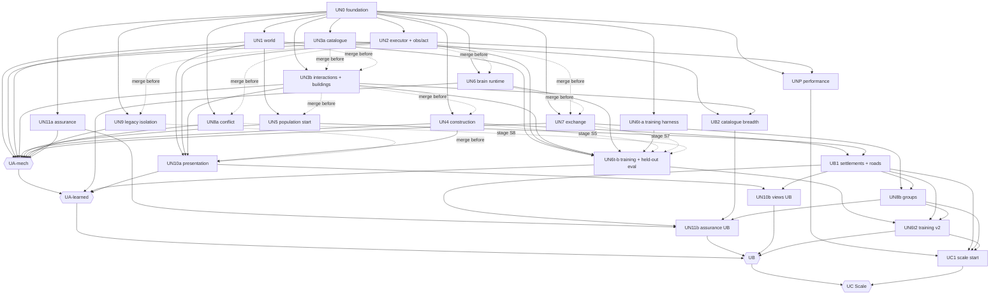

# Unification package index (owner D8 and D9, 28 Nov 2026)

The work packages for the **Unification milestone** under the controlling D9 architecture ([UNIFICATION_DESIGN.md §D9](UNIFICATION_DESIGN.md), "§D9") and its binding contracts ([SHARED_ARCHITECTURAL_CONTRACTS §23](../civdiv/SHARED_ARCHITECTURAL_CONTRACTS.md), "§23"). Precedence: [LATEST_OWNER_AMENDMENT.md](LATEST_OWNER_AMENDMENT.md) and owner decisions D9.1–D9.14 ([OWNER_DECISION_REGISTER](../civdiv/OWNER_DECISION_REGISTER.md)), then §D9 and §23, then the owner-added text kept verbatim below, then this index's §1 onwards. The lead operates the run as [CIVILISATION_AND_DIVINITY_RUNBOOK.md](../civdiv/CIVILISATION_AND_DIVINITY_RUNBOOK.md) says (worktrees, `--no-ff` merges, at most 6 package agents, at most 3 full `dotnet test` suites, at most 2 Unity runs, Opus/Sonnet, never Fable, never `main`). The workbook mapping is [CATALOGUE_MANIFEST.md](CATALOGUE_MANIFEST.md); the call-site evidence is [D9_CODE_CONFLICT_AUDIT.md](D9_CODE_CONFLICT_AUDIT.md); the code audit is [UNIFICATION_BASELINE.md](UNIFICATION_BASELINE.md).

**Prefix and names.** `UN` (U1–U6 are UI packages). Branch `unity/<id>` lower case (`unity/un3b`, `unity/un6t`), worktree `wt-lrs-<id>`. The package specs in [packages/](packages/) are rewritten from §2 below by the lead's Sonnet helpers before launch; where a spec and this index disagree, this index wins.

**Base.** `unity/poc` at `fb6ca85` (after `33a09e4`): save version 6, `MaxCand` 36, `PersonalCount` 40, five drives, I1a not merged; nothing of D9 is implemented. The old package list (UN0–UN11 of the D8 plan with UN6 "planner" and the D8 graph) is **obsolete** and replaced by §2–§5.

**The text from "Latest controlling package changes" to the end of §0.3 is owner-added and kept verbatim.** It uses the earlier package names; the mapping to the new set is §1.

---

## Latest controlling package changes (read before §0)

[Latest owner amendment](LATEST_OWNER_AMENDMENT.md) wins over all earlier package responsibilities, dependencies and gates. Use the existing UN numbers; the lead rebalances scope inside the 18-hour window. No new permanent ownership/permissions subsystem.

| Package | Revised responsibility |
|---|---|
| UN0 (Opus) | Freeze holder/location/provenance, primitive USE design/target/slot and communication/observation contracts, legacy isolation and catalogue IDs. No canonical title/permission in active physical executor. |
| UN1/2 (Sonnet) | Reachable need relief; environmental production, compatible operational collection shelter and physical storage requirements, no ownership veto. |
| UN3a/b (Opus) | Known design to site, contributed labour/materials, generic use, physical contents/occupancy and reservation/abandonment/death conservation; audit old rights branches. |
| UN4 (Sonnet) | 72 founders, hall accessible physically; group membership is social, not ownership or storage privilege. Founder profile attach only after UN6t; labelled fallback if needed. |
| UN5 (Opus) | Site and road geometry; actual local construction; proposals do not create finished roads before both settlements exist. |
| UN6a (Opus) | Shared controller, USE on design/location/site/person, physical conflict and transfer dispatch, no owner masking. Integrate with UN3/8; no high-level behaviours. |
| UN6t (Opus) | Prepare harness early; actual training against merged body/needs/interaction effects; held-out survival/construction and contested-resource curriculum, versioned artifact. Critical path for learned UA. |
| UN6b (Opus) | Learned sequences, local claims/expectations, delayed outcomes, social learning; integrate communication effects with UN8. |
| UN7 (Sonnet) | Map all catalogue rows; early objects, tools and domestic slice; flag ownership wording and unsafe/incomplete recipes as superseded/deferred. |
| UN8 (Opus) | Split: UN8a early minimal claims, offers/promises, independent giving, observed disputes and conflict memory hooks (UA); UN8b expanded informal cooperation/groups (UB). Keep no canonical owner or compulsory enforcement. |
| UN9 (Opus) | Disable Stage 3 and isolate old ownership/permission mechanics; audit legacy call paths with UN3/8 and preserve existing useful biological/divine/social features. |
| UN10 (Sonnet) | Same possession controls including construction and conflict; view physical contents and observed claims as distinct, needs and damage; no omniscient UI presented as NPC knowledge. |
| UN11 (Sonnet) | EC/EP/CF/TR/QA acceptance matrix in amendment; mechanical vs learned vs sustainable; ledger conservation and witness/claim provenance; final playable build. |

UN8a branch `unity/un8a` / worktree `wt-lrs-un8a` may prepare after UN0; integration needs UN6a and UN3a physical effects. UN6t harness may prepare after UN0; training/evaluation of the complete UA slice waits for integrated UN1/2/3a/6a/8a physical and social mechanics. UN6b may prepare on frozen interfaces, merge after training integration and UN8a. UN11a gates UA after UN4b/6t/6b/8a/9b/10a plus other prior UA prerequisites. UN8b after UA and UN5b/UN7 relevant effects; UB requires extended group, road and cultural experiments. The diagrams and estimates below are historical and must not override these edges. Lead must recalculate critical path and ensure no cycles; no expansion of concurrency or deadline.

## 0. Catalogue and embodiment amendment — governing schedule for the next 18-hour run

Use [God_of_the_Island_Core_Design.xlsx](God_of_the_Island_Core_Design.xlsx) and design §0.2 as controlling inputs. The legacy package descriptions, diagrams, hour estimates and detailed gates below are retained as a dependency/reference baseline; where they conflict with this section, this section governs. Before launching affected agents, the lead makes small targeted amendments to their actual `packages/UN*.md` specs, shared contracts, owner decision register, acceptance tests and DEV_LOG. These external files were not supplied with this amendment. Do not spend the run rewriting plans. No new standalone economic subsystem.

| Package | Amended deliverable / ownership | Dependencies and priority |
|---|---|---|
| UN0 (Opus) | Behaviour-neutral contracts: 12 primitive controls, typed targets/slots, facing/action progress, object/building/recipe/interaction definitions, needs extension, stable ID map, catalogue manifest schema, trainer observation/action seam. Validate actual catalogue count and ID capacity before R75. | Wave 0; critical; preserve old hashes. Freeze interfaces, not guessed content numbers. |
| UN1 (Sonnet) | Seven terrains, infinite forage, fish dice numbers via UN2; implement 12 need channels with reachable relief, safe water/sanitation path before activating thirst; herb access compatibility. | UN0; Wave 1. |
| UN2 (Sonnet) | Gradual physical raw lots; no extraction without designated operational building; fish roll integration. | UN0, merge after UN1. |
| UN3a/b (Opus) | Generic building capabilities, labour-only shelters, construction/collection/deposit/upgrade interaction effects, actual finite furnishings/occupancy; ownership, estate fix and interrupted reservations. | UN0, integrate UN1/2; core effects before UN6 autonomous integration. |
| UN4a/b (Sonnet) | 72 founders, varied consistent families, communal hall fits all, explicit founder assets, founding group, child initial learning state and trained adult profile attachment. | UN0; 4b needs UN1/3a/5a; policy attachment waits UN6t artifact or labelled fallback. |
| UN5a/b (Opus) | Geometry/site legality early; roads/new settlements via primitive interactions and actual contribution. | UN0; 5a early before 4b; 5b after 3/4b/5a. |
| UN6a (Opus) | Implement the single motor executor and candidate/observation adapter. Movement is local; all ordinary physical outcomes dispatched through shared interaction effects. | UN0, launch as soon as slot free (do not wait for all UN3); integrate collection/build effects with UN3a. |
| UN6t (Opus) | New split of UN6: headless training harness, versioned trained founder policy, held-out teacher-free evaluation, actual delayed learning and child observation experiment. | UN0 contract; can prepare harness while UN6a/UN3a/UN1 work, train against merged executor/effects/needs; integrate before claiming learned UA. Separate branch `unity/un6t`, worktree `wt-lrs-un6t`. |
| UN6b (Opus) | Brain-internal learned sequences, bounded memory/intentions, generalisation, interruptions, trade and construction; remove high-level goal bypasses. | UN6a, UN3b and UN6t evidence; may prepare independent tests earlier. |
| UN7 (Sonnet) | Catalogue normaliser/validator and dependency audit first; starter production/furnishing rows and generic interaction effects; extend the full Widelands/Sims web in dependency order. | UN0 for catalogue mapping; UN3a for runtime recipes; coordinate UN6a API. Start mapping in parallel, not after UA. |
| UN8 (Opus) | Informal groups via gestures, voluntary contributions, project sites; no forced organisation threshold. | UN4b/UN5b/UN3/UN6a; UB. |
| UN9a/b (Opus) | Disable independent Stage 3 AI/economy in both hosts; route possession and divine directives through primitive interface, preserve miracles. | UN0; 9b after UN4/UN6a; no duplicate brain. |
| UN10a/b (Sonnet) | Visible facing/steps, gestures, carried goods, furniture/occupancy, needs panel and shared possessed controls; later roads/groups. | UN1/2/3a/9a/6a for 10a; 5b/8 for 10b. Existing Unity token rules. |
| UN11a/b (Sonnet) | Catalogue coverage, motor/need/training/estate tests, autonomous vertical slice, analytics, replay, performance, demographic experiments and actual Windows build. | 11a after UA core integration, preparation in parallel; 11b after UB packages. |

### 0.1 Execution and priorities

Existing limits apply (six agents, three full .NET suites, controlled Unity token). Start UN0 first while lead runs baseline and catalogues the input. After UN0, prioritise UN1/2/3a/6a/9a and either UN7 mapping or UN4a as capacity permits; queue UN5a promptly before UN4b. UN6t may prepare trainer fixtures once interfaces frozen and needs configuration identified; give it a slot ahead of UB-only work. Merge validated catalogue foundations and physical effects before any trained policy claims; no competing frozen-file edits. Launch every ready high-priority package as slots free. Record actual hard dependencies and updated branch list; this table supersedes the original graph's UN6 and UN7 launch gates. Review shared surfaces and lead-owned ID/save changes. Keep old packages and regression tests, do not delete Stage 3. 

**UA first:** working unified mode with 72 people, six collection shelters, all terrain/forage/dice rules, shared motor executor, actual founder training experiment, autonomous survival and at least one construction/collection/exchange demonstration, needs definitions and a small working need-relief set (all enabled needs reachable), and a domestic vertical slice: make/obtain mat or bed, install, occupy and measure benefit. Full row mapping and honest coverage report. Target baseline Widelands chains sufficient to craft a primitive tool or furniture; no promise of every advanced ware. Do not call UA fully accepted if training or autonomous economy is missing. Label incomplete checkpoint separately rather than applying green release tag. 

**UB next:** expand validated catalogue recipes, furnishings and need interactions, learned specialisation/cultural transmission, group/road/settlement functionality, long-run and viability experiments. Full catalogue implementation is an incremental objective, not a reason to compromise core tests. Each object/building row has a status and evidence; any advanced chain without prerequisites remains staged or deferred. Include all 12 needs in coherent active scenario once water/sanitation and relief are verified. Preserve future industry, energy, currency and patents. Industry starts only after UB and credible autonomous multi-generation primitive production/trade/viability, or explicit owner decision on evidence. A report alone is insufficient.

**Timebox:** original 53 agent-hour / 17–20 elapsed-hour UA estimate predates this larger scope and is not reliable for the amended run. Use 18 hours as the session budget, with final ~2 hours reserved for integration, regression, replay, build and report. Do not start a package that cannot safely be reviewed/merged before cutoff; preserve partial branches and a precise handover. Prioritise real working slices over breadth; do not silently reduce the tests or claim full learned civilisation. No requirement to finish UB in one run.

### 0.2 Additional acceptance rows and reporting

Use CATALOG-1, MOTOR-1/2, TRAIN-1/2, NEED-1, ECON-1/2 from design §0.2.5. UN11 records mechanical implementation, autonomous demonstration and sustainability separately. Compare trained/untrained controls and child exposed/unexposed, held-out seeds; distinguish scripted teacher traces from evaluation. Report catalogue status row-by-row (12 controls, 12 needs, 138 objects, 65 buildings), active vs defined needs, actual learned policies/versions, recipe/interaction coverage, unresolved bootstrap dependencies, asset and goods reconciliation, population curves and observed specialisation. Final reports include full/targeted test counts, failures/skips/not run, hashes, save/replay parity, build path and performance. Preserve the 20-seed demographic follow-up; three-seed smoke is not proof of viability.

### 0.3 Lead rulings superseding earlier defaults

Before UN0 merges: reconcile R75 with actual catalogue ID needs (no blind 96-slot cap); U-P2 only neutral foundation/all behavioral changes off; U2 excludes founder lots; sea gets numbers; hall accommodates all 12; standalone Hut off; varied families; fix estate/group ownership; interruptible storage reservation; no direct high-level verbs in unified policy; explicit user/brain control equivalence; keep all requested needs, activate only reachable relief; secondary sources validated separately from Catan raws. Record owner requirements vs proposed defaults, including unresolved values. Update the original acceptance mapping rather than delete U1–U14/B1–B11. This is a targeted amendment; retain the runbook's branch, merge, safety and push policies.

---

## 1. From the owner-added names to the D9 package set

| Owner-added name (above) | D9 package(s) | Note |
|---|---|---|
| UN0 | **UN0** | plus system-level legacy isolation, physical goods without title, schemas for executor, observation and interactions |
| UN1/2 (geography, raw materialisation, needs) | **UN1** | one Sonnet package: world, forage, water, dice materialisation, need rates |
| UN3a/b (buildings, construction) | **UN3a** catalogue, **UN3b** interactions and buildings, **UN4** construction | the catalogue loader is separated so it starts at once |
| UN4a/b (population start) | **UN5** | |
| UN5a/b (settlements, roads) | **UB1** | UB; the six founding settlements are UN5 |
| UN6a (shared controller) | **UN2** | executor and observation/action interface |
| UN6b (learned sequences, social learning) | **UN6** | brain runtime, overlay, knowledge, cultural transmission |
| UN6t | **UN6t** | unchanged role; critical path |
| UN7 (catalogue mapping, domestic slice) | **UN3a** (mapping) + **UN3b** (domestic interactions) + **UB2** (breadth) | |
| UN8 → UN8a / UN8b | **UN7** exchange and communication, **UN8a** conflict slice, **UN8b** groups (UB) | the owner-added UN8a "claims, offers, promises, giving" is UN7 here |
| UN9a/b | **UN9** | one package |
| UN10a/b | **UN10a**, **UN10b** | |
| UN11a/b | **UN11a**, **UN11b** | |
| (new, owner 28 Nov scale target) | **UNP** performance, **UC** checkpoint | lower urgency; never delays UA |

## 2. Package set

Tier **UA** = needed for the UA checkpoints; **UB** = expanding society; **UC** = scale. Effort = agent-hours (estimates). "Hard" prerequisites must be **merged** before the package starts; "merge-after" packages may start earlier but merge only after the named package. Owned areas are the only files a package may change (plus flagged additive hunks named in its spec); frozen surfaces belong to UN0 and the lead (§23.0, §23.15).

| ID | Objective | Tier | Agent | Hard prerequisites | Merge-after | Owned areas | Effort |
|---|---|---|---|---|---|---|---|
| **UN0** | Foundation, behaviour-neutral when off: `Unification` switch block and `Unified.On`; `GodState.Unification`; hash part; save null-acceptance; every id of §23.4 (wares 72–93, `PersonalCount` 160, ledger 16 slots, reasons, `BinKind`, `MoveReason`, `ObjClass`, `GestureAct.Claim`, `ControlInputKind.Primitive`, domains 80–88); **physical goods without title** inside `Goods` (§23.4) with origin table; system-install gates and the `PersonTick` site (§23.3); schemas (`ObsSchema`, `ActSchema`, `CatalogueDefs`, `EffectKind`, entity records §23.8, `ISpatialIndex`, `IPrimitivePolicy`, `EffectRegistry`); invariants U-C1–U-C6; pins U-P1, U-P2, U-P3 (static) | UA | **Opus** | `unity/poc` green baseline | — | all frozen files of §23.15 row 1; `Unified/Schema/*`, `Unified/UnifiedState.cs`, `Unified/UnifiedHooks.cs`, `Unified/Invariants.cs`; tests `UN0*` | 3.7 |
| **UN1** | World: seven terrains and sea ring (54-hex default, radius configurable; spike first), coast nodes; forage places (seven foods, infinite, time-limited, rabbit ×3), herbs; fresh-water points and salt water (§D9.5 G3); dice allowance → gradual materialisation on raw nodes incl. sea fish; environment books; the seven new need channels' rates and decay; effect handlers `Forage`, `DrinkWash`; world queries through `ISpatialIndex` | UA | Sonnet | UN0 | — | `Unified/World/*`, `Unified/Needs/*`, `EffectHandlers.UN1.cs`, `UnifiedState.UN1.cs`, flagged additive hunk in `Board/BoardGenerator.cs`; scenario `unif_world`; tests `UN1*` | 3.5 |
| **UN2** | Primitive executor for the 12 controls (`Motor`, §23.5): facing, steps, TAKE/DROP rules incl. held-out, `Resisted`, grab from the incapacitated; SLEEP, WAIT, GESTURE (`Messages.Emit` + `MsgExt`); USE resolver over catalogue `InteractionDef` rows with durations, progress, interruption; legality masks; observation encoder `Percept` (`Obs v1`) with a simple `ISpatialIndex`; possession adapter (`ControlInputKind.Primitive` hook); fixture harness for scripted primitive streams; QA-01, MOTOR-1 | UA | **Opus** | UN0 | — | `Unified/Motor/*`, `Unified/Percept/*`, `Unified/Spatial/SimpleSpatialIndex.cs`, `UnifiedHooks.UN2.cs`, `DotNet/God.Runner.Tests/Support/PrimitiveFixture.cs`; tests `UN2*`, `Motor_*` | 4.0 |
| **UN3a** | Catalogue: reviewed `docs/unification/catalogue/catalogue.json` (all 12 + 12 + 138 + 65 rows with stage, fix codes and status; UA-initial 39 rows with corrections N1/A–I applied and §D9.5 numbers); dependency-free generator/validator `DotNet/God.Catalogue`; generated tables; closure, cycle and reachability audit; CATALOG-1 report | UA | Sonnet | UN0 | — | `docs/unification/catalogue/*`, `DotNet/God.Catalogue/*`, `Unified/Catalogue/Generated/*`, status columns of `CATALOGUE_MANIFEST.md`; tests `Catalogue_*` | 2.5 |
| **UN3b** | Interactions and buildings: `Building` capabilities (storage, sleeping spots, fixtures, workstation in/out, condition, occupancy); effects `Eat`, `NeedRelief`, `CollectRaw` (physical gate + reservations with expiry), `Deposit`, `Install`, `Occupy`, `WorkInput`, `RecipeWork`, `Fuel`, `Relieve`, `Play`; hearth, well, carpenter, latrine, hall capabilities; EP-01, EP-02 mechanical, NEED-1 relief, ECON-1 mechanical (shelter → collect → carpenter → stool/bed → install → occupy → measured benefit) | UA | **Opus** | UN0 | UN1, UN3a | `Unified/Buildings/*`, `Unified/Interactions/Effects.UN3b.cs`, `UnifiedState.UN3b.cs`; tests `UN3b*`, `EP01*`, `EP02*`, `Need1*`, `Econ1*` | 4.0 |
| **UN4** | Construction: `Sites.Place` by `USE` with a known design on a valid placement (row rules, coast/terrain, footprint, development area), `Contribute`, `Labour` (tool multipliers), cooperation, interruption and resumption, completion → `Buildings.Create`, upgrades L2/L3 as upgrade sites, damage/destruction drops contents; provenance only; EC-01; EP-05 site parts | UA | **Opus** | UN0 | UN3b | `Unified/Construction/*`, `EffectHandlers.UN4.cs`, `UnifiedState.UN4.cs`; tests `UN4*`, `EC01*` | 3.0 |
| **UN5** | Population start: six tribes × (7 adults + 5 children), deterministic varied families (Founders generator "Tribal"), temperaments, founder knowledge sets and skills (§D9.5 Start), six founding settlements on Catan vertices, completed hall per tribe with the founder endowment ledger, founder food; `TribeOrder` display table; U1 | UA | Sonnet | UN0, UN1 | UN3b | `Unified/Start/*`, `Population/Founders.Tribal.cs` (new file), scenarios `unif_start*`; tests `UN5*` | 3.0 |
| **UN6** | Brain runtime: deterministic integer inference (int16, ≤ 20k MAC, ≤ 4 KB state), artifact loader with hash check, `BrainState` (recurrent state, memory, knowledge, skills), `IPrimitivePolicy` implementations (Untrained, Trained, labelled Fallback), decision at action completion, per-person associative overlay on `AssociationStore`/`Learner` with need-based credit, knowledge acquisition by own success, observation and teaching, children's start state, optional bounded planning (off), `Brain.AddClaim` API; fills `UnifiedHooks.PersonTick` | UA | **Opus** | UN0 | UN2 | `Unified/Brain/*` except `Artifacts/`, `UnifiedHooks.UN6.cs`; tests `UN6*`, `Brain_*` | 3.5 |
| **UN6t** | Founder training: (a) harness from H4.6 on stubs: `DotNet/God.Train` (vectorised headless envs on the real sim, curriculum S1–S8, teacher labelled and training-only, behaviour cloning + evolution strategies, quantised evaluation), evaluation harness, **thresholds file committed before any held-out run** (§D9.2 c); (b) training against merged effects, artifact `FounderPolicyV1.g.cs` (+ V2 if S7–S8 land), held-out evaluation with untrained and frozen controls, TR-01 report; TR-02 initial child experiment | UA (critical path) | **Opus** | (a) UN0; (b) UN1, UN2, UN3b, UN6 | (b) S5 needs UN4; S7 UN7; S8 UN8a | `DotNet/God.Train/*`, `Unified/Brain/Artifacts/*`, `docs/unification/TRAINING_THRESHOLDS.md`, `docs/runs/TRAINING_REPORT.md`; tests `TR01*`, `TR02*` | 3 + 7 (incl. ~4 h compute) |
| **UN7** | Exchange and communication: GESTURE referents and correlation id (`MsgExt`), `HoldOut` effect and hand-over completion by `TAKE`, lapse, `TakeResisted`/`Grabbed` events, claims as beliefs and their communication, observer belief, trust and reputation updates from perception only (feeding M5 `SocialMemory` without its `Held`/title paths); EP-03, EP-04 mechanical | UA | **Opus** | UN0 | UN2, UN6 | `Unified/Exchange/*`, `EffectHandlers.UN7.cs`, `UnifiedState.UN7.cs`; tests `UN7*`, `EP03*`, `EP04*` | 3.0 |
| **UN8a** | Conflict slice: `Strike` (Duel maths on NPC stats, `Bodies.Damage` Violence), `Equip` (generic defence), `Treat` (herbs → `Bodies.Heal`), fatigue cost, pain, witness-local fear and observation records, victim memory only of a perceived actor, identity-neutral; CF-01 mechanical; CF-02 measurement harness (aggression, avoidance, retaliation, non-retaliation, response to betrayal) | UA | **Opus** | UN0 | UN2 | `Unified/Conflict/*`, `EffectHandlers.UN8a.cs`, `UnifiedState.UN8a.cs`; tests `UN8a*`, `CF01*`, `CF02*` | 2.5 |
| **UN9** | Legacy isolation and decoupling: hosts (`GodBootstrap`, `AiHost`, menu "Living island (you as a god)" = unified once UA-mech passes), no faction AI/VP/HQ elimination/stockpiles/circles in unified games; M4 estates, executor, `StoreAccess`, `SenseBins`, household economic verbs; M5 `Held`/own-lot filters; C1/C3/C6/C7; `Ownership.Classify`, lost property; divine own-lot filters; compulsion through a labelled `CompulsionDriver` on `Motor`; Stage 3 regression scenario and pins; warehouse legacy-only labels; U-P3 runtime; EP-05 death conservation | UA | **Opus** | UN0 | UN2 | `Game/Boot/*`, `Game/Menu/GameMenu.cs`, flagged gate hunks in the files of the audit §8 (named in its spec), `Unified/Legacy/*`, Stage 3 regression scenario files; tests `UN9*`, `EP05*`, `Unified_NoStage3*` | 3.0 |
| **UN10a** | Presentation: continuous terrain (7 terrains, coast, sea), forage, water and raw nodes, buildings, sites (progress), fixtures, carried and held-out items, primitive animation (turn, step, use, gesture, sleep, strike), 12-need panel, possession HUD with all 12 controls incl. design placement and strike, brain badge (artifact version or **UNTRAINED FALLBACK**); no omniscient UI shown as NPC knowledge | UA | Sonnet (Unity token) | UN1, UN2, UN3b, UN4 | UN9 | `Assets/God/Game/Unified/*`, PlayMode tests | 4.0 |
| **UN11a** | Assurance and analytics: migrations 0044–0046, unified mappings, facts separating events, observations and claims (QA-02), reconciliation, unified save/replay parity (U-P6) and U-P5, the EC/EP/CF/TR/QA/CATALOG/MOTOR/NEED/ECON matrix as runnable tests, `unif_*` runs (72 people, seeds 1–3, 20 days), benchmarks at 72/600/1,200, `docs/runs/UA_REPORT.md` with separate mechanical, learned and long-run columns | UA | Sonnet | prep: UN0; UA-mech gate: UN1–UN5, UN7, UN8a, UN9; UA-learned gate: + UN6, UN6t, UN10a | — | `DotNet/God.Runner/Warehouse/Migrations/0044–0046`, `UNnMappings.cs` completion, `DotNet/God.Runner/Scenarios/unif_*`, `DotNet/God.Runner.Tests/UA*`, `docs/runs/UA_*` | 3.5 |
| **UNP** | Performance (scale rule, lower urgency): `DotNet/God.Bench` (72/600/1,200/2,000 people, legacy and unified), profile, a grid `ISpatialIndex` implementation, decision staggering by sim state, allocation removal on unified hot paths; legacy think-loop work only if hash-neutral | UC (runs in UA window if a slot is free) | **Opus** | UN0, UN2 | UN6 | `DotNet/God.Bench/*`, `Unified/Spatial/GridSpatialIndex.cs`, `docs/runs/PERF_*`; hash-neutral hunks named in its spec | 3.5 |
| **UB1** | Settlements and roads: settlement placement (Catan vertex, distance rule, development areas) and road edges between existing settlements only, both as construction sites with real materials and labour (§D9.5 G11); planned routes as claims; walking speed on roads | UB | **Opus** | UN4, UN5 | — | `Unified/Settlements/*`, `Unified/Roads/*` | 3.0 |
| **UB2** | Catalogue breadth: UB object and building rows in dependency order (reed yard, seed plot, pottery, stone workshop, tannery, weaving mill, sheep pen, charcoal kiln, lime kiln, water jug, soft armour, stone spear), furnishings and leisure interactions; ware ids 94+ | UB | Sonnet | UN3a, UN3b | — | `docs/unification/catalogue/*` additions, generated tables, `Effects.UB2.cs` | 3.0 |
| **UN8b** | Informal groups on D9 rules: proposal by gesture and referents, voluntary joining, real contributions, withdrawal and free-riding, group raids and defence as group behaviour, no power over goods, no automatic organisation | UB | **Opus** | UN7, UB1 | — | `Unified/Groups/*` | 3.0 |
| **UN6t2** | Training increment V2/V3: curriculum for roads, settlements, groups and contested multi-group encounters; re-evaluation | UB | **Opus** | UN6t, UB1, UN8b | — | as UN6t | 4.0 |
| **UN10b** | Views for settlements, roads, groups, conflict at scale | UB | Sonnet (token) | UN10a, UB1 | UN8b | `Assets/God/Game/Unified/*` (UB files) | 2.0 |
| **UN11b** | UB assurance: long run (seeds 1–3, 30 sim years, no god), V-experiments, 20-seed demographic evaluation, `UB_REPORT.md` | UB | Sonnet | UN11a, UB1, UB2, UN8b | — | as UN11a (UB files), migration 0047 | 3.0 |
| **UC1** | Scale start: large island (radius 6+), 3–4 settlements per tribe, 100–200 people per tribe, sustained inter-tribe conflict experiments | UC | Sonnet (+ Opus review) | UNP, UB1, UN8b, UN6t2 | — | `Unified/Start/*` (UC files), scenarios `unif_scale*` | 3.0 |

Opus: UN0, UN2, UN3b, UN4, UN6, UN6t, UN7, UN8a, UN9, UNP, UB1, UN8b, UN6t2. Sonnet: UN1, UN3a, UN5, UN10a, UN11a, UB2, UN10b, UN11b, UC1. **No package uses Fable.** UA total ≈ 55 agent-hours over at most six slots.

## 3. Dependency graph (acyclic)

Adjacency table (H = hard prerequisite, must be merged before start; M = merge-after; S = curriculum stage waits; blank = none). Every edge points from an earlier to a later row: the graph is acyclic.

| Package | UN0 | UN1 | UN2 | UN3a | UN3b | UN4 | UN5 | UN6 | UN6t-a | UN7 | UN8a | UN9 | UN10a | UN11a | UB1 | UB2 | UN8b |
|---|---|---|---|---|---|---|---|---|---|---|---|---|---|---|---|---|---|
| UN1 | H | | | | | | | | | | | | | | | | |
| UN2 | H | | | | | | | | | | | | | | | | |
| UN3a | H | | | | | | | | | | | | | | | | |
| UN3b | H | M | | M | | | | | | | | | | | | | |
| UN4 | H | | | | M | | | | | | | | | | | | |
| UN5 | H | H | | | M | | | | | | | | | | | | |
| UN6 | H | | M | | | | | | | | | | | | | | |
| UN6t-a | H | | | | | | | | | | | | | | | | |
| UN6t-b | H | H | H | | H | S | | H | H | S | S | | | | | | |
| UN7 | H | | M | | | | | M | | | | | | | | | |
| UN8a | H | | M | | | | | | | | | | | | | | |
| UN9 | H | | M | | | | | | | | | | | | | | |
| UN10a | H | H | H | | H | H | | | | | | M | | | | | |
| UN11a (UA-mech gate) | H | H | H | H | H | H | H | | | H | H | H | | | | | |
| UN11a (UA-learned gate) | as above + UN6, UN6t-b, UN10a | | | | | | | | | | | | | | | | |
| UNP | H | | H | | | | | M | | | | | | | | | |
| UB1 | H | | | | | H | H | | | | | | | | | | |
| UB2 | H | | | H | H | | | | | | | | | | | | |
| UN8b | H | | | | | | | | | H | | | | | H | | |
| UN6t2 | UN6t-b, UB1, UN8b (H) | | | | | | | | | | | | | | | | |
| UN10b | UN10a, UB1 (H); UN8b (M) | | | | | | | | | | | | | | | | |
| UN11b | UN11a, UB1, UB2, UN8b (H) | | | | | | | | | | | | | | | | |
| UC1 | UNP, UB1, UN8b, UN6t2 (H) | | | | | | | | | | | | | | | | |

## 4. Waves within the 18-hour window

Hours are elapsed from the start of the run (H0) and are planning estimates; position is found from git and DEV_LOG, not the clock. Slots never exceed six package agents; the lead is not counted. **Unity token** (one package agent at a time, plus the lead's `wt-lrs-ckpt`): UN0 (about H3.4–H4.0, batch compile and EditMode only), UN9 (H10.6–H11.1, batch smoke of both hosts), UN10a (H11.6–H14.8). Full `dotnet test` suites: at most three at once, the lead's merge suite first; UN6t's training rollouts use the runner, not the suite.

| Wave | Window | Slot 1 | Slot 2 | Slot 3 | Slot 4 | Slot 5 | Slot 6 |
|---|---|---|---|---|---|---|---|
| W0 | H0.0–H4.6 | **UN0** (H0.3–H4.0; merge gate H4.0–H4.6) | — | — | — | — | — |
| W1 | H4.6–H8.6 | **UN2** (→H8.6) | **UN6** (→H8.1) | **UN1** (→H8.1) | **UN3b** (→H8.6) | **UN3a** (→H7.1), then **UN4** (H7.4→H10.4) | **UN6t-a** (→H8.0, keeps the slot) |
| W2 | H8.1–H11.6 | UN2 → **UN7** (H8.6→H11.6) | UN6 → **UN9** (H8.1→H11.1) | UN1 → **UN5** (H8.5→H11.5) | UN3b → **UN8a** (H8.6→H11.1) | UN4 (→H10.4), then **UN10a** (H10.8→H14.8) | **UN6t-b** training from H9.5 |
| W3 | H11.1–H15.4 | UN7 (→H11.6), then free (UB1 only if UA-learned is safe; default: not started) | UN9 → **UN11a** (H11.1→H16.0) | UN5 (→H11.5), then free | UN8a → **UNP** (H11.1→H14.6; first to cut) | UN10a | UN6t-b: freeze H14.0, held-out eval H14.0–H15.0, merge H15.0–H15.4 |
| W4 | H15.4–H18.0 | UA-learned gate H15.4–H16.0; **protected final window H16.0–H18.0** (no new package; fixes for red gates only) | | | | | |

**Training timeline inside UN6t-b:** S1–S4 from H9.5 (after UN1, UN2, UN3b and UN6 merge); S5–S6 from H10.8 (UN4 merged); S8 from H11.6 (UN8a); S7 from H12.3 (UN7). Artifact freeze **H14.0** whatever its state; held-out evaluation H14.0–H15.0 (20 small seeds × trained/frozen/untrained, 3 full 72-person seeds × 20 days); `TRAINING_REPORT.md` H15.0. S7–S8 untrained at freeze are reported as not trained; T7 and CF-02 learned are then "not evaluated", not passed.

## 5. Critical path (estimated)

UN0 (H0.3 → H4.6 merged) → UN2 (H4.6 → H9.0 merged) → UN3b and UN6 merged (H9.5) → **UN6t-b training** (H9.5 → H14.0) → held-out evaluation (H14.0 → H15.0) → artifact merge (H15.4) → **UA-learned gate** (H15.4 → H16.0) → **final build and assurance window** (H16.0 → H18.0). Slack is about zero; the training freeze at H14.0 and the window at H16.0 are fixed. Near-critical: UN4 (S5 needs it by about H11) and UN10a (needed for the UA-learned gate by H15.2).

## 6. Merge order and gates

The lead merges in `wt-lrs` into `unity/poc` with `--no-ff`, at most two packages with disjoint files per suite run.

| # | Merge (≈ hour) | Gate beyond the standard gate |
|---|---|---|
| 1 | **UN0** (H4.6) | lead reads every frozen-file hunk; U-P1 exact (all base parts, three Stage 3 hashes, P1/P4/P8); U-P2; U-P3 static; `Wares_LayoutNeutral`, `Ledger_WideningNeutral`, `Unified_GoodsNoTitle`, U-C1–U-C6 in a stub unified run; Unity batch compile 0 errors and EditMode green; bench within 3 %; §23 recorded as ruling; **no save bump** |
| 2 | **UN3a** (H7.4) | catalogue tests; CATALOG-1 report; workbook SHA pinned |
| 3 | **UN1** (H8.5) | board spike reviewed (54 hexes and radius 6 generate); forage/water reachability; dice allowance conservation; U-P1 |
| 4 | **UN2** (H9.0) | MOTOR-1, U-P4 (origin neutrality), U-P6 stub, possession adapter test, no `NodePather` in unified decision path (static) |
| 5 | **UN6** + **UN3b** (H9.5) | UN6: inference determinism and budget test, artifact hash refusal, Untrained/Fallback labelled; UN3b: EP-01, EP-02, NEED-1 relief, ECON-1 mechanical |
| 6 | **UN4** (H10.8) | EC-01 (multiple contributors, interruption, conservation, no output before completion) |
| 7 | **UN9** + **UN8a** (H11.6) | UN9: `Unified_NoStage3*`, U-P3 runtime, EP-05, both hosts give equal hashes, Stage 3 regression pins; UN8a: CF-01 |
| 8 | **UN5** (H11.9) | U1 composition, families valid, hall sleeps 12, endowment ledgered, U-C1 from tick 0 |
| 9 | **UN7** (H12.3) | EP-03 mechanical (fulfil, partial, defect; no second leg), EP-04 |
| 10 | **UN11a (mechanical part)** → **UA-mech** (H13.0–H13.5) | §7 UA-mech list; lead bumps save version 6 → 7 in this merge commit with DEV_LOG re-pin; tag `unif-ua-mech` |
| 11 | **UNP** (≈ H14.8, only if neutral) | bench report; hash-neutral; otherwise left on its branch |
| 12 | **UN10a** (H15.2) | PlayMode green in `wt-lrs-ckpt`; screenshots; badge shows artifact or fallback |
| 13 | **UN6t** (H15.4) | lead re-runs two held-out seeds independently and checks the thresholds file hash predates the evaluation commit; artifact hash, `Obs`/`Act` schema hash and catalogue hash match `unity/poc`; set `Brain.Kind = 1` in `unif_*` only if TR-01 passed, else `Kind = 2` labelled |
| 14 | **UN11a (learned part)** → **UA-learned** (H15.4–H16.0) | §7 UA-learned list; tag `unif-ua` only if green |

**Standard gate for every merge** (runbook §5): the branch has merged current `unity/poc`; the agent's counts in its DEV_LOG record; `git diff --stat unity/poc...unity/<id>` inside its owned areas plus declared flagged hunks; `AgentScripts/check-game-compile.ps1` 0 errors; `dotnet test DotNet -c Release` green; U-P1, P1, P4, P8 and the three Stage 3 hashes unchanged; the package's headline test re-run by the lead. A red baseline is fixed before anything merges.

## 7. Checkpoints

### UA-mech "Primitive society, mechanical evidence"

Packages UN0–UN5, UN7, UN8a, UN9, UN11a (mechanical part). Evidence is from scripted primitive streams and fixtures (labelled `Fixture`), never presented as autonomous behaviour: EC-01, EP-01, EP-02, EP-03 (mechanical), EP-04, EP-05, CF-01, QA-01, QA-02, CATALOG-1, MOTOR-1, MOTOR-2, NEED-1, ECON-1 (mechanical), ECON-2 regressions, U1, U-P1–U-P6; 72-person unified start runs 20 days deterministically with the untrained brain (outcome reported, not judged); save v7 round trip. Tag `unif-ua-mech`.

### UA-learned "Primitive society, trained founders"

Adds UN6, UN6t, UN10a. Requires **TR-01 passed honestly** against the thresholds committed before evaluation (§D9.2 c), plus EC-02 (autonomous design and site choice, held-out layouts, no fixed sequence), EP-03 learned (reported), CF-02 evaluation report (strategies measured, never required), TR-02 initial experiment (reported, failures included), QA-01 for trained actors, Unity EditMode/PlayMode, the unified Windows player build (batchmode), `docs/runs/UA_REPORT.md` with separate **mechanical**, **learned/autonomous** and **long-run viability** columns. Tag `unif-ua`; the lead pushes tested `unity/poc` and package branches (never `main`).

**A failed training gate means UA-learned is not green.** It is reported as "UA-learned: not passed" with the metrics, the artifact and the cause; the game may ship with `Brain.Kind = Fallback` **visibly labelled** in the save, the HUD badge and every report; a scripted controller or a primitive wrapper around old `Eat/Flee/Build` rules is never reported as trained. UA-mech may still be green.

### UB "Expanding society"

UB1, UB2, UN8b, UN6t2, UN10b, UN11b: settlements and roads built by people between existing settlements, broader recipes and furnishings, informal groups, trained use of them, long run (seeds 1–3, 30 sim years, no god), 20-seed demography. Industry (I1a…) stays deferred until UB plus credible autonomous primitive viability, unless the owner decides otherwise (D9.14).

### UC "Scale" (owner decision D10, after UB)

Six tribes, 3–4 settlements each, 100–200 people per tribe (600–1,200 total) on an enlarged island with sustained back-and-forth conflict emerging from individuals and groups (no faction AI). Gate (L): 1,200 people with trained-brain inference at ≥ 100 ticks/s headless and ≥ 20 ticks/s in the player; long run with inter-tribe conflict measured. **What every UA package does now so UC is not blocked:** UN0 sizes nothing by tribe count, board size or population (lists, configuration paths of §23.1); UN1 generates any radius (tested 4 and 6) and multiple settlement corners per tribe; UN2 perceives only through `ISpatialIndex`, cost O(persons) per tick, no all-pairs scan; UN3b/UN4 process only active sites, reservations and workstations; UN5 generator takes tribe count, sizes and settlements per tribe from configuration; UN6 keeps the inference and state budget and decides only on action completion (staggering by sim state, never the camera); UN7/UN8a find witnesses through the spatial index; UN10a draws with instancing and level of detail; UN11a tracks benchmarks at 72, 600 and 1,200 people from UA on (baseline before trained-brain inference: about 1,080 ticks/s at 500 and 384 ticks/s at 1,000).

## 8. Cut plan by hour

Never cut: training honesty (thresholds committed before evaluation, held-out seeds, untrained and frozen controls, honest failure reporting), determinism (U-P1, Stage 3 pins, save and replay exactness) and the protected final window H16.0–H18.0.

| Hour | If behind | Drop or shrink (in this order) |
|---|---|---|
| any | — | UB and UC packages never start in this run unless UA-learned is green before H14 |
| H6.0 | UN0 not merged | UNP is cut; UN10a shrinks to hex-coloured terrain, people, sites, buildings, HUD badge and primitive possession |
| H9.5 | UN2/UN3b/UN6 not merged | UN3b drops `Play` and `Fun` relief content (Fun channel inactive, recorded); UN8a drops `Equip`; UN7 drops claims communication (hold-out and referents stay) |
| H11.0 | training not started | S7–S8 dropped from artifact V1 (T7, EP-03 learned, CF-02 learned reported "not evaluated"); TR-02 reduced to one matched-pair experiment |
| H12.5 | UN5 or UN7 not merged | UN5 families simplified to fixed valid patterns; UN7 merges hold-out only; UA-mech proceeds without the missing rows marked "not run" |
| H14.0 | — | **artifact freeze**; no further training in this run |
| H14.5 | UN10a not merged | merge what works behind a flag; PlayMode limited to boot, possession and badge |
| H15.0 | held-out evaluation not finished | evaluate the 20 small seeds only; T6 "not run" ⇒ UA-learned not green |
| H16.0 | anything | no merges except fixes for red gates; build, full suite, pins, replay, reports |

## 9. Neutrality pins

As §23.2: U-P1 (every package and merge), U-P2 (UN0; re-run UN9, UN11a), U-P3 (UN0 static, UN9 runtime), U-P4 (UN2; re-run UN6, UN9, UN11a), U-P5 (UN11a), U-P6 (UN2 stub, UN11a full), P1, P4, P8 and present P2/P3/P5/P9, Stage 3 hashes `12be0f64cefc59f1`, `4bd54b271857a803`, `0a66415b389d7a87`. Hashes move only at declared re-pins (UA-mech save bump is one), recorded by the lead.

## 10. Acceptance map

| Row | Short statement | Owner (evidence) | Checkpoint |
|---|---|---|---|
| EC-01 | L1 shelters: zero materials, real work, no output before completion, contributors and interruptions conserve | UN4 (UN11a) | UA-mech |
| EC-02 | known designs and own site choice, held-out layouts, no fixed sequence | UN6t (UN11a) | UA-learned |
| EP-01 | take from any accessible container regardless of legacy fields; physical constraints hold | UN3b, UN9 | UA-mech |
| EP-02 | shared hall/shelter, concealed cache unknown to others, contested claims coexist, no owner veto, full/expired destination retains goods | UN3b, UN7 | UA-mech |
| EP-03 | offer/promise + one hand-over; fulfil, partial, defect; no second leg | UN7 (mech), UN6t (learned) | UA-mech and UA-learned |
| EP-04 | unwitnessed removal hides the actor; differing interpretations and claims stay separate | UN7, UN8a | UA-mech |
| EP-05 | death, abandoned site, damage, interruption, disputed container conserve goods and locations | UN9, UN4, UN3b | UA-mech |
| CF-01 | persistent person can attack same/other tribe by USE; pain, injury, death; retreat; no faction command | UN8a | UA-mech |
| CF-02 | contested-resource encounters measured on held-out seeds; variants compared; no scripted strategy | UN8a harness, UN6t | UA evaluation (reported); UB |
| TR-01 | versioned artifact; teacher-free survival and basic construction/collection/interaction on held-out maps vs predeclared thresholds and controls | UN6t | UA-learned |
| TR-02 | exposed vs matched children; transfer and retention without copying memories; failures reported | UN6, UN6t | UA (initial), UB |
| QA-01 | identical primitive streams give identical physics for autonomous, possessed and test actors; legacy hashes; replay/save exact | UN2, UN11a | UA, UB |
| QA-02 | analytics separate events, observations, claims, promises and disputes; no theft or legitimate-owner fact | UN11a, UN9 | UA, UB |
| CATALOG-1 | every workbook row mapped with status; deterministic export; checks | UN3a | UA-mech |
| MOTOR-1/2 | every act is a validated primitive; distinct goods/targets for eat, collect/deposit, build/upgrade, produce/install, occupy, wash, sanitation | UN2, UN3b | UA-mech |
| NEED-1 | 12 channels defined, bounded, exercised; enabled channels have reachable relief | UN1, UN3b | UA-mech |
| ECON-1 | shelter → tool or furniture → exchange → install → measured benefit; no injected goods except founder endowment | UN3b, UN7 (mech); UN6t (learned, reported) | UA-mech; UA-learned reported |
| ECON-2 | legacy regressions and divine/possession in unified mode | UN9 | UA-mech |
| U1–U14, B1–B11 | kept, read through the rows above (§D9.8) | as above | as above |

## 11. Explicitly deferred

Industry, knowledge, money, electricity, vehicles, boats, waste chains beyond the latrine, patents, formal institutions, courts and policing, faction military, recipe invention, animal biology and breeding, new pair formation (UB), standalone family hut (owner question, R73), deletion of Stage 3 code.

## 12. Lead decisions recorded with this index (defaults; see §D9 and §23)

R75/R76 numbering withdrawn in favour of §23.4 (wares 72–159, `PersonalCount` 160, no `MaxCand` change, no new verbs); unification events 1200–1399 and domains 80–88; migrations 0044–0047 to UN11; save 6 → 7 at UA-mech; C# trainer primary; held-out seeds 900001–900020; thresholds T1–T7; artifact embedded as generated C#; hall endowment G6; natural water G3; settlement and road costs G11; scale target UC with 100–200 people per tribe. Owner-level open questions: §D9.7 (inheritance of the trained network; standalone hut).
