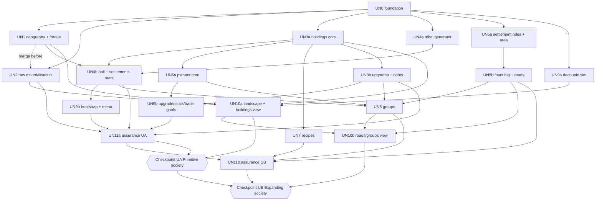

# Unification package index (owner D8, 28 Nov 2026)

The list of work packages for the **Unification milestone**: making the artificial world one simulation (owner decisions D8.1–D8.18 in [../civdiv/OWNER_DECISION_REGISTER.md](../civdiv/OWNER_DECISION_REGISTER.md)). It follows the design ([UNIFICATION_DESIGN.md](UNIFICATION_DESIGN.md), "the design") and the code audit ([UNIFICATION_BASELINE.md](UNIFICATION_BASELINE.md), "the audit") and is operated by the lead exactly as [../civdiv/CIVILISATION_AND_DIVINITY_RUNBOOK.md](../civdiv/CIVILISATION_AND_DIVINITY_RUNBOOK.md) says (worktrees, merge strategy, concurrency, gates). The owner's text is [OWNER_BRIEF_2026-11-28_UNIFICATION.md](OWNER_BRIEF_2026-11-28_UNIFICATION.md) (Part B supersedes Part A: no raw material is collected without an operational collection building; level 1 costs only labour and time). One self-contained spec per package is in [packages/](packages/); the start prompt is [NEXT_SESSION_PROMPT_UNIFICATION.md](NEXT_SESSION_PROMPT_UNIFICATION.md); the acceptance rows are section D8 of [../stage4/ACCEPTANCE_TESTS.md](../stage4/ACCEPTANCE_TESTS.md).

**Prefix.** The prefix is **UN** because U1–U6 are already UI packages. Branch `unity/<id>` (lower case, for example `unity/un3`), worktree `wt-lrs-<id>` (for example `wt-lrs-un3`). A package with two checkpoints (a, b) continues on the same worktree with a new branch cut from `unity/poc` after its `a` part merged (`unity/un3b`).

**Status of the base.** `unity/poc` at `b297cb0`. The industry foundation **I1a has not merged**; D8.18 puts the whole industrial run (I1a, I1–I6, K1, K2) **after Checkpoint UB**. UN0 therefore lands, in the exact layout of contracts §22.3, the part of I1a's goods-surface widening that unification needs, so I1a later adds content only (section 7).

---

## Latest controlling package changes (read before §0)

[Latest owner amendment](LATEST_OWNER_AMENDMENT.md) wins over all earlier package responsibilities, dependencies and gates. Use the existing UN numbers; the lead rebalances scope inside the 18-hour window. No new permanent ownership/permissions subsystem.

| Package | Revised responsibility |
|---|---|
| UN0 (Opus) | Freeze holder/location/provenance, primitive USE design/target/slot and communication/observation contracts, legacy isolation and catalogue IDs. No canonical title/permission in active physical executor. |
| UN1/2 (Sonnet) | Reachable need relief; environmental production, compatible operational collection shelter and physical storage requirements, no ownership veto. |
| UN3a/b (Opus) | Known design to site, contributed labour/materials, generic use, physical contents/occupancy and reservation/abandonment/death conservation; audit old rights branches. |
| UN4 (Sonnet) | 72 founders, hall accessible physically; group membership is social, not ownership or storage privilege. Founder profile attach only after UN6t; labelled fallback if needed. |
| UN5 (Opus) | Site and road geometry; actual local construction; proposals do not create finished roads before both settlements exist. |
| UN6a (Opus) | Shared controller, USE on design/location/site/person, physical conflict and transfer dispatch, no owner masking. Integrate with UN3/8; no high-level behaviours. |
| UN6t (Opus) | Prepare harness early; actual training against merged body/needs/interaction effects; held-out survival/construction and contested-resource curriculum, versioned artifact. Critical path for learned UA. |
| UN6b (Opus) | Learned sequences, local claims/expectations, delayed outcomes, social learning; integrate communication effects with UN8. |
| UN7 (Sonnet) | Map all catalogue rows; early objects, tools and domestic slice; flag ownership wording and unsafe/incomplete recipes as superseded/deferred. |
| UN8 (Opus) | Split: UN8a early minimal claims, offers/promises, independent giving, observed disputes and conflict memory hooks (UA); UN8b expanded informal cooperation/groups (UB). Keep no canonical owner or compulsory enforcement. |
| UN9 (Opus) | Disable Stage 3 and isolate old ownership/permission mechanics; audit legacy call paths with UN3/8 and preserve existing useful biological/divine/social features. |
| UN10 (Sonnet) | Same possession controls including construction and conflict; view physical contents and observed claims as distinct, needs and damage; no omniscient UI presented as NPC knowledge. |
| UN11 (Sonnet) | EC/EP/CF/TR/QA acceptance matrix in amendment; mechanical vs learned vs sustainable; ledger conservation and witness/claim provenance; final playable build. |

UN8a branch `unity/un8a` / worktree `wt-lrs-un8a` may prepare after UN0; integration needs UN6a and UN3a physical effects. UN6t harness may prepare after UN0; training/evaluation of the complete UA slice waits for integrated UN1/2/3a/6a/8a physical and social mechanics. UN6b may prepare on frozen interfaces, merge after training integration and UN8a. UN11a gates UA after UN4b/6t/6b/8a/9b/10a plus other prior UA prerequisites. UN8b after UA and UN5b/UN7 relevant effects; UB requires extended group, road and cultural experiments. The diagrams and estimates below are historical and must not override these edges. Lead must recalculate critical path and ensure no cycles; no expansion of concurrency or deadline.

## 0. Catalogue and embodiment amendment — governing schedule for the next 18-hour run

Use [God_of_the_Island_Core_Design.xlsx](God_of_the_Island_Core_Design.xlsx) and design §0.2 as controlling inputs. The legacy package descriptions, diagrams, hour estimates and detailed gates below are retained as a dependency/reference baseline; where they conflict with this section, this section governs. Before launching affected agents, the lead makes small targeted amendments to their actual `packages/UN*.md` specs, shared contracts, owner decision register, acceptance tests and DEV_LOG. These external files were not supplied with this amendment. Do not spend the run rewriting plans. No new standalone economic subsystem.

| Package | Amended deliverable / ownership | Dependencies and priority |
|---|---|---|
| UN0 (Opus) | Behaviour-neutral contracts: 12 primitive controls, typed targets/slots, facing/action progress, object/building/recipe/interaction definitions, needs extension, stable ID map, catalogue manifest schema, trainer observation/action seam. Validate actual catalogue count and ID capacity before R75. | Wave 0; critical; preserve old hashes. Freeze interfaces, not guessed content numbers. |
| UN1 (Sonnet) | Seven terrains, infinite forage, fish dice numbers via UN2; implement 12 need channels with reachable relief, safe water/sanitation path before activating thirst; herb access compatibility. | UN0; Wave 1. |
| UN2 (Sonnet) | Gradual physical raw lots; no extraction without designated operational building; fish roll integration. | UN0, merge after UN1. |
| UN3a/b (Opus) | Generic building capabilities, labour-only shelters, construction/collection/deposit/upgrade interaction effects, actual finite furnishings/occupancy; ownership, estate fix and interrupted reservations. | UN0, integrate UN1/2; core effects before UN6 autonomous integration. |
| UN4a/b (Sonnet) | 72 founders, varied consistent families, communal hall fits all, explicit founder assets, founding group, child initial learning state and trained adult profile attachment. | UN0; 4b needs UN1/3a/5a; policy attachment waits UN6t artifact or labelled fallback. |
| UN5a/b (Opus) | Geometry/site legality early; roads/new settlements via primitive interactions and actual contribution. | UN0; 5a early before 4b; 5b after 3/4b/5a. |
| UN6a (Opus) | Implement the single motor executor and candidate/observation adapter. Movement is local; all ordinary physical outcomes dispatched through shared interaction effects. | UN0, launch as soon as slot free (do not wait for all UN3); integrate collection/build effects with UN3a. |
| UN6t (Opus) | New split of UN6: headless training harness, versioned trained founder policy, held-out teacher-free evaluation, actual delayed learning and child observation experiment. | UN0 contract; can prepare harness while UN6a/UN3a/UN1 work, train against merged executor/effects/needs; integrate before claiming learned UA. Separate branch `unity/un6t`, worktree `wt-lrs-un6t`. |
| UN6b (Opus) | Brain-internal learned sequences, bounded memory/intentions, generalisation, interruptions, trade and construction; remove high-level goal bypasses. | UN6a, UN3b and UN6t evidence; may prepare independent tests earlier. |
| UN7 (Sonnet) | Catalogue normaliser/validator and dependency audit first; starter production/furnishing rows and generic interaction effects; extend the full Widelands/Sims web in dependency order. | UN0 for catalogue mapping; UN3a for runtime recipes; coordinate UN6a API. Start mapping in parallel, not after UA. |
| UN8 (Opus) | Informal groups via gestures, voluntary contributions, project sites; no forced organisation threshold. | UN4b/UN5b/UN3/UN6a; UB. |
| UN9a/b (Opus) | Disable independent Stage 3 AI/economy in both hosts; route possession and divine directives through primitive interface, preserve miracles. | UN0; 9b after UN4/UN6a; no duplicate brain. |
| UN10a/b (Sonnet) | Visible facing/steps, gestures, carried goods, furniture/occupancy, needs panel and shared possessed controls; later roads/groups. | UN1/2/3a/9a/6a for 10a; 5b/8 for 10b. Existing Unity token rules. |
| UN11a/b (Sonnet) | Catalogue coverage, motor/need/training/estate tests, autonomous vertical slice, analytics, replay, performance, demographic experiments and actual Windows build. | 11a after UA core integration, preparation in parallel; 11b after UB packages. |

### 0.1 Execution and priorities

Existing limits apply (six agents, three full .NET suites, controlled Unity token). Start UN0 first while lead runs baseline and catalogues the input. After UN0, prioritise UN1/2/3a/6a/9a and either UN7 mapping or UN4a as capacity permits; queue UN5a promptly before UN4b. UN6t may prepare trainer fixtures once interfaces frozen and needs configuration identified; give it a slot ahead of UB-only work. Merge validated catalogue foundations and physical effects before any trained policy claims; no competing frozen-file edits. Launch every ready high-priority package as slots free. Record actual hard dependencies and updated branch list; this table supersedes the original graph's UN6 and UN7 launch gates. Review shared surfaces and lead-owned ID/save changes. Keep old packages and regression tests, do not delete Stage 3. 

**UA first:** working unified mode with 72 people, six collection shelters, all terrain/forage/dice rules, shared motor executor, actual founder training experiment, autonomous survival and at least one construction/collection/exchange demonstration, needs definitions and a small working need-relief set (all enabled needs reachable), and a domestic vertical slice: make/obtain mat or bed, install, occupy and measure benefit. Full row mapping and honest coverage report. Target baseline Widelands chains sufficient to craft a primitive tool or furniture; no promise of every advanced ware. Do not call UA fully accepted if training or autonomous economy is missing. Label incomplete checkpoint separately rather than applying green release tag. 

**UB next:** expand validated catalogue recipes, furnishings and need interactions, learned specialisation/cultural transmission, group/road/settlement functionality, long-run and viability experiments. Full catalogue implementation is an incremental objective, not a reason to compromise core tests. Each object/building row has a status and evidence; any advanced chain without prerequisites remains staged or deferred. Include all 12 needs in coherent active scenario once water/sanitation and relief are verified. Preserve future industry, energy, currency and patents. Industry starts only after UB and credible autonomous multi-generation primitive production/trade/viability, or explicit owner decision on evidence. A report alone is insufficient.

**Timebox:** original 53 agent-hour / 17–20 elapsed-hour UA estimate predates this larger scope and is not reliable for the amended run. Use 18 hours as the session budget, with final ~2 hours reserved for integration, regression, replay, build and report. Do not start a package that cannot safely be reviewed/merged before cutoff; preserve partial branches and a precise handover. Prioritise real working slices over breadth; do not silently reduce the tests or claim full learned civilisation. No requirement to finish UB in one run.

### 0.2 Additional acceptance rows and reporting

Use CATALOG-1, MOTOR-1/2, TRAIN-1/2, NEED-1, ECON-1/2 from design §0.2.5. UN11 records mechanical implementation, autonomous demonstration and sustainability separately. Compare trained/untrained controls and child exposed/unexposed, held-out seeds; distinguish scripted teacher traces from evaluation. Report catalogue status row-by-row (12 controls, 12 needs, 138 objects, 65 buildings), active vs defined needs, actual learned policies/versions, recipe/interaction coverage, unresolved bootstrap dependencies, asset and goods reconciliation, population curves and observed specialisation. Final reports include full/targeted test counts, failures/skips/not run, hashes, save/replay parity, build path and performance. Preserve the 20-seed demographic follow-up; three-seed smoke is not proof of viability.

### 0.3 Lead rulings superseding earlier defaults

Before UN0 merges: reconcile R75 with actual catalogue ID needs (no blind 96-slot cap); U-P2 only neutral foundation/all behavioral changes off; U2 excludes founder lots; sea gets numbers; hall accommodates all 12; standalone Hut off; varied families; fix estate/group ownership; interruptible storage reservation; no direct high-level verbs in unified policy; explicit user/brain control equivalence; keep all requested needs, activate only reachable relief; secondary sources validated separately from Catan raws. Record owner requirements vs proposed defaults, including unresolved values. Update the original acceptance mapping rather than delete U1–U14/B1–B11. This is a targeted amendment; retain the runbook's branch, merge, safety and push policies.

## 1. The ten principles the packages protect (all from D8)

1. **One simulation:** no faction-level AI plays the economy; NPCs are the only source of ordinary economic decisions and labour (UN9 enforces, UN11 proves).
2. **Foraging sustains life:** infinite, rate-limited, no building (UN1).
3. **Raw materials are physical and only collectable through an operational building** (UN2, UN3); never straight into an inventory.
4. **Labour creates initial capital:** level 1 costs only labour and time; levels 2–3 cost materials and never change the natural supply (UN3).
5. **One building architecture** (capabilities, levels, five distinct rights); collection shelters are also sleeping shelters (UN3); no separate housing system (R73).
6. **Individuals plan** across multiple steps, bounded and interruptible, on the learner (UN6).
7. **Specialisation, trade and employment emerge**; no professions (UN3, UN6, UN7, measured by UN11).
8. **Informal groups before institutions**; refusal, withdrawal and free-riding are possible; no automatic organisations (UN8).
9. **Catan settlement and road rules; no flags or carriers; roads only speed walking** (UN5).
10. **Stage 3 is kept compiled and pinned as an isolated regression scenario**; the normal game never depends on it (UN9).

## 2. Summary table

Tier A = needed for **Checkpoint UA "Primitive society"**; Tier B = needed for **UB "Expanding society"**. Effort is agent-hours (estimates, not promises).

| ID | Title | Tier | Agent | Hard prerequisites | Soft prerequisites | Effort | Branch / worktree | Checkpoint | Spec |
|---|---|---|---|---|---|---|---|---|---|
| **UN0** | Unification foundation (behaviour-neutral shared surface) | A | **Opus** | `unity/poc` green at `b297cb0` or successor | | 4 | `unity/un0` / `wt-lrs-un0` | UA | [UN0](packages/UN0.md) |
| **UN1** | Geography (seven hex types, sea ring) and infinite forage | A | Sonnet | UN0 | | 3 (1a 1.5, 1b 1.5) | `unity/un1` / `wt-lrs-un1` | UA | [UN1](packages/UN1.md) |
| **UN2** | Raw-material materialisation (allowance, gradual lots, perception) | A | Sonnet | UN0 | UN1 (merge after) | 3 | `unity/un2` / `wt-lrs-un2` | UA | [UN2](packages/UN2.md) |
| **UN3** | Building architecture and the six collection shelters with levels | A | **Opus** | UN0 | UN2 (`RawNodes.Take`), UN1 | 6 (3a 3.5, 3b 2.5) | `unity/un3`, `unity/un3b` / `wt-lrs-un3` | UA | [UN3](packages/UN3.md) |
| **UN4** | Starting population, communal building, founding settlements | A | Sonnet | 4a: UN0; 4b: UN1, UN3a | UN9 (`TribeOrder`) | 4 (4a 2.5, 4b 1.5) | `unity/un4`, `unity/un4b` / `wt-lrs-un4` | UA | [UN4](packages/UN4.md) |
| **UN5** | Settlements and roads by NPCs (Catan rules, development areas, planned routes) | B | **Opus** | UN0 | UN1 (merge after), UN3, UN4b | 5 (5a 2, 5b 3) | `unity/un5` / `wt-lrs-un5` | UB (5a feeds UA) | [UN5](packages/UN5.md) |
| **UN6** | Individual multi-step planning | A | **Opus** | UN0, UN3a | UN2, UN4a, UN5, UN7, UN8 (register goal rules) | 6 (6a 3, 6b 3) | `unity/un6` / `wt-lrs-un6` | UA | [UN6](packages/UN6.md) |
| **UN7** | Production recipes (D8.12) and workshops | B | Sonnet | UN0, UN3a | UN2, UN4a, UN6 | 3 | `unity/un7` / `wt-lrs-un7` | UB | [UN7](packages/UN7.md) |
| **UN8** | Informal groups (propose, join, contribute, withdraw, free-ride; projects) | B | **Opus** | UN0, UN3, UN4b, UN5, UN6a | UN7 | 5 (8a 3, 8b 2) | `unity/un8` / `wt-lrs-un8` | UB | [UN8](packages/UN8.md) |
| **UN9** | Decouple Stage 3 from the normal game; Stage 3 as regression scenario | A | **Opus** | UN0; 9b: UN4 | UN1, UN2, UN3, UN6 | 4 (9a 2, 9b 2) | `unity/un9`, `unity/un9b` / `wt-lrs-un9` | UA | [UN9](packages/UN9.md) |
| **UN10** | Presentation (landscape, shelters, forage and raw lots, roads, settlements, groups, HUD) | A (10a), B (10b) | Sonnet (holds the Unity token) | 10a: UN1, UN2, UN3, UN9a; 10b: UN10a, UN5, UN8 | UN4, UN6, UN7 | 5 (10a 3, 10b 2) | `unity/un10a`, `unity/un10b` / `wt-lrs-un10` | UA / UB | [UN10](packages/UN10.md) |
| **UN11** | Assurance and analytics (warehouse, reconciliation, replay, D8.18 long run, V1–V7) | A (11a), B (11b) | Sonnet | 11a: UN0, UN1, UN2, UN3, UN4, UN6, UN9; 11b: UN11a, UN5, UN7, UN8 | UN10 | 5 (11a 2.5, 11b 2.5) | `unity/un11a`, `unity/un11b` / `wt-lrs-un11` | UA / UB | [UN11](packages/UN11.md) |

Total about 53 agent-hours. **No package uses Fable.** Opus: UN0, UN3, UN5, UN6, UN8, UN9 (hard simulation, frozen surfaces, cognition, rule fidelity). Sonnet: UN1, UN2, UN4, UN7, UN10, UN11 (bounded data, rules on an existing mechanism, presentation, testing and reporting). A Sonnet package that hits its first stated risk hands the finding to the lead, who may reassign it to Opus (named in UN1 and UN4).

**Boundaries chosen** (changes from the brief's starting list, all to make parallel work safe): (1) **UN4 is split** into 4a (generator, needs only UN0) and 4b (hall, founding group, settlements), so the largest data task starts in Wave 1; (2) the **`Group` record is declared by UN4b** (the founding community group) and extended by UN8; (3) **UN3 has an interim hand-back UN3a** so UN4b, UN6, UN7 and UN10a can start at about hour 8 instead of waiting for upgrades and rights; (4) **UN5 contains the development-area predicate**, UN0 only the neutral seam; (5) **UN0 lands data shapes** (`BuildingDef`, `RecipeDef`, `Settlement`, `GoalRules` registry) so packages register rows in their own partial files and never edit each other's; (6) **warehouse tables and reconciliation are UN11's**, while each package ships its own mapper stub, catalogue and `*_EventsRoundTrip` test (one migration owner avoids migration-number races); (7) the **exchange** acceptance (U7, B10) has no package of its own: M5 barter and C3 employment are unchanged, each package appends valuation rows for its wares through the `ValuationPriors` seam, UN3 tests the physical hand-over, UN11 runs the scenario.

## 3. Dependency graph

Prerequisite table (hard unless marked soft; "x" means the row waits for the column's merge):

| Package | UN0 | UN1 | UN2 | UN3a | UN3b | UN4a | UN4b | UN5a | UN5b | UN6a | UN6b | UN7 | UN8 | UN9a | UN9b | UN10a |
|---|---|---|---|---|---|---|---|---|---|---|---|---|---|---|---|---|
| UN1 | x | | | | | | | | | | | | | | | |
| UN2 | x | soft | | | | | | | | | | | | | | |
| UN3a | x | soft | soft | | | | | | | | | | | | | |
| UN3b | x | | soft | x | | | | soft (area rule) | | | | | | | | |
| UN4a | x | | | | | | | | | | | | | | | |
| UN4b | x | x | | x | | x | | | | | | | | | | |
| UN5a | x | soft | | | | | | | | | | | | | | |
| UN5b | x | | | soft | | | soft | x | | | | | | | | |
| UN6a | x | | soft | x | | soft | | | | | | | | | | |
| UN6b | x | | | | x | | | | | x | | | | | | |
| UN7 | x | | soft | x | | soft | | | | soft | | | | | | |
| UN8 | x | | | | x | | x | | x | x | | soft | | | | |
| UN9a | x | | | | | | | | | | | | | | | |
| UN9b | x | | | | | | x | | | | | | | x | | |
| UN10a | x | x | x | x | soft (cards) | | soft | | | soft | | | | x | | |
| UN10b | x | | | | | | | | x | | | soft | x | | | x |
| UN11a | x | x | x | x | x | x | x | soft | | x | x | | | x | x | soft |
| UN11b | x | | | | | | | | x | | | x | x | | | |

(UN11b also requires UN11a.) UN3b is also a soft prerequisite of UN10a for the building cards: UN10a may start on UN3a and merge after UN3b.

## 4. Waves and what runs in parallel

The waves are dependency-driven, not clock barriers (runbook, graph §4). Hours are estimates from the efforts above and the critical path, not promises.

| Wave | Starts when | Packages | Run in parallel |
|---|---|---|---|
| **W0 Baseline and foundation** | the lead has run the baseline (`dotnet test`, compile check, Stage 3 hashes) and recorded R75 and the lead decisions of section 9 | **UN0** (UN0a then UN0b), lead review of every frozen-file hunk, contracts §23 | UN0 alone; the lead prepares worktrees |
| **W1 Independent foundations** | UN0 merged | **UN1**, **UN2**, **UN3** (3a first), **UN4a**, **UN5a**, **UN9a** | all six at once (the cap of 6 package agents); at most 3 full suites at once, the lead's merge suite first; no Unity runs (no Unity token held) |
| **W2 Core functions** | UN3a merged (and UN1, UN2 for those that need them) | **UN3b**, **UN4b** (after UN1 and UN3a), **UN6a** then **UN6b**, **UN7**, **UN5b** (after UN5a), **UN9b** (after UN4b), **UN10a** (after UN1, UN2, UN3a, UN9a; holds the Unity token) | up to six at a time as slots free; UN6 is the UA critical path: launch it the moment UN3a merges |
| **UA gate** | the UA set merged | **UN11a** (starts when UN9b, UN6b and UN3b are in; may start its warehouse part earlier on UN1–UN4) | UN11a with UN10a's finish and UN5b/UN7 continuing |
| **W3 Expansion** | UN3b, UN4b, UN5b, UN6a merged | **UN8** (8a then 8b), **UN10b** (after UN8a for groups, UN5b for roads), **UN11b** (after UN5b, UN7, UN8) | UN8 with UN7's tail and UN10b's start |
| **UB gate** | all merged | the long run and the reports (inside UN11b) | UN11b runs in the background while the lead prepares the checkpoint |

Critical path to UA (estimated): UN0 (4 h) → UN3a (3.5 h) → UN6a (3 h) → UN6b (3 h) → UN11a (2.5 h) ≈ 16 h of agent time on the chain, with waves 1 and 2 otherwise parallel (about 17–20 hours elapsed including merging and gates). UB adds UN5b/UN8/UN11b on top (a further ≈ 8–10 h elapsed). These are planning numbers; position is found from git and DEV_LOG, not the clock.

**Concurrency limits** (runbook §3): at most 6 package agents, 3 full `dotnet test` suites at once (the lead's first), 2 Unity runs (the lead's checkpoint folder plus one package agent holding the Unity token: UN0 briefly at its end, UN9b for its batch smoke, UN10a/UN10b while running). Separate worktrees do not make shared-surface edits safe: that is why UN0 lands the shared surface first and why every later package owns only partial files (section 8).

## 5. Merge order and gates

The lead merges in `wt-lrs` into `unity/poc` with `--no-ff`, one commit per package (or part), batching **at most two packages with disjoint files** per suite run (runbook §5). Order (a later item may be merged before an earlier one only if the earlier is not its prerequisite):

| # | Merge | Gate beyond the standard gate |
|---|---|---|
| 1 | **UN0** | review of every frozen-file diff; U-P1 exact (all base hashes, three Stage 3 smoke hashes, population smoke); `Wares_LayoutNeutral`, `Ledger_WideningNeutral`, `VerbMax_Neutral`; Unity batch EditMode; bench within 3 %; contracts §23 and R75 recorded; **no save version bump yet** |
| 2 | **UN1** (1a, then 1b) | board spike result reviewed; M3 learning pins untouched; `Forage_Survive_NoDice` |
| 3 | **UN2** | `Geo-1/2` exact; `Dice_Stage3_Unchanged` |
| 4 | **UN3a** | C1 tests unchanged with `Buildings.Enabled = 0`; flagged additive C1 edits reviewed; B2–B7 green |
| 5 | **UN9a**, **UN4a**, **UN5a** (any order, two per suite) | `Unified_NoStage3EconomySystem`; Stage 3 pins; U-P1 |
| 6 | **UN3b** | B8–B9, rights mutation test |
| 7 | **UN4b**, **UN6a**, **UN7** | UN4b: U1 and hall ownership; UN6a: `Plan_NeverActs`, `Plan_ShelterExample`; UN7: U6 |
| 8 | **UN6b**, **UN9b**, **UN10a** | UN9b: both hosts equal hash, menu wording agreed; UN10a: PlayMode green, screenshots |
| 9 | **UN11a** → **UA GATE** (section 6) | |
| 10 | **UN5b**, then **UN8a**, **UN8b** | UN5b: U10 and road tests; UN8: U9, U12, no-auto-org |
| 11 | **UN10b**, **UN11b** → **UB GATE** (section 6) | |

**Standard gate for every merge** (runbook §5 and §9): the branch has merged current `unity/poc`; the agent's own counts are in its DEV_LOG record; `git diff --stat unity/poc...unity/<id>` touches only the spec's owned files plus its declared flagged hunks; full `dotnet test DotNet -c Release` green; `powershell -NoProfile -ExecutionPolicy Bypass -File AgentScripts/check-game-compile.ps1` 0 errors; pins P1, P4, P8, U-P1 and the three Stage 3 smoke hashes of `DotNet/God.Runner.Tests/PolicyRunTests.cs:27` unchanged; the headline acceptance test of the package **re-run by the lead independently**. A red baseline is fixed before anything merges. Saves: `SaveFile.cs` and the version belong to the lead, bumped **once at Checkpoint UA** (and again at UB if state shapes changed) with a re-pin recorded in DEV_LOG.

## 6. Checkpoints

### UA "Primitive society" (no faction AI)

**Packages:** UN0, UN1, UN2, UN3 (a+b), UN4 (a+b), UN6 (a+b), UN9 (a+b), UN10a, UN11a.

**What must be demonstrable (headless on seeds 1–3, and in Unity batch smoke, never windowed in automation; the owner's windowed look is manual):**

1. Six tribes start with exactly 7 adults and 5 children each; hall owned by a founding community group, not the tribe (U1).
2. People **survive by foraging** the seven foods, independent of dice (U2, B1); forage never runs out.
3. Dice produce **gradual physical raw material** (U3); nobody can pick it up by hand (B2).
4. An individual, without any command, **builds a first collection shelter for labour and time only** (U4, B3, B4), **collects, carries and deposits** within storage limits (B5, B6), and **sleeps** in it (B7).
5. **Upgrades** consume wood and labour and give measurable benefit without changing the supply (B8, B9); the planner derives the multi-step objective itself (U8).
6. **Exchange** between individuals by physical hand-over (U7, B10), and specialisation is **measured** (U5), not asserted.
7. **No faction AI, stockpile, walker, flag, construction, VP or circle** in the normal game (U11, U13, B11); Stage 3 unchanged as a regression scenario.
8. Deterministic, replayable, reconcilable (U14); V1 viability, V2, V3, V5 reported.

**Gate:** full `dotnet test` green; compile check 0 errors; Unity EditMode and PlayMode green in `wt-lrs-ckpt`; `unif_normal` 20-day run; `docs/runs/UA_REPORT.md` with every row passed, failed or **not run**; U-P1…U-P6 real; tag `unif-ua`; the lead pushes tested `unity/poc` and the package branches (never `main`). The report states plainly what did not pass; **UB work may continue to address failures**, but an incomplete UA is labelled as such; viability failures are escalated, and Industry is gated on credible autonomous viability (§0).

### UB "Expanding society"

**Adds:** UN5 (settlements, roads, planned sites), UN7 (recipes), UN8 (groups), UN10b, UN11b.

**What must be demonstrable:** manufacturing through real recipes with knowledge, labour, materials, capability and level (U6); an informal group that **emerges from individual participation** (U12); a **cooperatively built road** with measurable walking benefit and recorded free-riding (U9); an NPC-founded **new settlement** (U10); goods carried directly by NPCs with no flags or carriers (U11); and the **D8.18 long run**: seeds 1–3 for 30 sim years with `Divinity.Enabled = 0` and no commands, replayable, with a report of when (or whether) the first collection building, upgrade, exchange, recipe run, group, road, new settlement and member-founded organisation appeared; V4, V6, V7 reported.

**Gate:** as UA plus `Unified_LongRun`, `docs/runs/UB_REPORT.md`, tag `unif-ub`, push (never `main` without the owner). The outcome of the long run is a finding, not a guaranteed outcome; a credible autonomous viable society is a separate gate to Industry (§0).

### Industry and further institutions resume only after UB

**The Industry run (I1a, I1–I6, K1, K2, and the further institutions, divine and military extensions that depend on them) resumes only after Checkpoint UB** (D8.18). Nothing in this index starts an industrial package; I1a will land on top of UN0 (section 7) and reuse `BuildingDef`, `RecipeDef`, the `Unification` ids and the unified world, not a parallel economy. Existing institutional, divine, industrial, energy, patent and monetary work is kept, not discarded.

## 7. Shared ids landed by UN0 (provisional per R72, corrected against contracts §22)

R72 accepted the design's proposed numbers **provisionally** "after checking collisions with the industry addendum". The check found the following collisions, resolved in UN0 (the lead records the resolutions as ruling R75 and amends §22.3 before UN0 merges):

| Space | Design proposal | Conflict | UN0 value |
|---|---|---|---|
| Wares | 40 `Mushroom` … 54 `Hammer`, `PersonalCount` 96 | contracts §22.3 gives 40–71 to industry (`IronOre`…`Paper`/`Coin`, `PersonalCount` 72 at I1a) | **72–86** (72 `Mushroom`, 73 `WildEgg`, 74 `Rabbit`, 75 `WildVeg`, 76 `CactusFruit`, 77 `Seaweed`, 78 `Hay`, 79 `Sheep`, 80 `Wool`, 81 `Meat`, 82 `Hide`, 83 `BuildingBlock`, 84 `Bedding`, 85 `PreparedFood`, 86 `Hammer`); 87–95 spare; **`PersonalCount` 96 now**; 40–71 left empty for I1a (hash-only-when-non-zero) |
| Ledger | `ProduceReason.Collected = 6`, 8 slots | §22.3 assigns 6 `Extracted`, 7 `Processed`, 8 `Discarded`, 9 `Salvaged` and widens to 16 slots | ledger widened to 16 slots now (slots 8–15 hashed only when non-zero); **`Collected` = 10** |
| `MaxCand` | 40 → 44 | code has 36; §22 raises to 40 for Industry | 36 → **40** for Unification; the lead sets 44 if I1a has landed first |
| Hash part | `unification` after `divine` | §22.1 appends `industry` after `divine` | `unification` after `divine`; `industry` after `unification` when I1a lands |
| Verb `Max` | 128 → 160, rows 128–139 | none (§22.5 leaves rows above 127 free) | as proposed: 128 `Collect`, 129 `AdoptGoal`, 130 `ProposeGroup`, 131 `JoinGroup`, 132 `ContributeGroup`, 133 `LeaveGroup`, 134 `ProposeRoad`, 135 `RoadWork`, 136 `ProposeSettlement`, 137 `Upgrade`, 138 `Repair`, 139 spare |
| `NpcVerb` | 220–229 | none (K block ends 219) | 220 `Collect`, 221 `RoadWork`, 222 `Propose`, 223 `JoinGroup`, 224 `Contribute`, sentinel 229 |
| `ObjClass` | 130–149 | none (industry 110–122, spare 123–129) | 130 `RawNode`, 131 `ForagePlace`, 132 `Settlement`, 133 `Road`, 134 `GroupSite`, 135 `Goal`, 136–149 building rows |
| `SelfFeature` / `SituationKind` / episode keys | 88–95 / 152–159 / 48–55 | none | as proposed |
| `UseKind` / `TelemetryDomain` | `Sleep = 5` / 80–83 → events 1200–1299 | none (domains 70–79 are industry's) | as proposed |
| Migration | one "unification" migration | §22.7 lists 0044–0049 free | `0044_unification.sql`, `0045_unification_groups.sql` (UN11; the lead allocates) |

**Who edits what.** Only UN0 and the lead change frozen surfaces. Every other package adds data and logic in its own **partial files** named `…UNn.cs` (`UnificationState.UN3.cs`, `UnificationHooks.UN6.cs`, `GoalRules.UN7.cs`, `ValuationPriors.UN3.cs`, `UN5Mappings.cs`, …), and the few additive, switch-gated edits to existing non-frozen files (`Civ/Assets.cs`, `Civ/Work.cs`, `Civ/Ownership.cs`, `Population/NodePather.cs`, `Territory/TerritoryState.cs`, `Board/BoardGenerator.cs`, `Game/Boot/*`, `Game/Menu/GameMenu.cs`) are **named in the spec and in the hand-back** for the lead's diff review. A missing seam is an amendment request to the lead; a package never works around one.

## 8. Neutrality pins (design §13.2) and who keeps them

| Pin | Statement | Landed by | Re-run by |
|---|---|---|---|
| U-P1 `Unification_Off_Reproduces_Base` | every unification switch 0: every part hash of every existing scenario (seeds 1–3, every checkpoint) equals the base head's; the three Stage 3 smoke hashes unchanged | UN0 | **every** package and merge |
| U-P2 `Unification_Idle_Neutral` | neutral foundation only, all behaviour-changing switches off, legacy start: legacy hashes equal U-P1 | UN0 (guarding form) | UN4, UN9, UN11 |
| U-P3 `Forage_SubSwitch_Isolated` | only `Forage.Enabled = 1` in a Stage 3 faction game: Stage 3 parts unchanged | UN1 | UN9, UN11 |
| U-P4 `Planning_Off_Neutral` | `Planning.Enabled = 0` in a unified run equals the run with plan terms zero | UN6 | UN8, UN11 |
| U-P5 `Recording_Neutral` | Off/Summary/Full recording of the new domains gives one hash | UN11 | UN11 |
| U-P6 `Switch_Matrix` | each sub-switch alone, pairwise, all on | UN0 (stub), UN11 (real) | UN11 |
| P1, P4, P8 and P2, P3, P5, P9 where present; `PolicyRunTests.cs:27` hashes `12be0f64cefc59f1`, `4bd54b271857a803`, `0a66415b389d7a87` | existing pins | existing | every package |

Hashes move only at declared re-pins, each recorded in DEV_LOG by the lead (the UA save version bump is one).

## 9. Inconsistencies found between the design, the audit, the contracts and the code (and what the specs do about them)

1. **Ware and ledger ids collide with the industry addendum** (design §13.4 versus contracts §22.3): resolved in UN0 (section 7); lead ruling R75 needed.
2. **R73 versus the design's `Hut` row** (design §5.5, §10.7, §15.4 keep a plain hut; R73: no separate hut by default): UN3 builds the row but disabled (`Buildings.HutRow = 0`); the planner's `Shelter` goal resolves to collection shelters and the communal hall; an owner question remains.
3. **Hall capacity** (design §9.5: 8 beds): 7 adults and 5 children at half a bed need 9.5, so the hall cannot house a tribe; superseded by §0: provide full initial occupancy with basic comfort (UN4 T9 tests sufficient capacity).
4. **Tribe order and names**: D8.9 lists Amber, Crimson, Azure, Jade, Violet, Ivory; the code has `F1 = Azure`, `F2 = Crimson` (audit §5, `Faction.cs:27`). UN9 keeps enum ids and Stage 3 names and adds a `TribeOrder` display table; an enum rename is a lead decision.
5. **The design omits victory points and HQ-loss elimination** (audit S13, R6): `FactionSystem` would eliminate a tribe with no HQ; UN9 removes VP and elimination in unified mode.
6. **The design's rule U-1 ("`SimBuilder` skips the systems") does not cover the player path** (audit R4: `GodBootstrap.StartAi` attaches the AI outside the sim): UN9 makes unified mode a sim/tuning flag honoured by both hosts and saved with the game.
7. **`MaxCand`**: the design assumes 40 → 44 (after I1a), the code has 36: UN0 sets 40.
8. **Board size**: the design's sea ring (radius 4) enlarges the board from 30 hexes (audit §4.1: `Meadow` "rim of a larger board" never exercised) to 54; topology, start corners, camera and views were not exercised on it. UN1 must spike this first; fallback needs a lead decision.
9. **Raw-hex arithmetic**: the design §4.3 estimates "about 24 raw hexes" for the 30-hex island, but with the default deal (3 desert) 27 land hexes yield raws, plus the Sea ring's fish nodes; expected supply is higher than the quoted 190 units a day; UN11 V4 measures it.
10. **Fish**: D8.2 makes fish a raw material; the code treats `Fish` (30) as food (`FishNutrition`); the design is silent: UN1 adds `Forage.RawFishNutrition` default 0 (not edible raw); cooked fish is UN7 R8.
11. **Valuation covers only food, log and axe** (audit R13): the design assumes barter of new raws works; each package appends valuation priors for its wares through the `ValuationPriors` seam; whether trade then arises is measured (U7, B10), not assumed.
12. **Demography results are stale** (audit R8, §14: older conclusions unverified on merged code and for 72 people instead of 120): no package asserts viability; UN11 V1 measures it first.
13. **Stage 3 population scenarios implicitly include the AI** (audit R15: `band_6x20`, `civ_assets`, …): none is edited; unified equivalents are new `unif_*` files.
14. **Stage 3 read paths unverified**: HUD, telemetry, KPIs and divine code may read `EconomyState`, `Hq` or VP; the audit did not run anything: UN9 finds them by test.
15. **Group record split**: the design places groups in one package (§12); the founding community group needs the record at tick 0, so UN4b declares it and UN8 extends it (a coupling the specs state).
16. **Intent origin probe** (U13: "no intent has an origin other than an NPC mind"): the audit did not establish whether the intent path carries an origin tag; UN9 adds the probe and escalates if the tag is missing.
17. **Design says "Axe (20) is kept"; audit R9** (axe is NPC tool and Stage 3 armour ware): UN7 uses it only as the NPC tool in unified mode.

**Lead decisions to take before UN0 merges** (each has the default the specs use): R75 (ware, ledger, `MaxCand`, hash-part order); the Hut-row default (R73: off); tribe-order mechanism (display table); the menu wording of the normal start ("Living Island" = unified); migration numbers 0044/0045; whether UA bumps the save version (default yes, once).

## 10. Acceptance map

| Row | Statement (short) | Owning packages |
|---|---|---|
| U1 | six tribes, 7 adults and 5 children | UN4 |
| U2 | survive by forage, no dice | UN1 (+ UN4b, UN11) |
| U3 | rolls make gradual physical materials | UN2 |
| U4 | collect and build a productive building | UN3, UN6 (+ UN11) |
| U5 | another individual specialises | UN6, UN3 (measured by UN11) |
| U6 | production by recipes | UN7 |
| U7 | physical exchange | UN3 (M5 unchanged), UN11 |
| U8 | multi-step construction objective | UN6 |
| U9 | cooperative road | UN8, UN5 |
| U10 | founding a new settlement | UN5 (+ UN8) |
| U11 | goods carried by NPCs, no flags or carriers | UN9 (+ UN3, UN5) |
| U12 | informal group emerges | UN8 |
| U13 | no faction AI, no divine intervention needed | UN9 |
| U14 | deterministic, replayable, reconcilable | UN11 (+ every package's save parity) |
| B1–B9 | forage without building; no raw collection without building; level 1 labour only; labour and time; collect-carry-deposit; storage cap; sleeping; upgrade costs; upgrade benefit | B1 UN1; B2–B9 UN3 |
| B10 | cooperation, trade and specialisation around buildings | UN3, UN6, UN11 |
| B11 | no faction-level economic AI | UN9 |
| D8.18 | the long run and viability experiments V1–V7 | UN11 |

The rows are written into [../stage4/ACCEPTANCE_TESTS.md](../stage4/ACCEPTANCE_TESTS.md) section D8 with kind, measurable criterion, owning document, suite and package.

## 11. Explicitly deferred (kept in the long-term design, not in this milestone)

Industry (I1a…I6), knowledge and money (K1, K2), electricity, vehicles and boats, waste, patents, the military and defence mechanics beyond recording a group objective (`Defence` is inert), formal institutions beyond what emerges by member acts, tolls and road ownership, recipe invention, detailed water infrastructure beyond initial safe needs relief, breeding of sheep (`SheepBreedPermille` 0), hay feeding, and deletion of Stage 3 code (only after U-P1 holds, the regression passes on its own tuning and the owner agrees; design §13.8).
